# The Slot Finder: System Architecture

> **Status:** design v0.4. Twenty-two features are built ([`docs/features/README.md`](docs/features/README.md)). Parts marked **(later)** are design only and not built.
> **Technology:** Go server (Echo, Uber FX, GORM, PostgreSQL, Redis, Keycloak) and React client (Vite, Tailwind, shadcn/ui, TanStack Query, Zustand, Axios). See [section 12](#12-tech-stack). Sections 1–11 and 15 describe the design independently of the stack.
> **Diagrams:** rendered inline below (Mermaid). The same set is in [`docs/architecture.drawio`](docs/architecture.drawio) for draw.io (9 pages).

**User manual:** [docs/user-manual.md](docs/user-manual.md) for people who use the app.

Details per part:
- [`server/README.md`](server/README.md): modules, API, planning engine, data rules
- [`client/README.md`](client/README.md): screens, feature modules, API usage rules
- [`docs/features/`](docs/features/README.md): one spec per feature, in build order, with acceptance criteria and tasks

---

## 1. Problem and scope

**Challenge:** Customer projects arrive continuously. Each has its own size and deadline and needs several kinds of expertise (PM, Analyst, Engineer, QA). Today people are assigned by hand. As a result some are overloaded while others sit idle, and deadlines slip because nobody sees the crunch coming. Every change of plan means redoing the whole picture manually.

| # | Goal | Measured by |
|---|---|---|
| G1 | Propose a squad for each incoming project based on expertise, level and availability | Time from intake to approved squad |
| G2 | Show ahead of time who will be overloaded or underused and which weeks will crunch | Person × week heatmap, warnings N weeks ahead |
| G3 | When plans change (a project slips, someone goes on leave), propose a re-plan automatically | A re-plan draft with a diff, no manual recalculation |

**Glossary:**

| Term | Meaning |
|---|---|
| **Program** | A customer engagement that groups several projects, with one timeline, a brief (goal, objectives) and a charter |
| **Project** | A unit of delivery inside a program, with its own deadline and staffing demand |
| **Phase** | An ordered stage of a project (e.g. Discovery → Build → Test) with its own week range. When a phase ends later, every later phase of the project moves by the same number of weeks |
| **Expertise** | A kind of work: PM, Analyst, Engineer, QA. A person holds one or more expertises, each at a level, and exactly one is their **primary** expertise. The data model stores this as `PERSON_SKILL`; the UI always says *expertise*, never *skill* |
| **Demand** | Hours a project needs from one expertise, at a minimum level, inside one phase (or across the whole project). Its hours are the **budget hours** |
| **Staffing draft** | A plan the engine proposes (for new demand or after a change). The Planner reviews and accepts it |
| **Baseline** | The plan currently in force |
| **Scenario** | A what-if plan built from hypothetical changes |
| **Assignment** | A person owning part of one demand in a plan, with weekly hours under it. A person can hold several assignments in the same week, in different projects **and different expertises** |
| **Actual hours** | Hours a person really worked on a project in one week, imported from a timesheet CSV. Planned hours come from the baseline |
| **Calendar feed** | A person's secret ICS link from Google Calendar or Outlook. Out-of-office events in it become planned leave |
| **Cross-expertise** | An assignment whose expertise is not the person's primary one, e.g. an Engineer covering QA. Allowed when the person has that skill at the demand's minimum level |
| **Stretch** | An assignment below the demand's minimum level (or without the skill), for cover or cross-training. Only a Planner can create one, by hand, and it is always flagged |
| **Member** | A person with at least one assignment in a program's projects |
| **AI assistant** | Translates between natural language and the system's structured data. Ask AI (Q&A and what-if chat) and draft summary are built; the rest is later |

---

## 2. System context

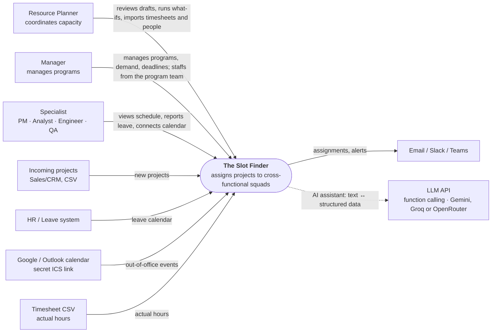

| Actor | What they do |
|---|---|
| **Resource Planner** | Sees team-wide load and each person's schedule, gives each program its team, generates staffing drafts, edits by hand, approves, builds what-if scenarios, imports timesheets |
| **Manager** (role `manager`) | Manages the programs they lead: creates projects, declares demand (budget hours per expertise) and scope points. Sees only the people in the teams of those programs, and proposes, edits and accepts staffing drafts for their projects from those teams |
| **Specialist** | Sees which projects they work on, which weeks and for how many hours; reports leave; connects their calendar so out-of-office time becomes leave |

---

## 3. Containers

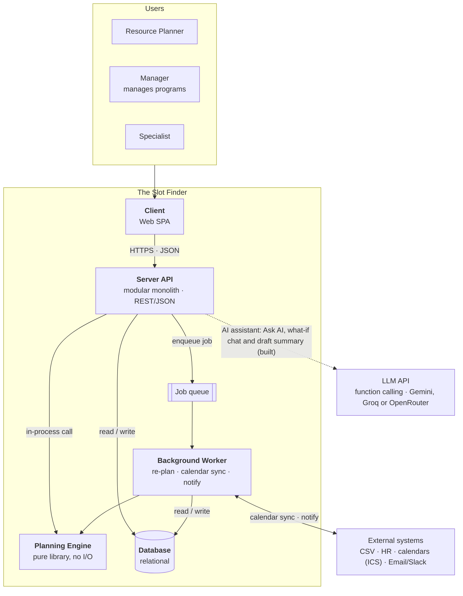

| Container | Responsible for | Not responsible for |
|---|---|---|
| **Client** | Shows heatmaps, program pages, forms, drafts and diffs; calls the API | Computing plans or metrics, deciding permissions |
| **Server API** | Source of truth: data, permissions, state transitions, transactions, metrics | The scheduling algorithm (that lives in the Engine) |
| **Planning Engine** | The pure function `propose(snapshot, policy) → result` | Database or network access |
| **Background Worker** | Heavy or asynchronous jobs: re-planning after changes, calendar sync, notifications. These run inside the server process; a separate worker process comes later | Serving user requests |
| **Job queue** | Passes jobs from the API to the Worker: rows in Postgres (change events as a transactional outbox), claimed with `FOR UPDATE SKIP LOCKED`. No separate queue service | |
| **Database** | Stores people, skills, absences and holidays, calendar feeds, programs and their teams, projects, demand, plans, allocations, actual hours, events and audit records. | |

The `server/` folder holds the Server API, the Background Worker and the Planning Engine in one Go codebase. The `client/` folder holds the web SPA.

---

## 4. Server modules

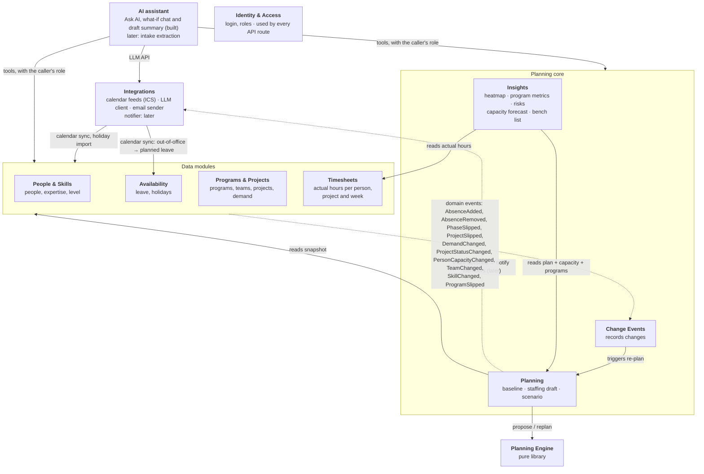

- Solid arrows are direct calls through a module's public interface.
- Dashed arrows are domain events.
- No module reads another module's tables.
- Inside the data modules, Availability reads People to compute capacity.
- The AI assistant owns no tables. It reaches other modules only through their services, with the caller's identity ([section 15](#15-ai-assistant)).

See [`server/README.md`](server/README.md) for details.

---

## 5. Planning engine (the core)

**Contract:** `propose(snapshot, policy) → { assignments, unmet, conflicts, score }`. The engine is a pure function: the same input always gives the same output. It knows nothing about phases or scope points; programs and clients reach it only as opaque ids for continuity. It only sees people (skills, capacity) and demand. Before calling it, the server turns each demand's phase into the demand's week window.

| Kind | Rules |
|---|---|
| **Hard constraints** (never violated) | The person has the demand's expertise (primary **or secondary**) at level ≥ `min_level` · total weekly hours across **all** their assignments ≤ capacity × `max_utilization` · at most `max_expertises_per_person_week` different expertises per person per week · no allocation below `min_hours_per_week`, except the last remainder of a demand · only inside the demand's week window (its phase, or the whole project) · never changes a **locked** allocation · never proposes a stretch assignment · only **members** get hours · only people in the **team of the demand's program** (else `unmet` with `NO_ONE_IN_TEAM`) |
| **Soft objectives** (weighted) | Meet deadlines by priority · **prefer people whose primary expertise matches**, and use cross-expertise people only when that helps a deadline or the load balance · balance load near `target_utilization` · **change as little as possible** versus the baseline · **continuity**: keep people on the same project, then the same program, then the same client · limit how many projects one person holds per week (later) |
| **Required output** | Every assignment carries a **reason** and its kind (`primary` or `cross_expertise`), e.g. "QA cover: Engineer (primary) with QA level 3 ≥ 2". Each assignment also lists up to `DRAFT_ALTERNATIVES_LIMIT` runner-up people with their free hours and the reason they lost. Demand that cannot be placed goes to `unmet` with a reason code. The engine never throws on an infeasible problem |

**How hours are laid out:**
- **Profile:** each demand has a `profile`. Only `flat` is built: the engine spreads the demand's hours evenly across its window. `front` (more hours early, for analysis) and `back` (more hours late, for testing) are later.
- **Headcount** is the number of people working the demand in parallel. The hours split about evenly between them (`hours ÷ headcount`). The engine keeps the same person in a seat for the whole window when it can. It splits a seat between two people only when nobody has enough capacity, and the reason says so.

**Policy defaults** come from server config, e.g. `max_utilization` 1.0, `target_utilization` 0.8, `min_hours_per_week` 8, `max_expertises_per_person_week` 2, `DRAFT_ALTERNATIVES_LIMIT` 5 (full list in [`server/README.md`](server/README.md#8-settings)).

**Strategies** (same interface, swappable):
1. **Greedy** (built): sort demand by priority, then deadline, then scarcity of the expertise. Pick the best-scoring person (primary-expertise match first) and spread the hours flat.
2. **Greedy + repair pass** (after the MVP): local swaps that free scarce cross-expertise people for demand nobody else can cover.
3. **Solver** (after the MVP): constraint programming or MILP for a global optimum.

Sample input and output are in [`server/README.md#4-planning-engine`](server/README.md#4-planning-engine).

---

## 6. Data model

The model has four layers on top of shared reference data. People and the work they can be given are kept apart; planning joins them; changes and actual hours come back from both and lead to re-plan drafts.

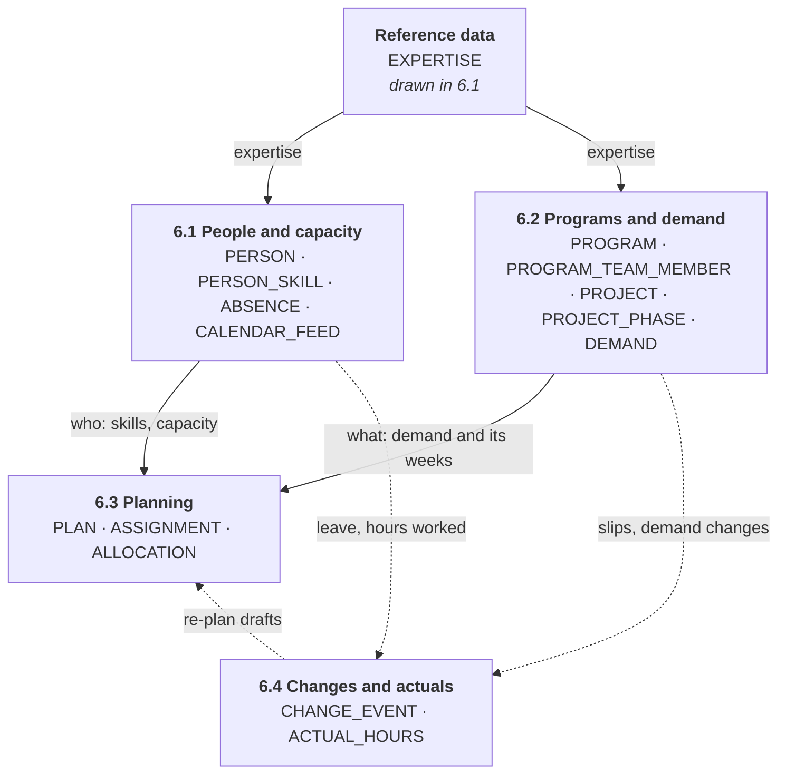

Each layer below has its own diagram. An entity from another layer is drawn there without its attributes.

### 6.1 People and capacity

Who can work, with which expertise and level, and how many hours each week. `EXPERTISE` is reference data that demand uses too.

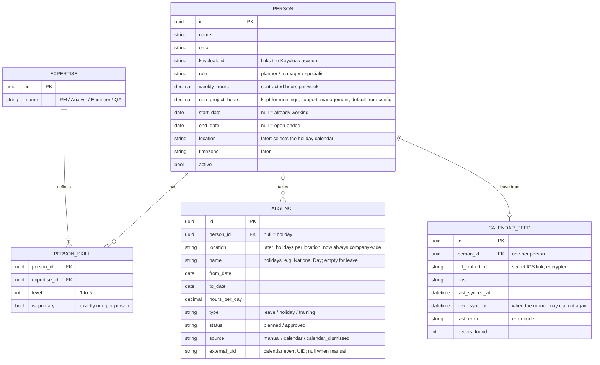

Not built yet: the columns `PERSON.location`, `PERSON.timezone`, `ABSENCE.location`.

### 6.2 Programs and demand

What has to be done: programs with their team, projects split into phases, and the demand per expertise.

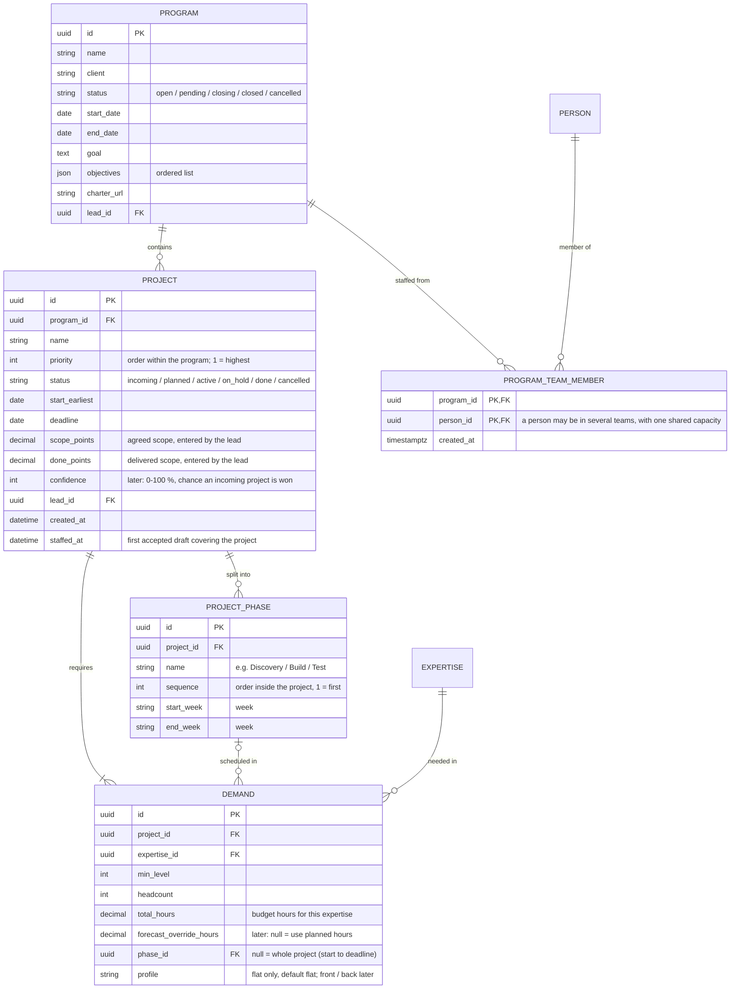

Not built yet: the columns `PROJECT.confidence`, `DEMAND.forecast_override_hours`.

### 6.3 Planning

Planning joins the two layers above: an assignment gives one person one demand, with hours per week, inside a versioned plan.

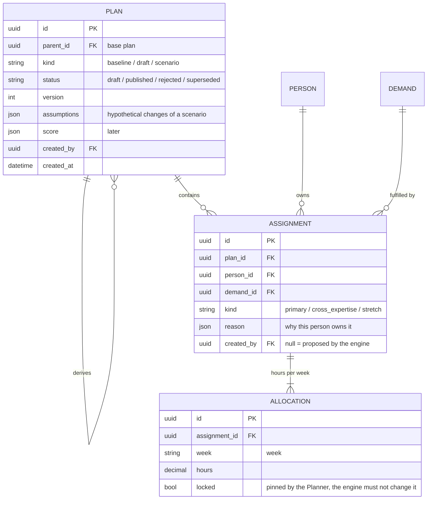

Not built yet: `PLAN.score` (the engine's score is not stored).

### 6.4 Changes and actuals

What happens after planning: change events that lead to re-plan drafts, and the hours people actually worked.

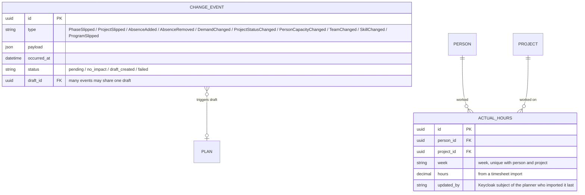

### 6.5 Rules and derived values

**Derived values for people (computed, not stored):**
- `capacity(person, week) = weekly_hours(week) − non_project_hours − absence hours in that week`, and 0 before `start_date` or after `end_date`
  - `weekly_hours(week)` is `PERSON.weekly_hours`
  - Absence hours count company-wide holidays (holidays per location: later). `approved` absence always counts. `planned` absence counts when policy `count_planned_absence` is on (default on), and is always reported as tentative
  - A future `start_date` lets a scenario include a **planned hire**
- `load(person, week) = Σ allocation.hours` over **all** their assignments in the **baseline**, whatever the expertise
- `load(person, week, expertise)`: the same sum, split by the demand's expertise. Shows which expertises a person spends their week on
- `utilization = load ÷ capacity`. Bands: under 50% underused · 50–85% healthy · 85–100% near full · over 100% **overloaded** (band limits are config, see [`server/README.md`](server/README.md#8-settings))
- From the current week on, `load` counts only **plannable** projects: not `on_hold`, `done` or `cancelled`. Earlier weeks keep all their hours as history. The stored plan is not changed, so a project put back to `active` keeps its hours
- Past weeks are fixed: a draft or re-plan never adds, removes or moves hours before the current week. The baseline's earlier hours count as delivered towards the demand and are copied into the draft as they are; the engine plans only the rest

**Derived values for programs and projects** are defined in [section 7](#7-metrics).

**Leave from calendars:** an out-of-office event in a person's calendar feed becomes `planned` leave with `source = calendar` and the event's UID. Each sync makes these absences match the calendar (create, move, delete) and records their change events. Absences entered by hand are never touched. The Planner approves calendar leave like any reported leave.

**Actual hours** are recorded per person × project × week from a timesheet CSV. They feed Actual hours and Burn % (section 7). Planning and capacity never read them.

**Pipeline:** an `incoming` project with no accepted assignments does not book anyone. Its demand only shows in the **capacity forecast** (section 7), spread flat over its window and weighted by the global `PIPELINE_CONFIDENCE_PERCENT` (per-project `confidence`: later). There is no person-level soft booking.

**Members working across expertises:**
- `kind` is set by the server, never by the client:
  - `primary` when the demand's expertise is the person's primary skill
  - `cross_expertise` when it is another skill at ≥ `min_level`
  - `stretch` when the level is lower or the skill is missing
- The engine proposes `primary` and `cross_expertise` only. A Planner can add a `stretch` assignment by hand in a staffing draft. It is locked and flagged, and accepting the draft needs an explicit confirmation.
- Capacity belongs to the person, not to an expertise. One person covering Engineer and QA in the same week has both counted against the same weekly hours.
- Tracking: load is also reported per expertise (`load(person, week, expertise)`), per program member, and as the **cross-expertise share** (section 7, later).

**Every plan is a versioned `PLAN`:** `baseline` is the plan in force, `draft` is a staffing draft from the engine, `scenario` is a what-if. Diff, rollback and what-if all use this one mechanism.

**Phases carry the dependencies between expertises:**
- A project is split into ordered phases, each with a week range set by the lead. A phase may overlap the previous one, e.g. testing starts in the last build week.
- Each demand belongs to one phase and is staffed only inside that phase's weeks. A demand without a phase (typically PM) spans the project, from its start to its deadline week.
- **Slip propagation:** when a phase's end week moves later by N weeks, the server moves every later phase of that project by N weeks in the same transaction. It then records one `PhaseSlipped` change event per phase it moved, which triggers a re-plan. Moving a phase earlier does not pull the later ones; the lead moves them on purpose.
- If the last phase ends after the deadline, the project is flagged **at risk**. The deadline itself is never moved automatically.

```text
Build   W42 ──────── W47        Build ends 2 weeks later (W49)
Test         W46 ──── W51   →   Test moves +2 weeks: W48 ──── W53 → past the deadline → at risk
```

---

## 7. Metrics

Programs and projects are the **demand side** of the system: what each program needs, how well it is staffed and how it is progressing. People and their capacity are the **supply side**. The engine connects the two. Screens are in [`client/README.md`](client/README.md).

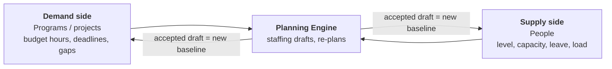

**Metrics** (all computed on the Server; "program" values are sums over its projects):

| Metric | Formula | Warning |
|---|---|---|
| **Time %** | (today − start) ÷ (end − start) | Over 100% while the program is not closed |
| **Scope %** | Σ `done_points` ÷ Σ `scope_points` | Scope % lower than Time % by more than `scope_lag_threshold` (config, e.g. 20 percentage points) = **behind on delivery** |
| **Budget hours** | Σ `DEMAND.total_hours` | |
| **Planned hours** | Σ allocation hours in the baseline | Planned > budget = **over-planned** |
| **Forecast hours** | per demand: planned hours (`forecast_override_hours` override: later) | |
| **Gap hours** | budget − forecast | Gap > 0 = **understaffed**. Also **at risk** if the deadline is within the alert horizon |
| **Staffing %** | planned ÷ budget | Under 100% with unmet demand |
| **Planned burn %** | planned hours in weeks up to the current week ÷ budget | None. The progress warning is on Scope % |
| **Actual hours** | Σ `ACTUAL_HOURS.hours` | |
| **Burn %** | actual hours ÷ budget. `null` until the project has actual hours | None. The progress warning is on Scope % |
| **EAC hours** (estimate at completion, later) | hours used to date ÷ Scope %. Hours used = actual hours when the project has them, else planned hours up to the current week | Shown only when Scope % ≥ `eac_min_scope_percent` (config, e.g. 10 %). EAC > budget = **likely over budget** |
| **Contribution %** (later) | budget hours of one expertise ÷ program budget hours | |
| **Cross-expertise share** (later) | hours in `cross_expertise` + `stretch` assignments ÷ planned hours | High share = the team leans on people outside their primary expertise; any stretch is listed |

Gap hours and Staffing % show the same shortfall, once in hours and once as a percentage. The Server returns them side by side. (A forecast override changes this: later.)

**Estimating hours at intake (later):** `hours_per_point(expertise)` = Σ hours of that expertise on `done` projects ÷ Σ their scope points (computed by the Server). The Server suggests `scope_points × hours_per_point` for each expertise, and the lead confirms or changes the hours. Hours stay the planning unit; points measure scope and seed estimates.

**Team insights** (computed by the insights module, across all programs):

| Insight | Definition | Use |
|---|---|---|
| **Capacity forecast by expertise** | Per expertise × week: free capacity, unmet confirmed demand, and expected pipeline demand (incoming projects' hours spread flat × the global `PIPELINE_CONFIDENCE_PERCENT`) | A sustained shortfall shows as a run of weeks in the forecast, for hiring or contractors |
| **Sustained overload** | A person over 100 % for at least `sustained_overload_weeks` consecutive weeks (config, e.g. 3) | A burnout risk, listed before single overloaded weeks |
| **Plan churn** (later) | Per accepted draft: how many people's allocations changed and how many hours moved | Reported with each draft's diff and tracked over time. High churn = an unstable plan |
| **Bench list** | People with capacity above 0 and utilization below the underused band in each of the next `bench_weeks` (config, e.g. 4) weeks, from this week. Free hours = Σ (capacity − load), most first | Find people with spare hours. The list suggests no actions; a Planner decides |

---

## 8. Key flows

### 8.1 New project → staffing draft → approval

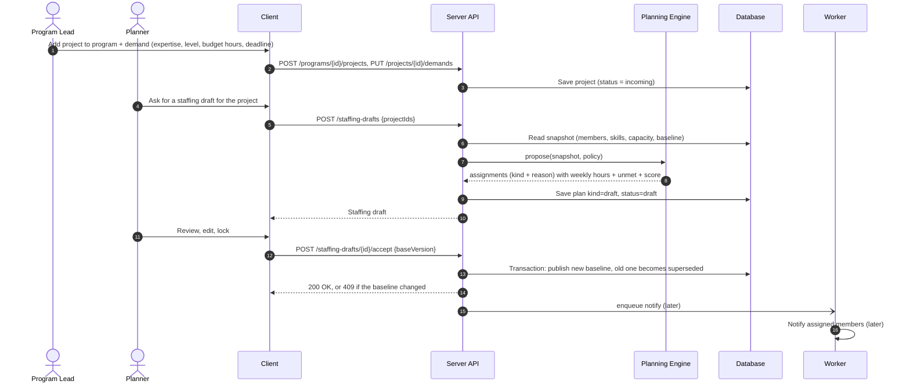

### 8.2 A change happens → re-plan

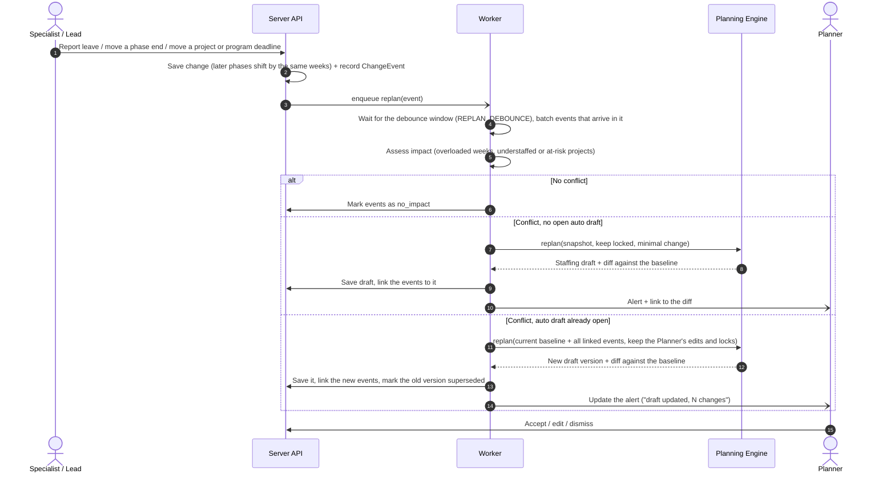

- **One open auto draft per baseline.** A draft is "auto" when change events link to it. Events that arrive within `REPLAN_DEBOUNCE` (config, e.g. 5 min) are batched into one run.
- An event that arrives while an auto draft is open is **merged**: the draft is regenerated from the current baseline plus all its linked events. The Planner's manual assignments and locked allocations are carried over. The previous version becomes `superseded`, so the Planner never reviews two drafts that disagree.
- An edit, accept or reject sent to a superseded version gets `409` with `DRAFT_SUPERSEDED`. The Client reloads the latest version and the Planner retries.
- Accepting or dismissing the draft closes it; the next event starts a new one.
- **Impact.** A batch ends as `no_impact` unless the baseline has a conflict (a person over `PLANNING_MAX_UTILIZATION` in a week, or hours outside the demand's window), or its events open projects. `DemandChanged`, `TeamChanged` and a `ProjectStatusChanged` to a plannable status open the projects they name. Freed capacity (`ProjectStatusChanged` to a non-plannable status, `PersonCapacityChanged`) opens every project. Events that open projects this way only open plannable projects whose baseline hours are below their budget hours (understaffed).

### 8.3 Lifecycles

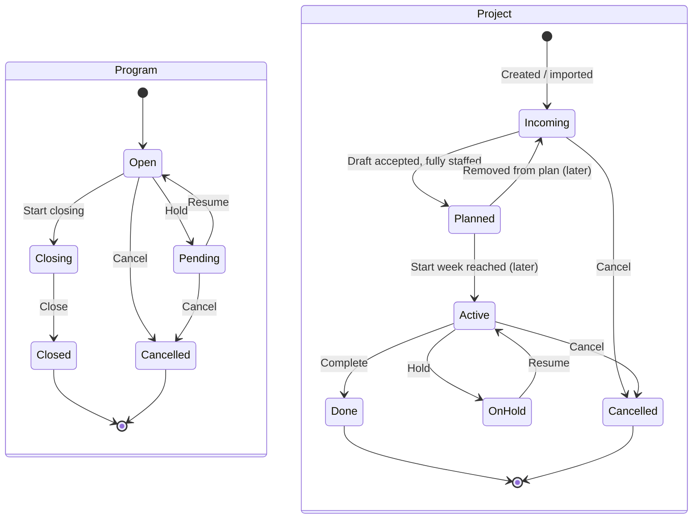

- Only the Server changes a program's or project's state. The Client sends **actions** (e.g. `hold`, `close`), never a new `status`.
- When a program is cancelled, its open projects are cancelled too, and their future allocations are removed in a new baseline.
### 8.4 Out of office in a calendar → planned leave

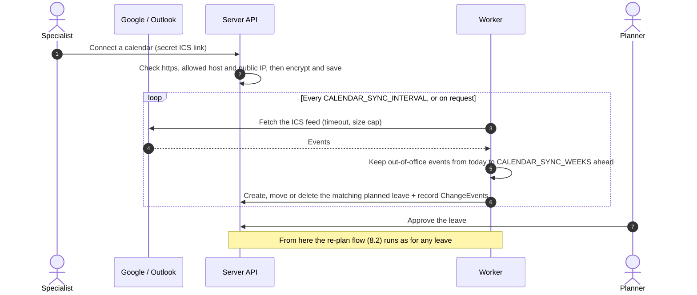

- An event counts when Outlook marks it out of office (`OOF`) or its title holds a keyword from `CALENDAR_LEAVE_KEYWORDS`.
- A failed fetch changes nothing and stores an error code. The link itself is never logged or returned.

### 8.5 Timesheet import

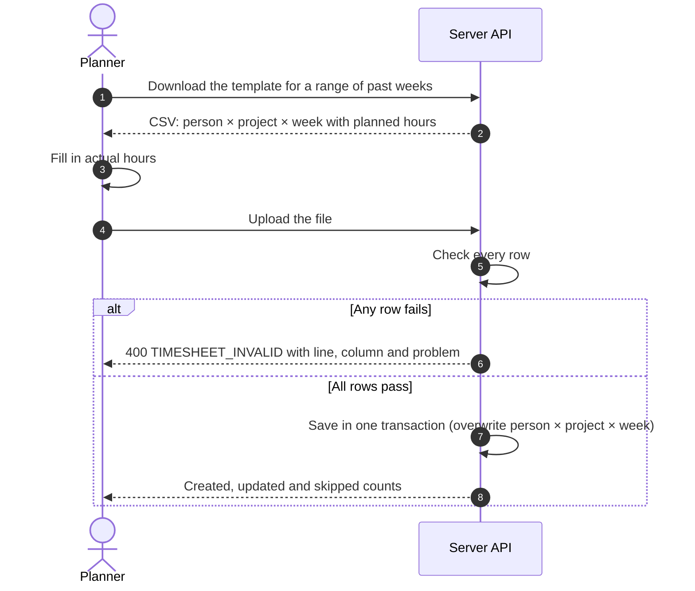

---

## 9. Cross-cutting concerns

| Topic | Decision |
|---|---|
| **Authentication** | Keycloak (OIDC) issues the JWT; the Client sends it as `Authorization: Bearer`. Unsafe requests also carry `X-CSRF-Token`. `/me` returns the user's role and person record  |
| **Authorization** | Keycloak roles: `planner` (everything), `manager` (shown as **Manager**: own programs and projects, the people of their program teams, drafts that cover only their programs), `specialist` (own schedule and leave), checked per route. Per-program rules (manager of this program, the people they may see) are checked in services against the database. **Everything is checked on the Server.** The Client uses roles only to show or hide controls |
| **Concurrency** | `PLAN.version`. Accepting a draft requires `baseVersion`. If the baseline has changed, the Server returns `409` and the Client regenerates the draft |
| **Transactions** | One business action is one transaction (accept = write all allocations + update plan states) |
| **Errors** | Every response, success or error, uses one envelope: `{ meta: { error_code, message, code, page, page_size, total }, data }`, with a meaningful HTTP status. Field errors go in `data` |
| **Audit** | Accepting a plan is recorded: who, when, which version. Later: edit and lock of allocations, budget and forecast changes, each with the value before and after. An action taken through the AI assistant (later) records the user as the actor and `via = ai_assistant` |
| **Time** | Stored in UTC. Weeks follow ISO-8601. The organization's timezone is configuration |
| **Rate limits** | Every request counts against an allowance per client IP. Routes that run the planning engine, read an uploaded file or fetch a URL also count against a tighter allowance per signed-in user and route. Over a limit the Server answers `429` with `Retry-After`, and the Client says how long to wait instead of retrying |
| **Links from users** | A calendar link is a secret and a fetch target. It is stored encrypted and never logged or returned. The Server fetches it over https from allowed hosts only, never to a private IP, with a timeout and a size cap |
| **Observability** | Structured logs with a request id; metrics for engine run time and `unmet` count (later) |

---

## 10. Design rules

| Rule | Why |
|---|---|
| The Server checks permissions on every endpoint | Checks that exist only in the UI can be bypassed |
| Multi-step actions run in **one Server transaction** | A failure halfway must not leave partial data behind |
| Write payloads use **dedicated DTOs** holding only fields the user edited | Display-only or computed fields must never overwrite stored data |
| Totals and metrics are **always recomputed** on the Server from source data | Totals patched on the client drift over time |
| Plans carry a **version**; stale writes get `409 Conflict` | Two planners must not silently overwrite each other |
| One shared error format that the Client handles for every status | An unexpected status must show an error, not crash the UI |

---

## 11. Testing strategy

| Layer | Approach |
|---|---|
| **Engine** | Golden tests on fixed snapshots. Property tests that check it never exceeds capacity, always respects expertise and level, never schedules outside a demand's week window, never changes a locked allocation, never proposes a stretch assignment, never exceeds the expertises-per-week limit, never allocates below `min_hours_per_week` except a demand's last remainder, lays hours out flat (`profile` shapes: later), never allocates to an assistant (later), never allocates outside a person's start and end dates, and picks a primary-expertise person over a cross-expertise one when both fit |
| **Server** | API + DB integration tests, contract tests against OpenAPI, permission tests for each role, metric tests for every formula in section 7 that is built (including Planned burn %; EAC hours later), phase slip propagation (later phases move, last phase past the deadline flags at risk), re-plan merge (a second event during an open auto draft gives one new draft version that keeps the Planner's edits and locks, and supersedes the old one) |
| **Client** | Component tests (heatmap, program header, staffing table, demand form, diff). One end-to-end test: add project to program → propose squad → accept → program staffing and heatmap update |
| **AI assistant** (later) | Unit tests use a fake LLM provider. An evaluation set of sample briefs with their expected demand runs against the configured provider on demand, not in CI: expertise, level and hours must match, and every source quote must appear in the brief. Permission tests through the AI tools: each tool gives the same result as its route for every role, and a specialist cannot read another person's schedule. Draft summaries may only contain numbers present in the engine output |
| **Sample data** | One shared seed for demos and tests (`make seed`): 2 programs, 6 projects (3 of them staffed in a baseline), 12 people with expertise and levels, one of them a planned hire with a future start date, company-wide holidays, leave periods, actual hours, 2 what-if scenarios. Locations: later |

---

## 12. Tech stack

| Part | Choice | Notes |
|---|---|---|
| **Server language / runtime** | Go | One codebase for API, background jobs and the planning engine |
| **HTTP + wiring** | Echo v5, Uber FX | FX wires providers in `cmd/server/main.go`; routes live in `cmd/server/routes/router.go` under `/api/v1` |
| **Database** | PostgreSQL, GORM, Atlas migrations | Migrations are generated from GORM models into `cmd/migrations/sql` |
| **Cache** | Redis | Background jobs use Postgres (outbox + `SKIP LOCKED`), not Redis |
| **Auth** | Keycloak (JWT) | Roles `planner`, `manager`, `specialist` |
| **Observability** | Zap, OpenTelemetry, Sentry (optional) | Local stack: OTel collector + Jaeger via docker compose |
| **API docs** | swaggo (Swagger 2.0, generated from handler annotations) | `server/docs/swagger.yaml` is the contract the Client builds against |
| **Client** | React + TypeScript, Vite | |
| **UI** | Tailwind CSS, shadcn/ui | |
| **Server state** | TanStack Query | Cache + invalidate after every write |
| **UI state** | Zustand | Filters, selections, session token. Never server data |
| **HTTP client** | Axios | Interceptors: JWT, CSRF token, envelope unwrap, shared error handling |
| **Routing** | React Router | |
| **AI assistant** | An LLM API with function calling (Gemini, Groq or OpenRouter), behind a provider interface | Ask AI is built; provider, API key and model are server config; nothing provider-specific outside the provider package |
| **i18n** | Own typed helper, no library | Keys are the English text, declared in a `LanguageKey` type; `t()` type-checks keys and `{placeholders}`. English needs no locale file |

---

## 13. Folder structure

```text
the-slot-finder/
├── README.md                 ← this document (Mermaid diagrams)
├── Makefile                  ← make setup · up · dev · check (run `make` to list)
├── CLAUDE.md                 ← guidance for Claude Code; conventions live in .claude/skills/
├── docs/
│   └── architecture.drawio   ← same diagrams, for draw.io
├── client/                   ← React SPA (see client/README.md)
│   ├── README.md
│   ├── package.json
│   └── src/                  ← app/ · pages/ · features/ · shared/
└── server/                   ← Go API (see server/README.md)
    ├── README.md
    ├── cmd/                  ← server entry point + routes, migrations
    ├── internal/             ← handlers · services · repositories · models · dtos · engine
    ├── docs/                 ← generated Swagger (contract for the client)
    ├── deploy/otel/          ← local OpenTelemetry collector config
    └── docker-compose.yml    ← Postgres, Redis, Keycloak, OTel collector, Jaeger
```

---

## 14. Architecture decisions

| # | Decision | Why | Trade-off |
|---|---|---|---|
| ADR-1 | The Server is a **modular monolith** | Small scale and team, simple deployment | Module boundaries are already drawn if services need splitting later |
| ADR-2 | The engine is a **pure library** with no I/O | Easy to test; changing the algorithm doesn't touch the API | A snapshot must be built before each call |
| ADR-3 | The planning unit is **hours per week** | Fine-grained enough for staffing decisions and keeps the engine light | No day-level or hour-level scheduling |
| ADR-4 | Every plan is a **versioned PLAN** | What-if, diff and rollback share one model | More allocation rows to store |
| ADR-5 | **A human approves** every plan | Users need to trust it; the engine always gives reasons | Not fully automatic |
| ADR-6 | Re-planning runs **in the background** | Doesn't block requests and can batch several changes | Jobs are Postgres rows (an outbox) run in-process at first; a separate worker process can use the same table later, without a queue service |
| ADR-7 | A **Program** level groups projects | Matches how customer engagements are run and reviewed | One more level of aggregation |
| ADR-8 | **Cost is hours only**; no money, no billing, no score | Hours are what staffing decisions need | Financial reporting stays in other tools |
| ADR-9 | **Scope points are entered by hand** at project level | Gives a delivery signal without task tracking | Depends on leads keeping them up to date |
| ADR-10 | **Forecast = planned hours**, with an optional override (override: later) | Stays in sync with the plan automatically | Overrides can go stale; they are audited |
| ADR-12 | Engine plans are called **staffing drafts** | Avoids confusion with business proposals | |
| ADR-13 | Server built on a **production-ready Go template** (Echo, FX, GORM, Keycloak, OTel) | Auth, errors, logging, tracing and migrations come ready-made | Layer-based layout (`handlers/services/repositories`) instead of per-module folders; Swagger is generated from code |
| ADR-14 | Client uses **React + TanStack Query + Zustand + Axios + shadcn/ui** | Clear split between server state and UI state; accessible components out of the box | Typed API hooks are written by hand until a generator is added |
| ADR-15 | **Phases** carry the dependencies between expertises: ordered, each with a week range; a later end shifts the later phases | Covers "QA waits for Engineering" and slip propagation while the engine stays greedy and phase-agnostic | Only whole-phase finish-to-start; no dependency graph between individual demands |
| ADR-16 | Ownership is an explicit **ASSIGNMENT** (person × demand) with weekly **ALLOCATION**s; people may hold several expertises at once | "Who owns what", cross-expertise cover and stretch can be tracked and locked per assignment | One more table; weekly hours always hang off an assignment |
| ADR-17 | **Hours stay the planning unit**; scope points measure delivery (hours-per-point estimates: later) | Capacity, load and budget all add up in one unit; points give a starting estimate from past projects | The suggestion is only as good as the history; the lead confirms the hours |
| ADR-18 | **One open auto re-plan draft** per baseline; new events are merged into it | The Planner reviews one consistent draft instead of several that conflict | A draft can change while it is being reviewed; each version is kept and the old one is superseded |
| ADR-19 | Pipeline demand shows in a **capacity forecast by expertise**, weighted by the global pipeline confidence; **no person-level soft booking** | Hiring signals without reserving people for work that may never come | Nobody is held for a likely win; the Planner acts on the forecast |
| ADR-21 | The **AI assistant** translates language ↔ structured data; the deterministic engine decides; its tools run **with the caller's permissions** | Faster intake and easier questions without giving up explainable, repeatable plans or the permission model | Depends on an external LLM provider and data-policy approval; extraction can be wrong, so the lead always reviews before saving |
| ADR-22 | Calendars come in through each person's **secret ICS link**, not OAuth | Works for Google and Outlook with one code path, without app registration or admin consent | The link is a secret to protect; out-of-office is found from Outlook's `OOF` flag or title keywords; recurring events are skipped |
| ADR-23 | Calendar out-of-office becomes **planned** leave that a Planner approves | A mislabelled event never becomes approved leave on its own (ADR-5) | One more approval for the Planner |
| ADR-24 | **Actual hours** are kept per person × project × week and imported from a **template CSV** built from the baseline | Matches how timesheets are kept; matching by project id never picks the wrong project; burn shows real hours | No actual hours per demand or per day; the template is filled in by hand or by a script |

---

## 15. AI assistant

> **Ask AI, what-if chat and the draft summary are built** (capabilities 2, 3 and 4). What-if chat is the only write, and it saves a scenario. It stays off until the chosen provider's key is configured, and the company data policy must approve sending data to that provider. The other capabilities are later.

**Principle:** the AI assistant translates between natural language and structured data. The Planning Engine still makes every allocation decision, and a human still accepts every plan.

| # | Capability (build order) | Input → output | Writes |
|---|---|---|---|
| 1 | **Intake extraction** (first; demo candidate) | A customer brief, SOW or email, pasted or uploaded → a suggested project: phases, demand (expertise, minimum level, hours, profile), each field with the source quote it came from | Nothing. The lead edits and confirms through the normal project, phase and demand endpoints |
| 2 | **What-if chat** (built as Ask AI tools) | "What if project X slips 2 weeks and Alex is on leave all of December?" → scenario `assumptions`, a scenario through the scenario API, and a summary of its diff | A scenario |
| 3 | **Draft explanation** (built for a staffing draft; diff and notification text later) | A staffing draft or re-plan diff → a plain-language summary, also used as notification text. It states only facts and numbers present in the engine's output (reasons, diff, unmet) | Nothing |
| 4 | **Q&A over plan data** (built as Ask AI) | "Which QA level ≥ 3 is free in W48?", "Which program will go over budget?" → an answer built from the insights tools | Nothing |
| 5 | **Skill suggestions** (after 1–4) | A CV or past projects → suggested levels | Nothing until the Planner approves; never applied automatically |

**Hours in an intake extraction:** hours stated in the text are used as written. When the text gives only scope points, the Server, not the LLM, fills in the hours from the hours-per-point suggestion (section 7) and marks them as suggested.

**Not for:** allocation decisions, metric calculations, accepting or publishing plans, evaluating or ranking people.

**How it plugs in:**
- A server module `ai`. It calls an LLM API with function calling through a provider interface: Gemini, Groq or OpenRouter, chosen by config.
- Each tool wraps an existing service method and runs **with the caller's identity and role**. The tool checks the same role list as the matching route, and the service applies the per-program rules, so a specialist sees only their own schedule here too. The model is offered only the tools the caller's role allows. The AI assistant never touches the database.
- Writes are limited to creating scenarios and staffing drafts. Intake suggestions are returned, not stored. It never changes the baseline and never accepts a draft.
- A customer document is data, never instructions: intake extraction has no tools that read other data or write anything.
- Every action it takes is audited with the user as the actor and `via = ai_assistant`.
- The Server keeps no chat history. The Client sends the visible conversation with each message.
- Provider, key, the model per task and limits are server config ([`server/README.md`](server/README.md#8-settings)). Details: [`server/README.md`](server/README.md#9-ai-assistant).

The draft summary sends only counts, hours, week labels, expertise names and project names, never person names, emails or customer names.

**Open question:** customer documents and personnel data would be sent to an external LLM. The company data policy must approve this before the feature is enabled.
