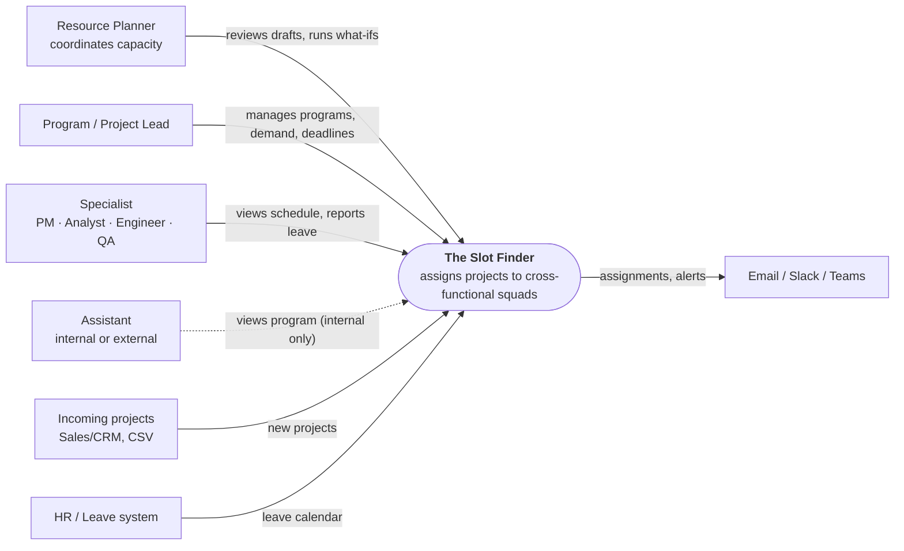
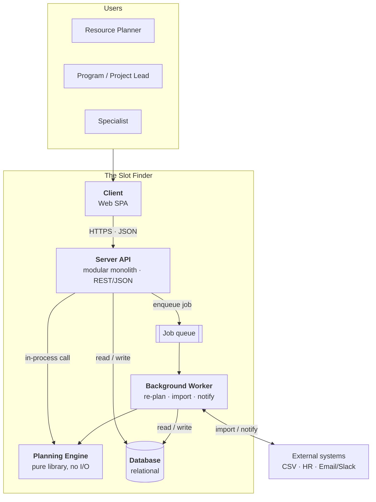
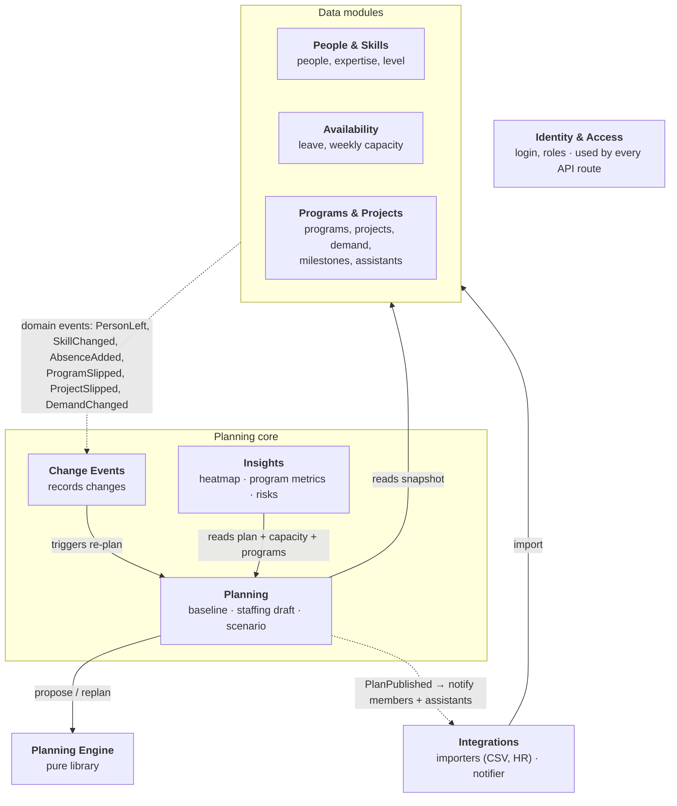
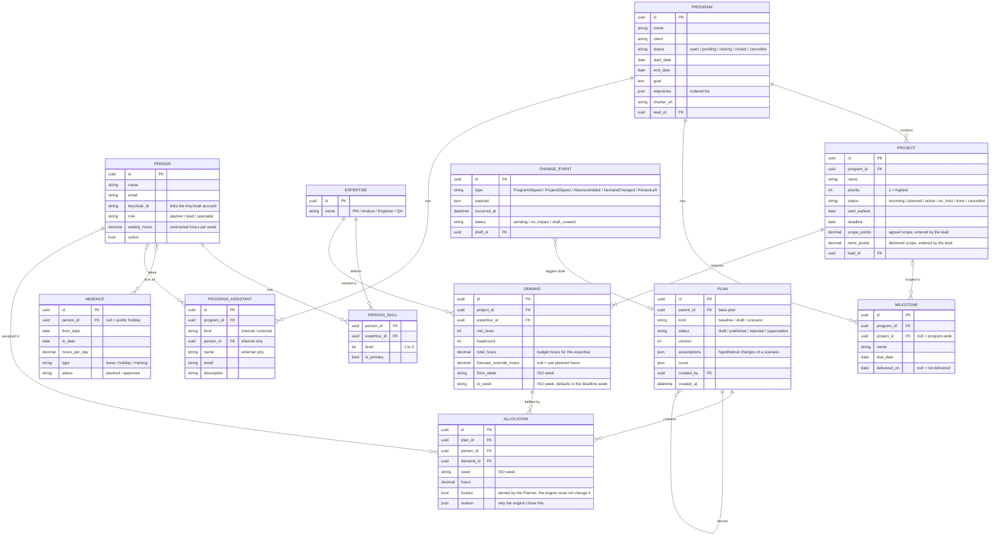
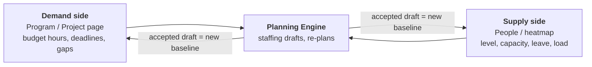
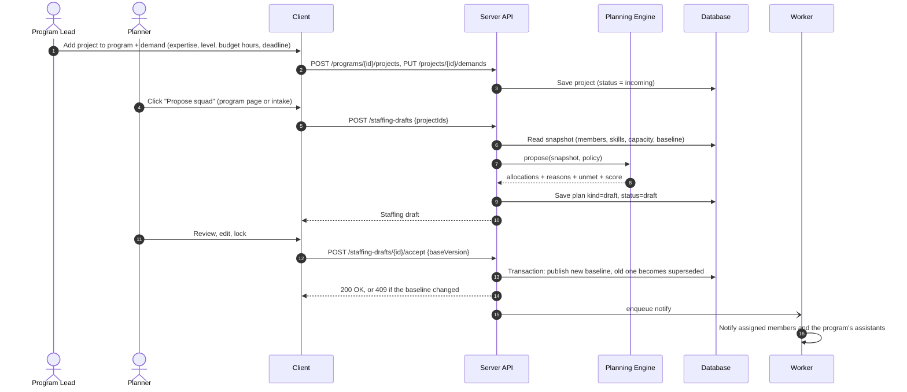
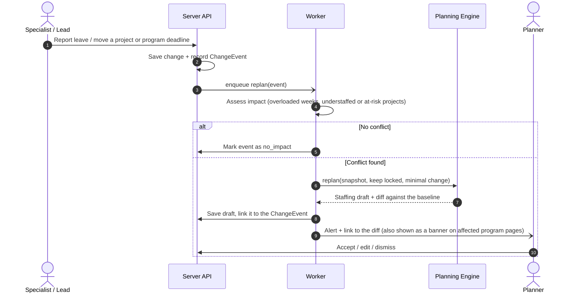
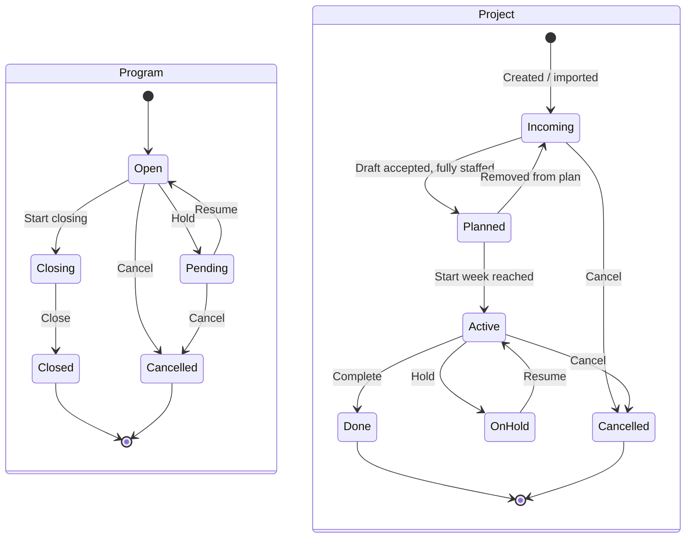

# The Slot Finder: System Architecture

> **Status:** design v0.3. The server and client skeletons exist; no feature code yet.
> **Technology:** Go server (Echo, Uber FX, GORM, PostgreSQL, Redis, Keycloak) and React client (Vite, Tailwind, shadcn/ui, TanStack Query, Zustand, Axios). See [section 12](#12-tech-stack). Sections 1–11 describe the design independently of the stack.
> **Diagrams:** rendered inline below (Mermaid). The same set is in [`docs/architecture.drawio`](docs/architecture.drawio) for draw.io (7 pages).

Details per part:
- [`server/README.md`](server/README.md): modules, API, planning engine, data rules
- [`client/README.md`](client/README.md): screens, feature modules, API usage rules

---

## 1. Problem and scope

**Challenge:** Customer projects arrive continuously. Each has its own size and deadline and needs several kinds of expertise (PM, Analyst, Engineer, QA). Today people are assigned by hand. As a result some are overloaded while others sit idle, and deadlines slip because nobody sees the crunch coming. Every change of plan means redoing the whole picture manually.

| # | Goal | Measured by |
|---|---|---|
| G1 | Propose a squad for each incoming project based on expertise, level and availability | Time from intake to approved squad |
| G2 | Show ahead of time who will be overloaded or underused and which weeks will crunch | Person × week heatmap, warnings N weeks ahead |
| G3 | When plans change (a project slips, someone goes on leave), propose a re-plan automatically | A re-plan draft with a diff, no manual recalculation |

**Out of scope for the MVP:**
- Task and sprint management inside a project
- Work logging. Actual hours become an optional CSV timesheet import in phase 2.
- Billing, money and financial scores. Cost is measured **in hours only**.

**Assumptions (confirmed):**
- **A1.** The planning unit is **hours per week**, using ISO weeks (e.g. `2026-W42`).
- **A2.** Scale is one organization with up to about 200 people and 100 concurrent projects, so a **modular monolith** is enough.
- **A3.** Initial data comes from seed files or CSV imports.
- **A4.** The engine only **proposes**. The **Resource Planner** makes the final decision.

**Glossary:**

| Term | Meaning |
|---|---|
| **Program** | A customer engagement that groups several projects, with one timeline, a brief (goal, objectives) and a charter |
| **Project** | A unit of delivery inside a program, with its own deadline and staffing demand |
| **Demand** | Hours a project needs from one expertise, at a minimum level, within a week range. Its hours are the **budget hours** |
| **Staffing draft** | A plan the engine proposes (for new demand or after a change). The Planner reviews and accepts it |
| **Baseline** | The plan currently in force |
| **Scenario** | A what-if plan built from hypothetical changes |
| **Member** | A person who receives allocated hours in a program's projects |
| **Assistant** | A person attached to a program for visibility only. Never allocated hours |

---

## 2. System context



| Actor | What they do |
|---|---|
| **Resource Planner** | Sees team-wide load, generates staffing drafts, edits by hand, approves, builds what-if scenarios |
| **Program / Project Lead** | Creates programs and projects, declares demand (budget hours per expertise), milestones and scope points, manages assistants |
| **Specialist** | Sees which projects they work on, which weeks and for how many hours; reports leave |
| **Assistant** | Internal: read-only view of one program. External: no login, receives notifications only |

---

## 3. Containers



| Container | Responsible for | Not responsible for |
|---|---|---|
| **Client** | Shows heatmaps, program pages, forms, drafts and diffs; calls the API | Computing plans or metrics, deciding permissions |
| **Server API** | Source of truth: data, permissions, state transitions, transactions, metrics | The scheduling algorithm (that lives in the Engine) |
| **Planning Engine** | The pure function `propose(snapshot, policy) → result` | Database or network access |
| **Background Worker** | Heavy or asynchronous jobs: re-planning after changes, imports, notifications. In the MVP these run inside the server process; a separate worker process comes later | Serving user requests |
| **Job queue** | Passes jobs from the API to the Worker. The MVP may run it in-process | |
| **Database** | Stores people, skills, absences, programs, projects, demand, milestones, plans, allocations, events and audit records | |

The `server/` folder holds the Server API, the Background Worker and the Planning Engine in one Go codebase. The `client/` folder holds the web SPA.

---

## 4. Server modules



- Solid arrows are direct calls through a module's public interface.
- Dashed arrows are domain events.
- No module reads another module's tables.
- Inside the data modules, Availability reads People to compute capacity.

See [`server/README.md`](server/README.md) for details.

---

## 5. Planning engine (the core)

**Contract:** `propose(snapshot, policy) → { allocations, unmet, conflicts, score }`. The engine is a pure function: the same input always gives the same output. It knows nothing about programs, assistants or scope points. It only sees people, capacity and demand.

| Kind | Rules |
|---|---|
| **Hard constraints** (never violated) | Matching expertise · level ≥ `min_level` · weekly hours ≤ capacity × `max_utilization` · only inside [earliest start, deadline] · never changes a **locked** allocation · only **members** get hours (assistants are never in the snapshot) |
| **Soft objectives** (weighted) | Meet deadlines by priority · balance load near `target_utilization` · **change as little as possible** versus the baseline · keep people on their projects · limit how many projects one person holds per week |
| **Required output** | Every allocation carries a **reason**. Demand that cannot be placed goes to `unmet` with a reason code. The engine never throws on an infeasible problem |

**Strategies** (same interface, swappable):
1. **Greedy** (MVP): sort demand by priority, then deadline, then scarcity of the expertise. Pick the best-scoring person and fill hours from the earliest week.
2. **Solver** (after the MVP): constraint programming or MILP for a global optimum.

Sample input and output are in [`server/README.md#4-planning-engine`](server/README.md#4-planning-engine).

---

## 6. Data model



**Derived values for people (computed, not stored):**
- `capacity(person, week) = weekly_hours − leave hours in that week`
- `load(person, week) = Σ allocation.hours` in the **baseline**
- `utilization = load ÷ capacity`. Bands: under 50% underused · 50–85% healthy · 85–100% near full · over 100% **overloaded**

**Derived values for programs and projects** are defined in [section 7](#7-program-view).

**Every plan is a versioned `PLAN`:** `baseline` is the plan in force, `draft` is a staffing draft from the engine, `scenario` is a what-if. Diff, rollback and what-if all use this one mechanism.

---

## 7. Program view

The program page is the **demand side** of the system: what each program needs, how well it is staffed and how it is progressing. The people heatmap is the **supply side**. The engine connects the two.



**Sections of the page** (text layout in [`client/README.md`](client/README.md#2-program-detail-page)):
1. **Header:** name, status, link to the brief and the charter, member avatars, timeline (start, end, next milestone) and four progress bars: Time, Scope, Cost, Staffing.
2. **Re-plan banner:** shown when a change has produced a staffing draft that touches this program.
3. **Program brief:** goal and numbered objectives.
4. **Scope (points)** card and **Cost (hours)** card.
5. **Staffing by expertise:** chart of budget versus forecast hours per expertise, and a detail table.
6. **Tabs:** **Projects** and **Members** (with sub-tabs **Member** and **Assistant**).

**Metrics** (all computed on the Server; "program" values are sums over its projects):

| Metric | Formula | Warning |
|---|---|---|
| **Time %** | (today − start) ÷ (end − start) | Over 100% while the program is not closed |
| **Scope %** | Σ `done_points` ÷ Σ `scope_points` | |
| **Budget hours** | Σ `DEMAND.total_hours` | |
| **Planned hours** | Σ allocation hours in the baseline | Planned > budget = **over-planned** |
| **Forecast hours** | per demand: `forecast_override_hours` if set, else planned hours | |
| **Gap hours** | budget − forecast | Gap > 0 = **understaffed**. Also **at risk** if the deadline is within the alert horizon |
| **Staffing %** | planned ÷ budget | Under 100% with unmet demand |
| **Cost %** | planned hours in weeks up to the current week ÷ budget. Phase 2: actual hours ÷ budget | Much lower than Time % = work is behind plan |
| **Contribution %** | budget hours of one expertise ÷ program budget hours | |
| **Next milestone** | earliest milestone not yet delivered | Due date passed = **overdue** |

**Projects tab** (one row per project):
- Squad avatars
- Name and status
- Start, end and next milestone
- Time / Scope / Cost bars
- **Staffing %**, with ⚠ and unmet hours when understaffed
- A **Propose squad** button when the gap is above 0. It opens a new staffing draft.

**Members tab:**
- **Member:** everyone with allocated hours in the program's projects in the baseline, plus the program and project leads. Columns: person, squad role (lead / member), expertise, hours in this program over the next 4 weeks, and **overall utilization over the next 4 weeks across all projects** (⚠ over 100%). Members are added or removed by editing a staffing draft, not on this tab.
- **Assistant → Internal:** a person with an account who gets read-only access to this program. Columns: person, email, remove.
- **Assistant → External:** a contact without an account who only receives notifications. Columns: name, email, description, remove.
- Assistants **never** receive hours and the engine never sees them.

---

## 8. Key flows

### 8.1 New project → staffing draft → approval



### 8.2 A change happens → re-plan



### 8.3 Lifecycles



- Only the Server changes a program's or project's state. The Client sends **actions** (e.g. `hold`, `close`), never a new `status`.
- When a program is cancelled, its open projects are cancelled too, and their future allocations are removed in a new baseline.

---

## 9. Cross-cutting concerns

| Topic | Decision |
|---|---|
| **Authentication** | Keycloak (OIDC) issues the JWT; the Client sends it as `Authorization: Bearer`. Unsafe requests also carry `X-CSRF-Token`. `/me` returns the user's role and the programs they assist |
| **Authorization** | Keycloak roles: `planner` (everything), `lead` (own programs and projects), `specialist` (own schedule and leave), checked per route. Per-program rules (lead of this program, **internal assistant** read-only access) are checked in services against the database. **Everything is checked on the Server.** The Client uses roles only to show or hide controls |
| **Concurrency** | `PLAN.version`. Accepting a draft requires `baseVersion`. If the baseline has changed, the Server returns `409` and the Client regenerates the draft |
| **Transactions** | One business action is one transaction (accept = write all allocations + update plan states) |
| **Errors** | Every response, success or error, uses one envelope: `{ meta: { error_code, message, code, page, page_size, total }, data }`, with a meaningful HTTP status. Field errors go in `data` |
| **Audit** | Accept, publish, edit and lock of allocations, budget and forecast changes, assistant changes: who, when, value before and after |
| **Time** | Stored in UTC. Weeks follow ISO-8601. The organization's timezone is configuration |
| **Observability** | Structured logs with a request id; metrics for engine run time and `unmet` count |

---

## 10. Design rules

| Rule | Why |
|---|---|
| The Server checks permissions on every endpoint | Checks that exist only in the UI can be bypassed |
| Multi-step actions run in **one Server transaction** | A failure halfway must not leave partial data behind |
| Write payloads use **dedicated DTOs** holding only fields the user edited | Display-only or computed fields must never overwrite stored data |
| Totals and metrics are **always recomputed** on the Server from source data | Totals patched on the client drift over time |
| Plans carry a **version**; stale writes get `409 Conflict` | Two planners must not silently overwrite each other |
| One shared error format that the Client handles for every status | An unexpected status must show an error, not crash the UI |

---

## 11. Testing strategy

| Layer | Approach |
|---|---|
| **Engine** | Golden tests on fixed snapshots. Property tests that check it never exceeds capacity, always respects expertise and level, never schedules outside a project's window, never changes a locked allocation and never allocates to an assistant |
| **Server** | API + DB integration tests, contract tests against OpenAPI, permission tests for each role (including internal assistants), metric tests for every formula in section 7 |
| **Client** | Component tests (heatmap, program header, staffing table, demand form, diff). One end-to-end test: add project to program → propose squad → accept → program staffing and heatmap update |
| **Sample data** | One shared seed for demos and tests: 2 programs, 6 projects, 12 people, 4 expertise areas, 3 leave periods, 2 assistants |

---

## 12. Tech stack

| Part | Choice | Notes |
|---|---|---|
| **Server language / runtime** | Go | One codebase for API, background jobs and the planning engine |
| **HTTP + wiring** | Echo v5, Uber FX | FX wires providers in `cmd/server/main.go`; routes live in `cmd/server/routes/router.go` under `/api/v1` |
| **Database** | PostgreSQL, GORM, Atlas migrations | Migrations are generated from GORM models into `cmd/migrations/sql` |
| **Cache / future queue** | Redis | Also the base for a job queue when background jobs move out of process |
| **Auth** | Keycloak (JWT) | Roles `planner`, `lead`, `specialist` |
| **Observability** | Zap, OpenTelemetry, Sentry (optional) | Local stack: OTel collector + Jaeger via docker compose |
| **API docs** | swaggo (Swagger 2.0, generated from handler annotations) | `server/docs/swagger.yaml` is the contract the Client builds against |
| **Client** | React + TypeScript, Vite | |
| **UI** | Tailwind CSS, shadcn/ui | |
| **Server state** | TanStack Query | Cache + invalidate after every write |
| **UI state** | Zustand | Filters, selections, session token. Never server data |
| **HTTP client** | Axios | Interceptors: JWT, CSRF token, envelope unwrap, shared error handling |
| **Routing** | React Router | |
| **i18n** | Own typed helper, no library | Keys are the English text, declared in a `LanguageKey` type; `t()` type-checks keys and `{placeholders}`. English needs no locale file |

---

## 13. Folder structure

```text
the-slot-finder/
├── README.md                 ← this document (Mermaid diagrams)
├── Makefile                  ← make setup · up · dev · check (run `make` to list)
├── CLAUDE.md                 ← guidance for Claude Code; conventions live in .claude/skills/
├── docs/
│   └── architecture.drawio   ← same diagrams, for draw.io
├── client/                   ← React SPA (see client/README.md)
│   ├── README.md
│   ├── package.json
│   └── src/                  ← app/ · pages/ · features/ · shared/
└── server/                   ← Go API (see server/README.md)
    ├── README.md
    ├── cmd/                  ← server entry point + routes, migrations
    ├── internal/             ← handlers · services · repositories · models · dtos · engine (planned)
    ├── docs/                 ← generated Swagger (contract for the client)
    ├── deploy/otel/          ← local OpenTelemetry collector config
    └── docker-compose.yml    ← Postgres, Redis, Keycloak, OTel collector, Jaeger
```

---

## 14. Architecture decisions

| # | Decision | Why | Trade-off |
|---|---|---|---|
| ADR-1 | The Server is a **modular monolith** | Small scale and team, simple deployment | Module boundaries are already drawn if services need splitting later |
| ADR-2 | The engine is a **pure library** with no I/O | Easy to test; changing the algorithm doesn't touch the API | A snapshot must be built before each call |
| ADR-3 | The planning unit is **hours per week** | Fine-grained enough for staffing decisions and keeps the engine light | No day-level or hour-level scheduling |
| ADR-4 | Every plan is a **versioned PLAN** | What-if, diff and rollback share one model | More allocation rows to store |
| ADR-5 | **A human approves** every plan | Users need to trust it; the engine always gives reasons | Not fully automatic |
| ADR-6 | Re-planning runs **in the background** | Doesn't block requests and can batch several changes | MVP runs jobs in-process; a separate worker with a Redis queue comes later |
| ADR-7 | A **Program** level groups projects | Matches how customer engagements are run and reviewed | One more level of aggregation |
| ADR-8 | **Cost is hours only**; no money, no billing, no score | Hours are what staffing decisions need | Financial reporting stays in other tools |
| ADR-9 | **Scope points are entered by hand** at project level | Gives a delivery signal without task tracking | Depends on leads keeping them up to date |
| ADR-10 | **Forecast = planned hours**, with an optional override | Stays in sync with the plan automatically | Overrides can go stale; they are audited |
| ADR-11 | **Assistants never receive hours** | Visibility for support people without distorting capacity | Anyone who does real work must be a member |
| ADR-12 | Engine plans are called **staffing drafts** | Avoids confusion with business proposals | |
| ADR-13 | Server built on a **production-ready Go template** (Echo, FX, GORM, Keycloak, OTel) | Auth, errors, logging, tracing and migrations come ready-made | Layer-based layout (`handlers/services/repositories`) instead of per-module folders; Swagger is generated from code |
| ADR-14 | Client uses **React + TanStack Query + Zustand + Axios + shadcn/ui** | Clear split between server state and UI state; accessible components out of the box | Typed API hooks are written by hand until a generator is added |
