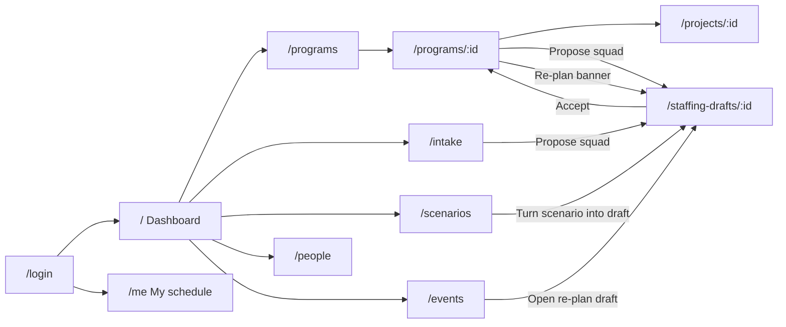
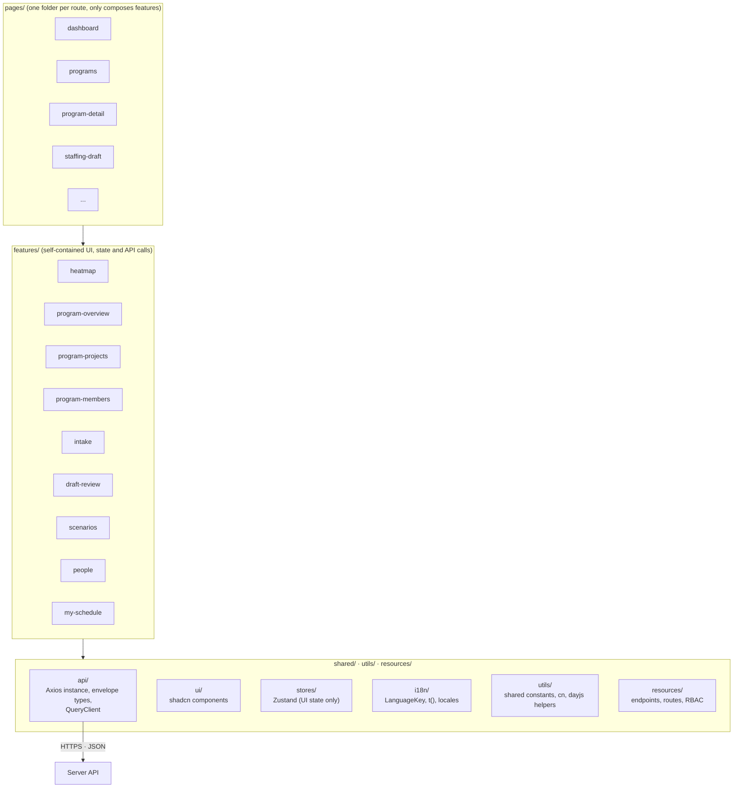

# Client: The Slot Finder

> React + TypeScript · Vite · Tailwind CSS v4 · shadcn/ui (Base UI) · TanStack Query · Zustand · Axios · React Router.
> For the overall architecture see [`../README.md`](../README.md).

The Client is a web SPA. Its job is to **display data and capture user actions**. It never computes plans or metrics, never decides permissions, and never accumulates totals itself.

## 0. Run locally

```bash
npm install
cp .env.example .env    # VITE_API_BASE_URL, defaults to /api/v1
npm run dev             # http://localhost:5173, proxies /api to the server on :3000
npm run build           # type-check + production build
npm run lint
npx shadcn@latest add <component>   # adds a component to src/shared/ui
```

## 1. Screens

| Route | Screen | Roles | Main API |
|---|---|---|---|
| `/login` | Log in | everyone | `POST /auth/login` |
| `/` | **Dashboard**: person × week heatmap, overload and deadline-risk alerts | planner, lead | `/insights/heatmap`, `/insights/risks` |
| `/programs` | **Programs**: list with status, timeline and the four progress bars | planner, lead, internal assistant | `/programs` |
| `/programs/:id` | **Program detail** (see section 2) | planner, lead, internal assistant | `/programs/:id`, `/programs/:id/overview`, `/programs/:id/projects`, `/programs/:id/members`, `/programs/:id/assistants`, `/events?programId=` |
| `/intake` | **Intake queue**: incoming projects across programs, "Propose squad" | planner, lead | `/projects?status=incoming`, `/staffing-drafts` |
| `/projects/:id` | **Project detail**: phase timeline, demand per phase, assigned people, risks, scope points | planner, lead | `/projects/:id`, `/projects/:id/phases`, `/plans/current` |
| `/staffing-drafts/:id` | **Staffing draft review**: assignment grid, reasons, diff, manual edits, lock, accept | planner | `/staffing-drafts/:id` |
| `/scenarios` | **What-if**: build scenarios (move a project, add leave), view the diff | planner | `/scenarios` |
| `/people` | **People**: expertise and level matrix, leave calendar, capacity | planner | `/people`, `/people/:id/absences` |
| `/me` | **My schedule**: projects by week, report leave | specialist | `/plans/current`, `/people/me/absences` |
| `/events` | **Change history** and re-plan status | planner | `/events` |



## 2. Program detail page

Layout:

```text
┌───────────────────────────────────────────────────────────────────────────────┐
│ HEADER  Program name [Open]   Brief · Charter   Members: ◯◯◯                   │
│         Timeline: start – end · Next milestone (⚠ overdue)                     │
│         Progress:  Time ▇▇▇▇ %   Scope ▇▇ %   Cost ▇▇▇ %   Staffing ▇▇▇▇ %      │
├───────────────────────────────────────────────────────────────────────────────┤
│ ⚠ RE-PLAN BANNER  "A change produced a staffing draft for this program → View" │
├───────────────────────────────────────────────────────────────────────────────┤
│ PROGRAM BRIEF   Goal · Objectives 1..n                                         │
├──────────────────────────────────────┬────────────────────────────────────────┤
│ SCOPE (points)                       │ COST (hours)                           │
│ Total · Done · Done %                │ Budget · Planned · Planned to date ·   │
│                                      │ Gap  (Actual: phase 2)                 │
├──────────────────────────────────────┴────────────────────────────────────────┤
│ STAFFING BY EXPERTISE                                                          │
│  chart: budget vs forecast hours per expertise                                 │
│  table: Expertise | Budget | Planned | Forecast ✎ | Gap | Staffing % | Contr.% │
├───────────────────────────────────────────────────────────────────────────────┤
│ [ PROJECTS ] [ MEMBERS ]                                                        │
│  Projects: Squad | Project + status | Start–End + next milestone | Phase |     │
│            Time/Scope/Cost bars | Staffing % ⚠ unmet | [Propose squad]          │
│  Members:  [ Member ] [ Assistant ]                                             │
│            Member:    Person | Squad role | Expertise | Hours here (4 wks) |   │
│                       Overall utilization (4 wks) ⚠                             │
│            Assistant: Internal  → Person | Email | Remove                      │
│                       External  → Name | Email | Description | Remove          │
└───────────────────────────────────────────────────────────────────────────────┘
```

**Behaviour:**
- **Header bars** come straight from `/programs/:id/overview`. Each bar shows ⚠ when the Server flags it (over 100% time, over-planned, understaffed).
- **Re-plan banner** appears when `/events?programId=` returns an event with status `draft_created`. It links to the staffing draft.
- **Forecast ✎**: editing calls `PATCH /programs/:id/forecast` for that demand. Clearing the field goes back to planned hours. The table is refetched after the save.
- **Propose squad** is visible to planners when a project's gap is above 0. It calls `POST /staffing-drafts { projectIds: [id] }` and opens the draft.
- **Members** are read-only here. To add or remove a member, edit a staffing draft. The **Assistant** sub-tab lets planners and the program lead add or remove assistants.
- Internal assistants see the whole page read-only, without edit controls or the Propose squad button.

## 3. Layers



**Dependency rule:** `pages` uses `features`, and `features` uses `shared`. Features **never import each other**. Anything they need to share moves into `shared`.

## 4. Key UI components

| Component | Description |
|---|---|
| **Heatmap grid** | Rows are people (grouped by expertise), columns are weeks. Colour shows utilization: under 50% / 50–85% / 85–100% / over 100%. Click a cell to see that week's projects |
| **Progress bars** | Time, Scope, Cost and Staffing with a percentage and a ⚠ flag from the Server |
| **Staffing by expertise** | Chart and table of budget, planned, forecast and gap hours per expertise, with an inline forecast editor |
| **Phase timeline** | Ordered phases as bars on ISO weeks. Moving a phase end later previews which later phases will shift, before saving |
| **Demand form** | One row per need: expertise, minimum level, headcount, budget hours, phase (or "whole project") |
| **Allocation editor** | Person × week grid for one staffing draft. Edit hours, lock or unlock, see why the engine chose each person |
| **Diff viewer** | Baseline versus a draft or scenario: who was added or removed, how hours changed, which projects changed risk status |
| **Assistant manager** | Internal assistant picker (people search) and external assistant form (name, email, description) |

## 5. Data and state rules

1. **Server state** (programs, projects, plans, metrics, heatmap) lives in **TanStack Query**. Each feature has an `api.ts` (calls through `shared/api/http.ts`) and `use-*.ts` hooks. After every mutation, **invalidate** the affected queries so they refetch. Never patch numbers on the Client.
2. **UI state** (filters, selected tab, selected cell) stays in component state or a **Zustand** store. Zustand never holds server data.
3. **Axios** (`shared/api/http.ts`) is the only HTTP client:
   - adds `Authorization: Bearer` from the auth store, and `X-CSRF-Token` on unsafe methods (the token is read from the server's response header)
   - unwraps the `{ meta, data }` envelope: `request<T>()` returns `data`, `requestWithMeta<T>()` returns `{ data, meta }` for pagination
   - turns every failure into an `ApiError` (`status`, `code`, `message`, `details`)
4. Write payloads send **only the fields the user changed**. Never send `status`, `utilization`, `gap_hours` or computed totals. To change state, call the action endpoint.
5. Permissions come from `/me` and are used only to show or hide controls. The Server checks them again.
6. Every failed query or mutation goes through **one shared handler** in `shared/api/query-client.ts`, which shows a toast. For `409 PLAN_VERSION_CONFLICT`, the draft-review feature asks the user whether to regenerate the draft.
7. Show weeks as ISO weeks (`2026-W42`) together with their date range. Do week math only with the dayjs helpers in `@/utils/functions` (`toIsoWeek`, `isoWeekRange`, `formatIsoWeekRange`).
8. A metric the Server returns as `null` (zero denominator) is shown as "—".
9. **All user-facing text goes through `t()`** from `@/shared/i18n`. The key is the English text itself and is declared in `LanguageKey`; English needs no locale file. Server data (names, emails) is shown as-is.

## 6. Folder layout

```text
client/
├── README.md
├── index.html · vite.config.ts · components.json · eslint.config.js · tsconfig*.json
├── .env.example
└── src/
    ├── index.css                 ← Tailwind v4 + shadcn theme
    ├── app/
    │   ├── main.tsx              ← entry point
    │   ├── router.tsx            ← all routes (paths from resources/routes)
    │   ├── app-providers/        ← QueryClientProvider, RouterProvider, Toaster
    │   └── app-layout/           ← sidebar + <Outlet/> (constants.ts, utils.ts, types.ts)
    ├── pages/                    ← one folder per route, e.g. program-detail/ → ProgramDetailPage
    ├── features/                 ← one folder per feature
    │   ├── health/               ← api.ts · use-health.ts · types.ts · index.ts
    │   ├── program-overview/     ← component.tsx · types.ts · mock-data.ts · index.ts · components/<child>/
    │   ├── program-projects/
    │   └── program-members/
    ├── resources/
    │   ├── endpoints/            ← server API paths per domain (HEALTH_ENDPOINTS, PROGRAM_ENDPOINTS)
    │   ├── routes/               ← client route paths (ROUTES)
    │   └── rbac/                 ← ROLES, PERMISSIONS, can()
    ├── utils/
    │   ├── constants/            ← constants shared by several places (date formats, query settings)
    │   └── functions/            ← shared helpers: cn, dayjs + ISO-week helpers
    └── shared/
        ├── api/                  ← http.ts (Axios), constants.ts, types.ts (envelope, ApiError), query-client.ts
        ├── i18n/                 ← language-key.ts (LanguageKey), translate.ts (t, translate), locales/, language-store.ts
        ├── ui/                   ← shadcn components, managed by the shadcn CLI
        ├── components/           ← app-level shared components, e.g. page-placeholder/
        └── stores/               ← auth-store.ts (Zustand)
```

Tests (component and end-to-end) are added with the first real feature.

## 7. Conventions

Each convention has a project skill in [`../.claude/skills`](../.claude/skills). ESLint enforces the mechanical parts (`npm run lint`).

| Convention | Skill | Enforced by lint |
|---|---|---|
| User-facing text goes through typed `t()` with English-text keys | `translating-client-text` | Raw text in JSX, and literal `alt` / `aria-label` / `placeholder` / `title` |
| Every component lives in its own folder (`index.ts` + `component.tsx` + `types.ts`), named after the folder | `structuring-client-components` | Types declared inside `component.tsx` |
| No inline styles: Tailwind classes, `cn()` and component variants | `styling-client-components` | `style={...}` anywhere outside `shared/ui` |
| `component.tsx` holds only imports and one component; no component inside a component; no inline function props; nesting at most 3 layers | `structuring-client-components` | All of these |
| Never hardcode: constants, `utils/`, `resources/` (endpoints, routes, RBAC); dates only through dayjs helpers | `organizing-client-shared-code` | Direct `dayjs` imports |
