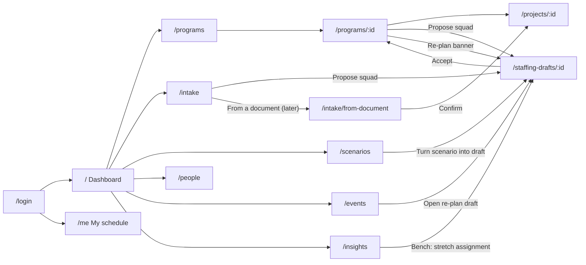
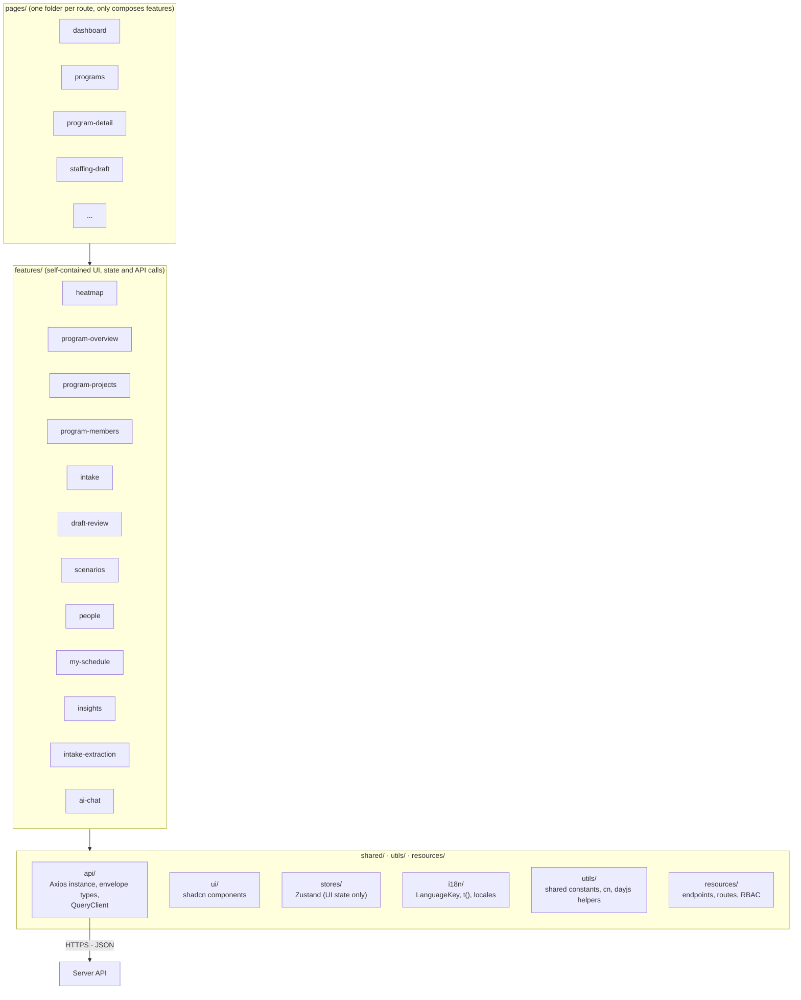

# Client: The Slot Finder

> React + TypeScript · Vite · Tailwind CSS v4 · shadcn/ui (Base UI) · TanStack Query · Zustand · Axios · React Router.
> For the overall architecture see [`../README.md`](../README.md).

The Client is a web SPA. Its job is to **display data and capture user actions**. It never computes plans or metrics, never decides permissions, and never accumulates totals itself.

## 0. Run locally

```bash
npm install
cp .env.example .env    # API base URL and the Keycloak realm + client used for sign-in
npm run dev             # http://localhost:5173, proxies /api to the server on :3000
npm run build           # type-check + production build
npm run lint
npx shadcn@latest add <component>   # adds a component to src/shared/ui
```

Sign in with a demo user (`planner`, `lead` or `specialist`; see [`server/README.md`](../server/README.md#0-run-locally)). Keycloak must be running (`make infra` or `make up`).

## 1. Screens

| Route | Screen | Roles | Main API |
|---|---|---|---|
| `/login` | **Sign in**: one button that redirects to Keycloak | everyone | Keycloak (OIDC, PKCE) |
| `/auth/callback` | Finishes the Keycloak round trip and returns to the page the user asked for | everyone | Keycloak token endpoint |
| `/` | **Dashboard**: person × week heatmap, overload and deadline-risk alerts | planner, lead | `/insights/heatmap`, `/insights/risks` |
| `/programs` | **Programs**: list with status, timeline and the four progress bars | planner, lead, internal assistant | `/programs` |
| `/programs/:id` | **Program detail** (see section 2) | planner, lead, internal assistant | `/programs/:id`, `/programs/:id/overview`, `/programs/:id/projects`, `/programs/:id/members`, `/programs/:id/assistants`, `/events?programId=` |
| `/intake` | **Intake queue**: incoming projects across programs with their confidence, "Propose squad" | planner, lead | `/projects?status=incoming`, `/staffing-drafts` |
| `/intake/from-document` | **Intake from a document** (later, AI): paste or upload a brief, review the suggested project with a source quote per field, edit, confirm | planner, lead | `/ai/intake-extractions`, then `/programs/:id/projects`, `/projects/:id/phases`, `/projects/:id/demands` |
| `/projects/:id` | **Project detail**: project form (with confidence), phase timeline, demand per phase with hours suggestion, assigned people, risks, scope points | planner, lead | `/projects/:id`, `/projects/:id/phases`, `/projects/:id/demands`, `/projects/:id/hours-suggestion`, `/plans/current` |
| `/staffing-drafts/:id` | **Staffing draft review**: assignment grid, reasons, alternatives with one-click swap, diff with plan churn, manual edits, lock, accept, AI summary (later) | planner | `/staffing-drafts/:id`, `/staffing-drafts/:id/assignments`, `/staffing-drafts/:id/summary` |
| `/scenarios` | **What-if**: build scenarios (move a project, add leave), view the diff | planner | `/scenarios` |
| `/people` | **People**: expertise and level matrix, skill tags, start and end dates, location, leave and holidays, capacity changes | planner | `/people`, `/people/:id/absences`, `/people/:id/tags`, `/people/:id/capacity-changes`, `/tags`, `/holidays` |
| `/insights` | **Insights**: capacity forecast by expertise (with pipeline × confidence and shortfall signals), bench list, plan churn over time | planner, lead (forecast only) | `/insights/capacity-forecast`, `/insights/bench`, `/insights/churn` |
| `/me` | **My schedule**: my assignments by week, grouped by expertise (primary first, cross-expertise and stretch marked), report leave | specialist | `/people/me/assignments`, `/people/me/absences` |
| `/events` | **Change history** and re-plan status | planner | `/events` |



## 2. Program detail page

Layout:

```text
┌───────────────────────────────────────────────────────────────────────────────┐
│ HEADER  Program name [Open]   Brief · Charter   Members: ◯◯◯                   │
│         Timeline: start – end · Next milestone (⚠ overdue)                     │
│         Progress:  Time ▇▇▇ %  Scope ▇▇ %  Planned burn ▇▇ %  Staffing ▇▇▇ %    │
├───────────────────────────────────────────────────────────────────────────────┤
│ ⚠ RE-PLAN BANNER  "A change produced a staffing draft for this program → View" │
├───────────────────────────────────────────────────────────────────────────────┤
│ PROGRAM BRIEF   Goal · Objectives 1..n                                         │
├──────────────────────────────────────┬────────────────────────────────────────┤
│ SCOPE (points)                       │ COST (hours)                           │
│ Total · Done · Done %                │ Budget · Planned · Planned to date ·   │
│                                      │ Gap · EAC ⚠  (Actual: phase 2)         │
├──────────────────────────────────────┴────────────────────────────────────────┤
│ STAFFING BY EXPERTISE                                                          │
│  chart: budget vs forecast hours per expertise                                 │
│  table: Expertise | Budget | Planned | Forecast ✎ | Gap | Staffing % | Contr.% │
├───────────────────────────────────────────────────────────────────────────────┤
│ [ PROJECTS ] [ MEMBERS ]                                                        │
│  Projects: Squad | Project + status | Start–End + next milestone | Phase |     │
│            Time/Scope/Burn bars | Staffing % · gap ⚠ | [Propose squad]          │
│  Members:  [ Member ] [ Assistant ]                                             │
│            Member:    Person | Squad role | Expertise chips (hours, ↔ cross,   │
│                       ⚠ stretch) | Overall utilization (4 wks) ⚠              │
│            Assistant: Internal  → Person | Email | Remove                      │
│                       External  → Name | Email | Description | Remove          │
└───────────────────────────────────────────────────────────────────────────────┘
```

**Behaviour:**
- **Header bars** come straight from `/programs/:id/overview`. Each bar shows ⚠ when the Server flags it (over 100% time, behind on delivery, over-planned, understaffed). Planned burn has no warning in the MVP.
- **EAC hours** on the Cost card comes from the overview. It is hidden while the Server returns `null` (too little scope done) and shows ⚠ when the Server flags **likely over budget**.
- **Staffing and gap** are shown together, e.g. "Staffing 80% · 40 h gap", because they show the same shortfall.
- **Re-plan banner** appears when `/events?programId=` returns an event with status `draft_created`. It links to the staffing draft.
- **Forecast ✎**: editing calls `PATCH /programs/:id/forecast` for that demand. Clearing the field goes back to planned hours. The table is refetched after the save.
- **Propose squad** is visible to planners when a project's gap is above 0. It calls `POST /staffing-drafts { projectIds: [id] }` and opens the draft.
- **Members** are read-only here. A member appears once, with a chip for each expertise they hold in this program. To add or remove a member or an assignment, edit a staffing draft. The **Assistant** sub-tab lets planners and the program lead add or remove assistants.
- Internal assistants see the whole page read-only, without edit controls or the Propose squad button.

## 3. Layers



**Dependency rule:** `pages` uses `features`, and `features` uses `shared`. Features **never import each other**. Anything they need to share moves into `shared`.

## 4. Key UI components

| Component | Description |
|---|---|
| **Heatmap grid** | Rows are people (grouped by primary expertise), columns are weeks. Colour shows utilization: under 50% / 50–85% / 85–100% / over 100%. A cell shows a small split of its hours by expertise, so someone covering QA as an Engineer is visible. Click a cell to see that week's assignments. Filtering by an expertise keeps everyone who holds it that week, with non-primary people marked. Planned (not yet approved) absence is drawn as **tentative** (hatched) |
| **Progress bars** | Time, Scope, Planned burn and Staffing with a percentage and a ⚠ flag from the Server |
| **Staffing by expertise** | Chart and table of budget, planned, forecast and gap hours per expertise, with an inline forecast editor |
| **Phase timeline** | Ordered phases as bars on ISO weeks. Moving a phase end later previews which later phases will shift, before saving |
| **Project form** | Name, priority, earliest start, deadline, scope points and, for an incoming project, **confidence** (0–100 %) |
| **Demand form** | One row per need: expertise, minimum level, headcount, budget hours, phase (or "whole project"), profile (flat / front / back), required and preferred tags, preferred person. Budget hours show a suggestion from `/projects/:id/hours-suggestion` (scope points × hours per point); the lead accepts it or types their own |
| **Assignment editor** | Person × week grid for one staffing draft, grouped by assignment (person × demand). Add a person to any demand, edit weekly hours, lock or unlock, and see the reason and kind of each assignment. Each assignment lists its **alternatives** (score and why they lost); **Swap** replaces the person in one click. A person below the demand's level becomes a **stretch** assignment: shown with ⚠, locked, and confirmed again on accept. If a re-plan merge has superseded the draft, a save, accept or reject gets `409 DRAFT_SUPERSEDED`; the editor reloads the latest version and tells the Planner to check it again |
| **Expertise chip** | Expertise name with hours. Plain for primary, marked ↔ for cross-expertise, ⚠ for stretch. Used in the Members tab, My schedule and the heatmap popover |
| **Diff viewer** | Baseline versus a draft or scenario: who was added or removed, how hours changed, which projects changed risk status. The header shows **plan churn** (people changed, hours moved) |
| **Capacity forecast** | Per expertise × week: free capacity against unmet confirmed demand and pipeline demand × confidence, with shortfall signals such as "short 1.5 FTE QA in W50–W03" |
| **Bench list** | People under the underused band for the coming weeks, with suggested actions (stretch assignment, training, internal work). Acting on one is a Planner decision |
| **Intake extraction review** (later) | The suggested project from `/ai/intake-extractions`, field by field. Each field shows its source quote, highlighted in the document; flagged fields (unknown expertise or tag, hours suggested from points) are marked. The lead edits, then **Confirm** saves through the normal project, phase and demand calls. Nothing is saved before that |
| **AI chat panel** (later) | A side panel on every page for planners, leads and specialists. Sends the visible conversation to `/ai/chat`, shows the reply and links to any scenario or draft it created. Marked as AI-generated |
| **AI summary** (later) | A card on the staffing draft page with the text from `/staffing-drafts/:id/summary`, next to the reasons it is based on. Marked as AI-generated |
| **Assistant manager** | Internal assistant picker (people search) and external assistant form (name, email, description) |

## 5. Data and state rules

1. **Server state** (programs, projects, plans, metrics, heatmap) lives in **TanStack Query**. Each feature has an `api.ts` (calls through `shared/api/http.ts`) and `use-*.ts` hooks. After every mutation, **invalidate** the affected queries so they refetch. Never patch numbers on the Client.
2. **UI state** (filters, selected tab, selected cell) stays in component state or a **Zustand** store. Zustand never holds server data.
3. **Axios** (`shared/api/http.ts`) is the only HTTP client:
   - adds `Authorization: Bearer` from the auth store, and `X-CSRF-Token` on unsafe methods (the token is read from the server's response header)
   - unwraps the `{ meta, data }` envelope: `request<T>()` returns `data`, `requestWithMeta<T>()` returns `{ data, meta }` for pagination
   - turns every failure into an `ApiError` (`status`, `code`, `message`, `details`)
4. Write payloads send **only the fields the user changed**. Never send `status`, `utilization`, `gap_hours` or computed totals. To change state, call the action endpoint.
5. Permissions come from `/me` (`useCurrentUser`) and are used only to show or hide controls. The Server checks them again. AI controls (later) appear only when `/me` reports the AI assistant enabled.
6. Every failed query or mutation goes through **one shared handler** in `shared/api/query-client.ts`, which shows a toast. For `409 PLAN_VERSION_CONFLICT`, the draft-review feature asks the user whether to regenerate the draft. For `409 DRAFT_SUPERSEDED`, it reloads the latest draft version.
7. Show weeks as ISO weeks (`2026-W42`) together with their date range. Do week math only with the dayjs helpers in `@/utils/functions` (`toIsoWeek`, `isoWeekRange`, `formatIsoWeekRange`).
8. A metric the Server returns as `null` (zero denominator) is shown as "—".
9. **Sign-in** uses [`oidc-client-ts`](https://github.com/authts/oidc-client-ts): Authorization Code with PKCE (S256) against the Keycloak realm in `VITE_OIDC_AUTHORITY`. It was chosen over `keycloak-js` because it is standard OIDC (not tied to Keycloak), typed, maintained, and renews tokens silently with the refresh token instead of a hidden iframe.
   - `shared/auth/` holds the OIDC client, the session functions (`startAuthSession`, `signIn`, `completeSignIn`, `signOut`) and `useCurrentUser`
   - the session token lives in `shared/stores/auth-store.ts`; `http.ts` reads it from there
   - `app/router.tsx` wraps the app in `RequireAuth` (signed-out users go to `/login`) and each route group in `RequirePermission` (other roles see "No access")
   - the home route sends planners and leads to the dashboard and specialists to their schedule
   - a `401` from the API ends the session in the shared error handler
10. **All user-facing text goes through `t()`** from `@/shared/i18n`. The key is the English text itself and is declared in `LanguageKey`; English needs no locale file. Server data (names, emails) is shown as-is.

## 6. Folder layout

```text
client/
├── README.md
├── index.html · vite.config.ts · components.json · eslint.config.js · tsconfig*.json
├── .env.example
└── src/
    ├── index.css                 ← Tailwind v4 + shadcn theme
    ├── app/
    │   ├── main.tsx              ← entry point
    │   ├── router.tsx            ← all routes (paths from resources/routes)
    │   ├── app-providers/        ← QueryClientProvider, RouterProvider, Toaster
    │   ├── app-layout/           ← sidebar filtered by role, signed-in user, sign out + <Outlet/>
    │   ├── require-auth/ · require-permission/ · home-route/   ← route guards
    ├── pages/                    ← one folder per route, e.g. program-detail/ → ProgramDetailPage
    ├── features/                 ← one folder per feature
    │   ├── health/               ← api.ts · use-health.ts · types.ts · index.ts
    │   ├── program-overview/     ← component.tsx · types.ts · mock-data.ts · index.ts · components/<child>/
    │   ├── program-projects/
    │   └── program-members/
    ├── resources/
    │   ├── endpoints/            ← server API paths per domain (HEALTH_ENDPOINTS, PROGRAM_ENDPOINTS)
    │   ├── routes/               ← client route paths (ROUTES)
    │   └── rbac/                 ← ROLES, PERMISSIONS, can()
    ├── utils/
    │   ├── constants/            ← constants shared by several places (date formats, query settings)
    │   └── functions/            ← shared helpers: cn, dayjs + ISO-week helpers
    └── shared/
        ├── api/                  ← http.ts (Axios), constants.ts, types.ts (envelope, ApiError), query-client.ts
        ├── auth/                 ← OIDC client (oidc-client-ts), session functions, useCurrentUser
        ├── i18n/                 ← language-key.ts (LanguageKey), translate.ts (t, translate), locales/, language-store.ts
        ├── ui/                   ← shadcn components, managed by the shadcn CLI
        ├── components/           ← app-level shared components, e.g. page-placeholder/
        └── stores/               ← auth-store.ts (Zustand)
```

Tests (component and end-to-end) are added with the first real feature.

## 7. Conventions

Each convention has a project skill in [`../.claude/skills`](../.claude/skills). ESLint enforces the mechanical parts (`npm run lint`).

| Convention | Skill | Enforced by lint |
|---|---|---|
| User-facing text goes through typed `t()` with English-text keys | `translating-client-text` | Raw text in JSX, and literal `alt` / `aria-label` / `placeholder` / `title` |
| Every component lives in its own folder (`index.ts` + `component.tsx` + `types.ts`), named after the folder | `structuring-client-components` | Types declared inside `component.tsx` |
| No inline styles: Tailwind classes, `cn()` and component variants | `styling-client-components` | `style={...}` anywhere outside `shared/ui` |
| `component.tsx` holds only imports and one component; no component inside a component; no inline function props; nesting at most 3 layers | `structuring-client-components` | All of these |
| Never hardcode: constants, `utils/`, `resources/` (endpoints, routes, RBAC); dates only through dayjs helpers | `organizing-client-shared-code` | Direct `dayjs` imports |
