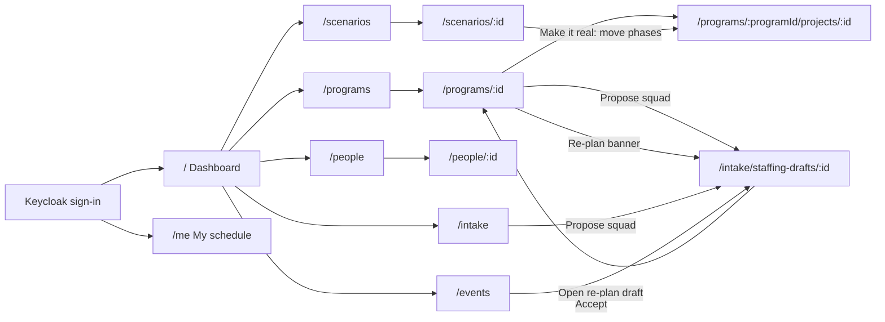
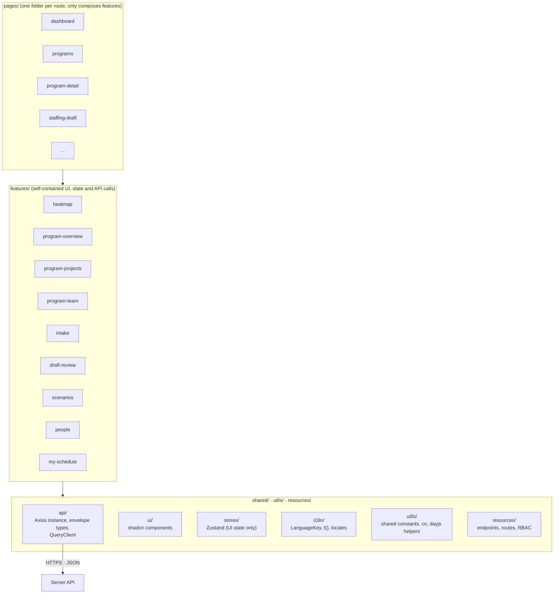

# Client: The Slot Finder

> React + TypeScript · Vite · Tailwind CSS v4 · shadcn/ui (Base UI) · TanStack Query · Zustand · Axios · React Router.
> For the overall architecture see [`../README.md`](../README.md).

The Client is a web SPA. Its job is to **display data and capture user actions**. It never computes plans or metrics, never decides permissions, and never accumulates totals itself.

## 0. Run locally

```bash
npm install
cp .env.example .env    # API base URL and the Keycloak realm + client used for sign-in
npm run dev             # http://localhost:5173, proxies /api to the server on :3000
npm run build           # type-check + production build
npm run lint
npx shadcn@latest add <component>   # adds a component to src/shared/ui
```

Sign in with a demo user (`planner`, `manager` or `specialist`; the `manager` role is shown as **Manager**; see [`server/README.md`](../server/README.md#0-run-locally)). Keycloak must be running (`make infra` or `make up`).

## 1. Screens

| Route | Screen | Roles | Main API |
|---|---|---|---|
| `/auth/callback` | Finishes the Keycloak round trip and returns to the page the user asked for | everyone | Keycloak token endpoint |
| `/` | **Dashboard**: person × week heatmap (search by name or expertise; filter by expertise or by program, which shows the program's team; the previous and next buttons beside **From week** move the start by the number of weeks shown; a cell's popover links to its project), overload and deadline-risk alerts; a manager sees the people of their program teams. The risks card lists **Sustained overload** ("Bao Tran: over 100 % for 3 weeks from 2026-W45") before single overloaded weeks, and hides the group when nobody has one; each name links to the person A **By person** / **By expertise** toggle in the heatmap card header switches the card (default: by person); the from week and weeks controls are shared, so switching keeps the range. **By expertise** is the capacity forecast: expertise × week grid of free hours (capacity minus load per person, never below 0). A cell shows `Short N hrs` when the unmet demand of planned and active projects plus the expected demand of incoming projects exceeds the free hours, and **Overloaded** when load is above capacity; green is enough free hours, amber short, red overloaded. The hover text gives capacity, load, unmet and pipeline hours. Clicking a cell opens a popover with the people of that expertise in that week, highest load first: the name (a link to the person's page), a utilization badge coloured by the shared bands, `load/capacity hrs` and free hours; it says so when nobody has capacity or load. An expertise overloaded for weeks in a row (`SUSTAINED_OVERLOAD_WEEKS`) gets a red **Overloaded N weeks in a row** badge whose tooltip names the first week; a manager sees their teams' capacity. | planner, lead | `/insights/heatmap`, `/insights/risks`, `/insights/capacity-forecast` |
| `/programs` | **Programs**: list with status and timeline; the arrow on a row opens a preview with its figures, projects and members. A manager sees only the programs they manage or lead a project in, and goes straight to the program when there is one | planner, lead | `/programs`, then `/programs/:id/overview`, `/programs/:id/projects`, `/programs/:id/members` |
| `/programs/:id` | **Program detail** (see section 2); **You can’t see this program** for a manager outside it | planner, lead | `/programs/:id`, `/programs/:id/overview`, `/programs/:id/projects`, `/programs/:id/team`, `/events?programId=` |
| `/intake` | **Intake queue**: incoming projects across programs with their confidence, "Propose squad" | planner, lead | `/projects?status=incoming`, `/staffing-drafts` |
| `/programs/:programId/projects/:id` | **Project detail** (**You can’t see this project** for a manager outside its program): project form (with confidence; saving a moved deadline shows a toast that a re-plan will run, with a link to Drafts), done points set with a slider or typed next to it in the header (saved when the slider is let go, on Enter or when the field is left; read-only text for whoever cannot edit), phase timeline (saving a phase shows the same re-plan toast), demand per phase, assigned people, risks, scope points; **Propose squad** in the header and the re-plan banner, as on the program page | planner, lead | `/projects/:id`, `/projects/:id/phases`, `/projects/:id/demands`, `/plans/current` |
| `/intake/staffing-drafts/:id` | **Staffing draft review**: assignment grid (each week is coloured by the person's whole load that week, the heatmap's bands, and the colour follows the hours as they are edited), reasons, diff against the baseline, manual edits (type hours in a cell, or drag a cell's hours to another week of the same row, or to the same week of another person on the same demand; locked cells and weeks outside the window do not take them, and each drop is one save), lock, **Swap** (an icon on the assignment row, off for a locked or stretch assignment: lists the program team's people who hold the expertise at the level, with their free hours over the window, and moves the hours to the one chosen in one save), accept (then the program page of the draft's first project's program opens), AI summary (later). A disabled Swap or Lock says why in its hint: saving, stretch, locked hours or no hours. **Add person** lists the demand's program team only. A manager edits, accepts and rejects a draft whose projects all belong to programs they manage | planner, lead (own) | `/staffing-drafts/:id`, `/staffing-drafts/:id/assignments` |
| `/drafts` | **Drafts**: every open staffing draft, manual and re-plan, newest first: when it was made, its origin, the projects and programs it covers, the baseline version (with Stale) and its unmet demands; a row opens the draft review. The sidebar item shows the open count, and the list refreshes every 15 s. A manager sees only drafts whose projects all belong to programs they manage. Empty: "No open staffing drafts." | planner, lead | `/plans/drafts` |
| `/scenarios` | **Scenarios**: the what-if list (assumptions, baseline version with Stale, people changed, hours moved, unmet) and **New scenario** (move a project, add leave) | planner | `/scenarios`, `/projects`, `/people` |
| `/scenarios/:id` | **Scenario**: assumptions and figures, Run again, Delete, changes week by week (Moved / Added / Removed / Changed; the person and the project in each change link to their pages), unmet demand, links to the projects planned again | planner | `/scenarios/:id`, `/scenarios/:id/rerun` |
| `/people` | **People**: two tabs. **People**: expertise and level matrix, start and end dates, location, **Import timesheet**, **Add person**; each row opens the person. **Holidays**: company holidays with their names, **Import holidays** (an iCalendar file or link, e.g. a public holiday calendar from Google) and **Add holiday**; a manager reads both tabs without the buttons, and sees only the people of their program teams and themselves | planner, lead (read only) | `/people`, `/people/:id/absences`, `/holidays`, `/holidays/import`, `/timesheets/template`, `/timesheets/import` |
| `/people/:id` | **Person**: tabs **Schedule** (month calendar, Monday to Sunday with days off shaded: absences, holidays, weekly load against capacity, hours per project, worked hours), **Absences** (Approve, **Add absence**) and **Calendar sync** (the calendar link and its status); a manager sees the schedule without tabs, and **You can’t see this person** for someone outside their program teams | planner, lead (read only) | `/people/:id/schedule`, `/people/:id/absences`, `/people/:id/calendar-feed` |
| `/me` | **My schedule**: tabs **Schedule** (my month calendar: hours per project each week, leave, holidays), **My absences** (report leave) and **Calendar sync** (connect my calendar) | specialist | `/me`, `/people/:id/schedule`, `/people/:id/absences`, `/people/:id/calendar-feed` (id from `/me`) |
| `/events` | **Change history** and re-plan status | planner | `/events` |

**Later** (not routed or not built yet):

- `/intake/from-document`: intake from a document with AI. The suggested project is reviewed field by field, each with its source quote, and nothing is saved before **Confirm**.
- `/insights`: capacity forecast by expertise, bench list and plan churn over time.
- Forecast editing on the program overview (`PATCH /programs/:id/forecast`).
- Internal assistants on a program (`/programs/:id/assistants`). The role is not in `server/internal/constants/roles.go`.



**Layout rules (every screen):**
- The sidebar and the header bar (breadcrumbs) are white; pages sit on a light gray area, and each block is a white card with its title, description and actions inside.
- A page made of one block (Programs, Intake, Scenarios, Events, each People tab) fills the screen: the page does not scroll, its table scrolls under a sticky header.
- A record page has one header: its name, one meta line, at most one primary button, **Edit**, and the other status actions in the ⋯ menu. Its parts sit in tabs.
- Adding or editing a record (program, project, phase, demand, person, absence, holiday, a person on a staffing draft) opens a form in a dialog; table rows never turn into inputs. The weekly hours of a staffing draft stay inputs in the grid.
- Every text and number field shows a placeholder with an example.
- **Loading:** data that is loading for the first time shows a skeleton in its own shape, from 300 ms on; data that loads again (another page, filter or month) stays on screen with a thin bar along the card's top; a button that starts a request shows a spinner in place of its icon. No lone spinners, no "Loading…" text, no empty message or `(0)` count while loading.

## 2. Program detail page

**Behaviour:**
- **Tabs**: **Overview** (progress and cost figures, staffing by expertise, the brief), **Projects** and **Team**. The page opens on Overview; the open tab is kept in the URL (`?tab=projects`), so a project's breadcrumb (Programs › program › **Projects** › project) leads back to the Projects tab. **Edit** sits next to a ⋯ menu with Put on hold, Start closing and Cancel program.
- **Header bars** come straight from `/programs/:id/overview`. Each bar shows ⚠ when the Server flags it (over 100% time, behind on delivery, over-planned, understaffed). Planned burn has no warning in the MVP.
- **EAC hours** on the Cost card comes from the overview. It is hidden while the Server returns `null` (too little scope done) and shows ⚠ when the Server flags **likely over budget**.
- **Staffing and gap** are shown together, e.g. "Staffing 80% · 40 h gap", because they show the same shortfall.
- **Re-plan banner** appears when `/events?programId=` returns an event with status `draft_created`. It links to the staffing draft.
- **Projects** are listed in priority order, each with the hours planned **Next week** and in the **Next 3 weeks**. Planners and the program's manager drag a row (or focus its handle and press ↑ / ↓) to change the order; the top project has the highest priority, and the new order is saved with `PUT /programs/:id/project-order`.
- **Propose squad** is visible to planners and to the program's manager for a project in a plannable status. It calls `POST /staffing-drafts { projectIds: [id] }` and opens the draft.
- **Team** lists the people the program's projects are staffed from: expertise, hours and weeks in this program's baseline ("Not staffed yet" before a draft gives them hours) and projects. Planners get **Add member** (a dialog to pick a person outside the team) and **Remove** on each row, with a confirm; removing keeps the member's baseline hours. The manager reads the team.

## 3. Layers



**Dependency rule:** `pages` uses `features`, and `features` uses `shared`. Features **never import each other**. Anything they need to share moves into `shared`.

## 4. Key UI components

| Component | Description |
|---|---|
| **Heatmap grid** | Rows are people (grouped by primary expertise), columns are weeks. Colour shows utilization: under 50% / 50–85% / 85–100% / over 100%. A cell shows a small split of its hours by expertise, so someone covering QA as an Engineer is visible. Click a cell to see that week's assignments. Filtering by an expertise keeps everyone who holds it that week, with non-primary people marked. Planned (not yet approved) absence is drawn as **tentative** (hatched). A past week with an imported timesheet shows the hours worked, with a muted ring, and the planned hours in its tooltip; its colour stays the band of the planned load |
| **Progress bars** | Time, Scope, Planned burn and Staffing with a percentage and a ⚠ flag from the Server |
| **Staffing by expertise** | Chart and table of budget, planned, forecast and gap hours per expertise |
| **Phase timeline** | Ordered phases as bars on ISO weeks, with the deadline week outlined and the current week marked when it is in range. One phase is edited at a time, in a dialog; moving its end later previews there, in the warning colour, which later phases will shift. The timeline on the page changes only after saving. A new or moved phase, and every later phase its slip shifts, must lie within 156 weeks before or after the current week. The week pickers grey out weeks outside that range |
| **Project form** | Name, earliest start, deadline, scope points and, for an incoming project, **confidence** (0–100 %). Both dates must lie within 156 weeks before or after the current week. The date pickers grey out days outside that range. A saved date outside it does not block saving the other fields |
| **Demand form** | One row per need: expertise, minimum level, headcount, budget hours, phase (or "whole project"), profile (flat / front / back), required and preferred tags, preferred person. Budget hours must be whole hours. Any other value shows "Use whole hours" and keeps Save off. |
| **Assignment editor** | Person × week grid for one staffing draft, grouped by assignment (person × demand). Add a person to any demand, edit weekly hours, lock or unlock, and see the reason and kind of each assignment. A person below the demand's level becomes a **stretch** assignment: shown with ⚠, locked, and confirmed again on accept. If a re-plan merge has superseded the draft, a save, accept or reject gets `409 DRAFT_SUPERSEDED`; the editor reloads the latest version and tells the Planner to check it again. **Allocate hours** on a row opens a dialog that sets a range of weeks inside the demand's window at once: the same hours every week, or a total spread evenly (rounded down to half hours, the remainder on the last week). Locked weeks keep their hours and the dialog says how many it skipped; each week stays between 0 and 80 h. It saves in one `PATCH /staffing-drafts/:id/assignments` |
| **Expertise chip** | Expertise name with hours. Plain for primary; cross-expertise and stretch get a second badge with that word. Used in the program team table |
| **Diff viewer** | Baseline versus a draft or scenario: who was added or removed, how hours changed, which projects changed risk status. |
| **Ask AI widget** | A round button fixed at the bottom-right of every screen in the app layout. Only planners and Managers see it (permission `ai:ask`). It opens a small panel over a dimmed, blurred layer; clicking the layer or pressing Escape closes it. The panel fades and slides in and out, and its header button toggles a larger size (width and height animate). Each question goes to `/ai/ask` with the current route path as `page_context` (up to 200 characters), and the answer shows under it. Questions are limited to 500 characters. Messages live in memory only: a reload clears them, and there is no history. While an answer is pending, a three-dot typing indicator shows. The wrapper ignores the mouse except the round button and the open panel. A failed question gets no toast: the chat adds a reply in the error colour (red border and text) that says to try again, and at the usage limit how many seconds to wait; the question stays in the list. The error reply has a **Try again** button (on the last message only, hidden while a question is pending) that re-sends the last question without adding a user message, and removes the error reply |
| **Guided tour** | Starts once per user on the first visit, with one step per sidebar link the role can see, one on the Ask AI button for the roles that can use it, and one on the account menu. The account menu's **Take the tour** starts it again; the close button or Esc ends it. Not started when the sidebar is hidden (below `lg`) or the browser's storage is unavailable. Drawn by driver.js, styled with the app tokens in `index.css` |
| **Intake extraction review** (later) | The suggested project from `/ai/intake-extractions`, field by field. Each field shows its source quote, highlighted in the document; flagged fields (unknown expertise or tag, hours suggested from points) are marked. The lead edits, then **Confirm** saves through the normal project, phase and demand calls. Nothing is saved before that |
| **AI chat panel** (later) | A side panel on every page for planners, leads and specialists. Sends the visible conversation to `/ai/chat`, shows the reply and links to any scenario or draft it created. Marked as AI-generated |
| **AI summary** (later) | A card on the staffing draft page with the text from `/staffing-drafts/:id/summary`, next to the reasons it is based on. Marked as AI-generated |

## 5. Data and state rules

1. **Server state** (programs, projects, plans, metrics, heatmap) lives in **TanStack Query**. Each feature has an `api.ts` (calls through `shared/api/http.ts`) and `use-*.ts` hooks. After every mutation, **invalidate** the affected queries so they refetch. Never patch numbers on the Client.
2. **UI state** (filters, selected tab, selected cell) stays in component state or a **Zustand** store. Zustand never holds server data.
3. **Axios** (`shared/api/http.ts`) is the only HTTP client:
   - adds `Authorization: Bearer` from the auth store, and `X-CSRF-Token` on unsafe methods (the token is read from the server's response header)
   - unwraps the `{ meta, data }` envelope: `request<T>()` returns `data`, `requestWithMeta<T>()` returns `{ data, meta }` for pagination
   - turns every failure into an `ApiError` (`status`, `code`, `message`, `details`)
4. Write payloads send **only the fields the user changed**. Never send `status`, `utilization`, `gap_hours` or computed totals. To change state, call the action endpoint.
5. Permissions come from `/me` (`useCurrentUser`) and are used only to show or hide controls. The Server checks them again. The Ask AI widget shows for the `ai:ask` permission alone. Later AI controls appear only when `/me` reports the AI assistant enabled.
6. Every failed query or mutation goes through **one shared handler** in `shared/api/query-client.ts`, which shows a toast. For `409 PLAN_VERSION_CONFLICT`, the draft-review feature asks the user whether to regenerate the draft. For `409 DRAFT_SUPERSEDED`, it reloads the latest draft version. For `429`, the toast says how many seconds to wait (`retry_after`), and a query is not retried after a `401`, `403` or `429`. A mutation can set `meta.quietErrors` to show every failure itself; a `401` still ends the session (Ask AI does this and shows failures in the chat).
7. Show weeks as ISO weeks (`2026-W42`) together with their date range. Do week math only with the dayjs helpers in `@/utils/functions` (`toIsoWeek`, `isoWeekRange`, `formatIsoWeekRange`).
8. A metric the Server returns as `null` (zero denominator) is shown as "—".
9. **Sign-in** uses [`oidc-client-ts`](https://github.com/authts/oidc-client-ts): Authorization Code with PKCE (S256) against the Keycloak realm in `VITE_OIDC_AUTHORITY`. It was chosen over `keycloak-js` because it is standard OIDC (not tied to Keycloak), typed, maintained, and renews tokens silently with the refresh token instead of a hidden iframe.
   - `shared/auth/` holds the OIDC client, the session functions (`startAuthSession`, `signIn`, `completeSignIn`, `signOut`) and `useCurrentUser`
   - the session token lives in `shared/stores/auth-store.ts`; `http.ts` reads it from there
   - `app/router.tsx` wraps the app in `RequireAuth` (signed-out users go straight to the Keycloak sign-in page and come back to the page they asked for) and each route group in `RequirePermission` (other roles see "No access")
   - signing out ends the Keycloak session and returns to the dashboard, which goes straight on to the sign-in page
   - the home route sends planners and leads to the dashboard and specialists to their schedule
   - URLs nest like the breadcrumbs (a project under its program, a staffing draft under Intake), so the sidebar marks the right section; each page route sets `handle: crumb(...)` for the breadcrumbs in `app/breadcrumbs`
   - a `401` from the API ends the session in the shared error handler
10. **All user-facing text goes through `t()`** from `@/shared/i18n`. The key is the English text itself and is declared in `LanguageKey`; English needs no locale file. Server data (names, emails) is shown as-is.
11. **Icon-only buttons in a table row are named on a long hover** (`IconHint` in `shared/components/icon-hint`, after half a second). **Our jargon explains itself.** Where baseline, staffing draft, stretch, cross-expertise, gap hours, staffing %, planned burn %, at risk or scenario is a heading, a column title or a badge, it goes through `Term` (`shared/components/term`): an info icon after the word, with a one-sentence definition on hover or keyboard focus. The definitions are i18n keys in that folder's `constants.ts`, taken from root README §6.5 and §7. Body text is not wrapped.
12. **Questions use the app's own dialog.** Accepting or rejecting a draft, removing a phase, demand or team member, deleting a scenario, disconnecting a calendar and the record menu's irreversible actions ask with `confirm()` (`shared/stores/confirm-store`), which opens the `ConfirmDialog` mounted in `app-providers`: a title, an optional description, an optional red warning (the draft's stretch assignments) and a confirming button named after the action, red when it cannot be undone. The browser's `confirm`, `alert` and `prompt` are not used; lint rejects them.
13. **A failed load says so.** A list or page whose request fails (Intake, Drafts, Change history, Scenarios, Heatmap, Risks, project summary, draft review, scenario review, a heatmap cell's popover) shows `LoadError` (`shared/components/load-error`): the reason and **Try again**. "Not found" is shown only for a 404.
14. **Theme.** The accent is `#3FA6EE` (`--primary` and `--ring` in `src/index.css`; links use a darker shade). The favicon and the Keycloak sign-in theme use the same blue.
15. **Shared UI.** Dialogs fade and zoom in and out over 200 ms (`shared/ui/dialog.tsx`). Buttons and button-like roles get a pointer cursor from one base rule in `src/index.css`, so new components need no cursor class.

## 6. Folder layout

```text
client/
├── README.md
├── index.html · vite.config.ts · components.json · eslint.config.js · tsconfig*.json
├── .env.example
└── src/
    ├── index.css                 ← Tailwind v4 + shadcn theme
    ├── app/
    │   ├── main.tsx              ← entry point
    │   ├── router.tsx            ← all routes (paths from resources/routes)
    │   ├── app-providers/        ← QueryClientProvider, RouterProvider, Toaster
    │   ├── app-layout/           ← sidebar filtered by role, signed-in user, sign out + <Outlet/>
    │   ├── require-auth/ · require-permission/ · home-route/   ← route guards
    │   ├── breadcrumbs/          ← the trail each route's handle sets
    ├── pages/                    ← one folder per route, e.g. program-detail/ → ProgramDetailPage
    ├── features/                 ← one folder per feature
    │   ├── health/               ← api.ts · use-health.ts · types.ts · index.ts
    │   ├── people/ · absences/ · holidays/ · person-calendar/ · calendar-feed/ · timesheet-import/
    │   ├── programs/ · program-overview/ · program-projects/ · program-team/   ← component.tsx · types.ts · index.ts · components/<child>/
    │   ├── project-summary/ · project-phases/ · demand-form/
    │   ├── intake/ · drafts-inbox/
    │   ├── draft-review/ · scenarios/ · scenario-review/
    │   ├── heatmap/              ← the dashboard's by-person view; filters in use-heatmap-filters.ts (Zustand); the week range is shared/week-range
    │   ├── replan-banner/ · change-history/
    │   ├── capacity-forecast/    ← the dashboard's by-expertise view; the week range comes from shared/week-range
    │   ├── risks/                ← the dashboard's risks list, next to the heatmap
    │   ├── ask-ai/               ← the floating Ask AI widget, mounted in app-layout
    │   └── guided-tour/          ← the sidebar tour, mounted in app-layout and started from the account menu
    ├── resources/
    │   ├── endpoints/            ← server API paths per domain (HEALTH_ENDPOINTS, PROGRAM_ENDPOINTS)
    │   ├── routes/               ← client route paths (ROUTES)
    │   └── rbac/                 ← ROLES, PERMISSIONS, can()
    ├── utils/
    │   ├── constants/            ← constants shared by several places (date formats, query settings)
    │   └── functions/            ← shared helpers: cn, dayjs + ISO-week helpers
    └── shared/
        ├── api/                  ← http.ts (Axios), constants.ts, types.ts (envelope, ApiError), query-client.ts
        ├── auth/                 ← OIDC client (oidc-client-ts), session functions, useCurrentUser
        ├── i18n/                 ← language-key.ts (LanguageKey), translate.ts (t, translate), locales/, language-store.ts
        ├── ui/                   ← shadcn components, managed by the shadcn CLI
        ├── components/           ← components used by several features, e.g. page-placeholder/, pager/, status-badge/
        ├── ai/                   ← Ask AI: api.ts, use-ask-ai.ts, types.ts
        ├── programs/ · expertises/ · staffing/ · events/ · people/ · scenarios/ · utilization/ · hooks/   ← API calls, query hooks and types shared by several features
        └── stores/               ← auth-store.ts (Zustand)
```

Component and unit tests use Vitest with Testing Library in jsdom (`npm test`). They sit next to the code: `component.test.tsx`, `utils.test.ts`, `use-<name>.test.ts`. End-to-end tests come later.

## 7. Conventions

Each convention has a project skill in [`../.claude/skills`](../.claude/skills). ESLint enforces the mechanical parts (`npm run lint`).

| Convention | Skill | Enforced by lint |
|---|---|---|
| User-facing text goes through typed `t()` with English-text keys | `translating-client-text` | Raw text in JSX, and literal `alt` / `aria-label` / `placeholder` / `title` |
| Every component lives in its own folder (`index.ts` + `component.tsx` + `types.ts`), named after the folder | `structuring-client-components` | Types declared inside `component.tsx` |
| No inline styles: Tailwind classes, `cn()` and component variants | `styling-client-components` | `style={...}` anywhere outside `shared/ui` |
| `component.tsx` holds only imports and one component; no component inside a component; no inline function props; nesting at most 3 layers | `structuring-client-components` | All of these |
| Never hardcode: constants, `utils/`, `resources/` (endpoints, routes, RBAC); dates only through dayjs helpers | `organizing-client-shared-code` | Direct `dayjs` imports |
