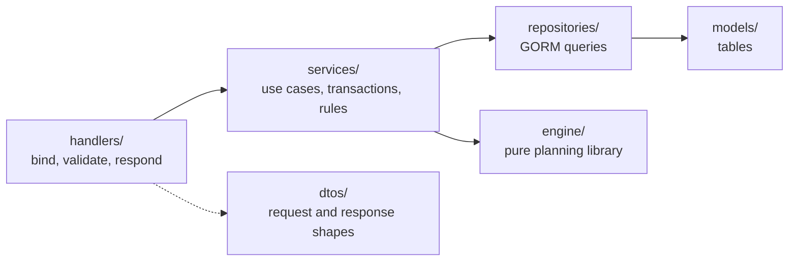

# Server: The Slot Finder

> Go · Echo v5 · Uber FX · GORM · PostgreSQL · Atlas · Redis · Keycloak · Zap · OpenTelemetry · swaggo.
> For the overall architecture see [`../README.md`](../README.md).

The Server is the **source of truth**. All data, permissions, state transitions, metrics and aggregated numbers live here. One Go codebase contains:

- **Server API**: serves the Client under `/api/v1`
- **Background jobs**: re-plan and calendar sync run in-process; notify is later
- **Planning Engine**: a pure package used by the planning service

## 0. Run locally

From the repo root (see the root `Makefile`):

```bash
make setup     # .env files + Go and npm dependencies
make up        # Docker: Postgres, Redis, Keycloak, OTel collector, Jaeger, migrations, API on :3000 (starts once Keycloak is ready)
make dev       # or: infra in Docker, API and client on the host
make seed      # demo data: expertises, 12 people with skills, leave, holidays, 2 programs with 6 projects,
               # a baseline staffing 3 of them and 2 what-if scenarios (safe to run again)
```

Inside `server/`:

```bash
make up                                      # API on the host (reads cmd/server/.env)
make tests                                   # unit tests with race + coverage
make lint                                    # golangci-lint
make swagger-load                            # regenerate docs/ after changing handler annotations (needs swag)
make migrate-generate name=<change>          # Atlas diff from GORM models (needs the Atlas CLI + Docker)
```

Swagger UI: `http://localhost:3000/swagger/index.html` (basic auth from `BASIC_AUTH_USER` / `BASIC_AUTH_SECRET`, non-production only). `/api/v1/health/metrics` uses the same basic auth. Keycloak: `http://localhost:8080/auth`.

**Sign-in.** On a fresh start, Keycloak imports [`deploy/keycloak/realm.json`](deploy/keycloak/realm.json): the realm, the roles `planner` / `manager` / `specialist`, the web app client (Authorization Code + PKCE) and the API client. Its `${...}` placeholders come from `cmd/server/.env` (`KEYCLOAK_REALM`, `KEYCLOAK_SPA_CLIENT_ID`, `KEYCLOAK_CLIENT_ID`, `CLIENT_APP_URL`, ...). `make reset-data` deletes the Keycloak data, so the next start imports the realm again.

**Renaming the role `lead` to `manager`.** Keycloak imports `realm.json` only on a fresh volume, so existing Keycloak data still has the realm role and demo user `lead`. Fix local data with `make reset-data`, or in the Keycloak admin console rename the realm role `lead` to `manager` (Realm roles) and the demo user. Rows in `people` keep their old `role` text: run `UPDATE people SET role = 'manager' WHERE role = 'lead'` (no Atlas migration, because it is data only). A deployed instance needs the same rename before this version is deployed, or every user with the old role gets `403`.

The sign-in pages use the `slot-finder` login theme in [`deploy/keycloak/themes/`](deploy/keycloak/themes/slot-finder/login), named by `KEYCLOAK_LOGIN_THEME`. A fresh import picks it up; on existing data, run `make keycloak-theme` at the repo root. `start-dev` does not cache themes, so edits show on reload. The theme folder is a read-only volume of the `keycloak` service, so template, CSS, script and text edits need no restart or `make keycloak-theme`; that command is only for changing which theme a realm uses. The "Don't have an account?" dialog on the sign-in page takes its texts and manual URL from `messages/messages_en.properties`.

Demo users, **for development only**. Their password is `KEYCLOAK_DEMO_PASSWORD` (`P@ssw0rd123` in `.env.example`); never reuse it outside a local machine.

| User | Role | Lands on |
|---|---|---|
| `planner` | planner | Dashboard |
| `manager` | manager (shown as **Manager**; manages Acme Commerce Platform) | Dashboard |
| `specialist` | specialist | My schedule |

The server verifies access tokens locally against the realm's JWKS, cached and refreshed every `AUTH_JWKS_REFRESH_INTERVAL` (and on an unknown key id). It calls Keycloak only to fetch those keys, never per request. `KEYCLOAK_URL` is how the server reaches Keycloak; `KEYCLOAK_PUBLIC_URL` is the issuer in the tokens, as the browser sees it.

**Sentry** is off (no `SENTRY_DSN`). The error handler attaches no request headers to an event. Before an event leaves the server, `internal/monitoring/sentry.go` drops its request body, query string and cookies, every header whose name contains `authorization`, `cookie`, `token`, `secret` or `key`, and calendar feed links (hosts in `CALENDAR_ALLOWED_HOSTS`) in messages, exception values and tags.

## 1. Architecture style

- **Modular monolith** in a **layer-based** layout. A logical module (people, programs, planning, ...) is a set of files with the same name across the layers.
- `cmd/server/main.go` wires providers with Uber FX. `cmd/server/routes/router.go` registers routes and middleware.



**Rules:**
1. Handlers call services only. Services own transactions and business rules.
2. A service uses **only its own module's repository**. To read another module's data it calls that module's service. No module reads another module's tables directly.
3. Repositories and models never import handlers or services. DTOs stay at the handler edge.
4. `internal/engine` **imports only the standard library**. The planning service builds a snapshot and passes it in.
5. Changes are recorded as **ChangeEvents** in a Postgres outbox, in the same transaction as the change (section 6).

**Shared building blocks** (each arrives with the feature that first needs it, see [`docs/features/`](../docs/features/README.md)):
- **`authz` service** (sign-in): named permission checks such as `CanViewPeople` or `CanEditProgram(programID)`. Handlers and services call the checks, never raw role lists. Role checks come first; per-program rules are added by later features.
- **Request claims** (sign-in): `AuthMiddleware` verifies the JWT locally against cached JWKS and puts the claims in the request `context.Context`. Code reads them through nil-safe accessors.
- **Clock** (sign-in): provided through FX and aware of the organization time zone (`TIMEZONE`). Code asks the Clock for "now" and the current week; nothing sets `time.Local`.
- **`TxManager`** (programs-and-demand): `TxManager.Do(ctx, fn)` runs `fn` in one transaction stored in `ctx` and commits or rolls back. Repositories get their handle with `r.db.From(ctx)`, which returns that transaction or the plain DB. Services own the boundary.
- **`isoweek.Week`** (people-and-skills, stored from programs-and-demand): weeks in Go. The API speaks `2026-W42`; the database stores the week's Monday in a `date` column named `*_week_start`.

## 2. Modules

Files per module follow the pattern `handlers/<module>.go`, `services/<module>.go`, `repositories/<module>.go`, `models/<module>.go`, `dtos/<module>.go`.

| Module | Responsibility | Owns data | Publishes events |
|---|---|---|---|
| **identity** | Local Keycloak token verification (cached JWKS), roles, mapping the token to a PERSON (`keycloak_id`; by email only when `email_verified` is true and the person is not linked to another account yet), the `authz` service with named permission checks | none (accounts live in Keycloak) | |
| **people** | People, expertise, levels, non-project hours, start and end dates. Location: later | PERSON, EXPERTISE, PERSON_SKILL | `PersonCapacityChanged`, `SkillChanged` |
| **availability** | Leave (entered by hand or read from a calendar feed), company-wide holidays; computes `capacity(person, week)`. Holidays per location: later | ABSENCE | `AbsenceAdded`, `AbsenceRemoved` |
| **programs** | Programs, projects, phases (and their slip propagation), staffing demand (budget hours, headcount, `flat` profile), scope points, done points, program teams, program and project lifecycles (including `staffed_at`). Forecast overrides, confidence: later | PROGRAM, PROGRAM_TEAM_MEMBER, PROJECT, PROJECT_PHASE, DEMAND | `ProjectStatusChanged`, `ProjectSlipped`, `PhaseSlipped`, `DemandChanged`, `TeamChanged`, `ProgramSlipped` |
| **planning** | Baseline, staffing drafts, scenarios; assignments and their kind (primary / cross-expertise / stretch) and alternatives; calls the engine; accept and publish | PLAN, ASSIGNMENT, ALLOCATION | none yet (`PlanPublished`: later) |
| **insights** | Heatmap, utilization, program and project metrics, at-risk lists, capacity forecast, sustained overload, bench list (read-only). Plan churn, hours per point: later | none (read-only) | |
| **events** | Records ChangeEvents, debounces them, assesses impact, creates re-plan jobs (one open auto draft per baseline) | CHANGE_EVENT | |
| **integrations** | Calendar feeds (secret ICS links and the sync runner, which writes leave through **availability**), the LLM provider client (used by Ask AI), email sender. Notifications (Email/Slack) to members: later. No live HR connection: people come in by CSV upload (`POST /people/import`) | CALENDAR_FEED | |
| **timesheets** | The timesheet template and import; actual hours per person, project and week | ACTUAL_HOURS | |
| **ai** | Ask AI and draft summary (built): read-only Q&A over the insights and planning data, and a summary of a staffing draft. Later: intake extraction, what-if chat. Runs the function-calling loop with the LLM; each tool wraps another module's service and runs with the caller's identity (section 9) | none | |

## 3. API (REST/JSON)

All paths below are under **`/api/v1`**. Every endpoint except health checks requires a Keycloak JWT (`Authorization: Bearer`); unsafe methods also need `X-CSRF-Token`. The Server checks permissions on every call: the role through `RequireRole` in the router, and per-program rules ("manager (own)") in the service. "manager (own)" means the manager of that program. A manager sees only the people in the teams of the programs they manage, plus themselves ("manager (team)" below); `AuthzService.VisiblePeople` answers that for the people list and detail, schedules, the heatmap and the risks.

**Rate limits.** Every request counts against `RATE_LIMIT` per `RATE_LIMIT_DURATION` for its client IP. The routes that run the planning engine, read an uploaded file, fetch a URL or call the AI model also count against `RATE_LIMIT_HEAVY` per `RATE_LIMIT_HEAVY_DURATION` for each signed-in user on each route: `POST /staffing-drafts`, `POST /scenarios`, `POST /scenarios/{id}/rerun`, `POST /timesheets/import`, `POST /people/import`, `POST /holidays/import`, `POST /ai/ask`, `POST /staffing-drafts/{id}/summary`, `PUT /people/{id}/calendar-feed` and `POST /people/{id}/calendar-feed/sync`. Over either limit the Server answers `429 RATE_LIMIT_EXCEEDED`, with a `Retry-After` header and `{ limit, window, retry_after }` in `data` (`retry_after` in seconds). The counters live in memory, one set per Server instance.

**Identity and people**

| Method | Path | Purpose | Roles |
|---|---|---|---|
| GET | `/me` | Current user, role and person id (enabled features: later) | everyone |
| GET | `/people/import-template` | CSV template for the people import: header and one example row | planner |
| POST | `/people/import` | Upload a filled-in people CSV (multipart `file`). Every row is checked first; any problem gets `400 PEOPLE_IMPORT_INVALID` with `data.problems` (line, column, code), and nothing is saved. Creates new emails, updates known ones; returns `{ created, updated, unchanged }`. Over the size or row limit: `413 PEOPLE_IMPORT_TOO_LARGE` | planner |
| GET | `/people` | List people with their skills | planner, manager (team) |
| POST | `/people` | Create a person (start and end dates, non-project hours, which must not exceed weekly hours: `400 PERSON_NON_PROJECT_HOURS_INVALID`) | planner |
| GET | `/people/{id}` | One person with their expertise, for the person page | planner, manager (team; else `403`) |
| PATCH | `/people/{id}` | Edit a person: only the sent fields; `start_date` and `end_date` accept null to clear them | planner |
| PUT | `/people/{id}/skills` | Replace expertise and levels (exactly one primary); records `SkillChanged` when they change | planner |
| GET, POST | `/people/{id}/absences` | Leave calendar. A person's own absence is always `planned`; planners choose the status. Dates that overlap another of the person's absences get `409 ABSENCE_OVERLAPS`. Leave read from a calendar feed has `source = calendar` | planner, the person themselves |
| DELETE | `/absences/{id}` | Remove an absence, or a holiday (planner) | planner, the person themselves |
| POST | `/absences/{id}/approve` | Approve a planned absence; records a change event | planner |
| GET | `/people/{id}/assignments?from=&to=` | Everything a person owns in the baseline: project, demand, **expertise**, kind, hours per week | planner, manager (team), the person themselves |
| GET | `/people/{id}/schedule?from=&to=` | One person's calendar: per week capacity, load, band, tentative flag, hours per project and actual hours; per day absences and holidays; the working weekdays | planner, manager (team), the person themselves |
| GET, PUT, DELETE | `/people/{id}/calendar-feed` | A person's calendar link: its status (never the link itself), connect or replace (`{ url }`, checked and synced once), disconnect. `503 CALENDAR_SYNC_DISABLED` without `CALENDAR_FEED_KEY` | planner, the person themselves |
| POST | `/people/{id}/calendar-feed/sync` | Sync that calendar now; `409 CALENDAR_SYNC_RUNNING` while another sync of the same calendar runs | planner, the person themselves |
| GET | `/expertises` | Expertise catalogue | everyone |
| GET, POST | `/holidays` | Company-wide holidays, each with an optional `name` (per location: later) | GET everyone, POST planner |
| POST | `/holidays/import` | Import holidays from an iCalendar file (multipart `file`) or a link (`url`: https, a calendar host only, never stored, logged or returned) between `from_date` and `to_date`, at `hours_per_day`. An event already imported (same UID) is skipped; returns `{ added, skipped }`. `400 HOLIDAY_SOURCE_INVALID` unless exactly one of file or link is sent | planner |

**Programs and projects**

A manager reads only the programs they lead or lead a project in, and the people of those programs' teams: `GET /programs`, `GET /projects` and the risks leave the others out, and the routes of another program or its projects answer `403`.

| Method | Path | Purpose | Roles |
|---|---|---|---|
| GET, POST | `/programs` | List or create programs | planner, manager |
| GET | `/programs/{id}` | Program record: brief, timeline, status | planner, manager |
| PATCH | `/programs/{id}` | Edit a program. Records `ProgramSlipped` when the end date changes | planner, manager (own) |
| POST | `/programs/{id}/actions/{hold\|resume\|start-closing\|close\|cancel}` | Change program state through an action. `cancel` also cancels the program's open projects | planner, manager (own) |
| GET | `/programs/{id}/overview` | Header metrics (Time, Scope, Planned burn, Burn from actual hours, Staffing with warnings), cost figures (budget, planned, planned to date, actual, forecast, gap; EAC hours later), staffing by expertise | planner, manager |
| GET | `/programs/{id}/projects` | Projects tab: rows in priority order with a `metrics` object (Time / Scope / Planned burn / Burn / Staffing and warnings, and the baseline hours planned next week and in the next three weeks: `next_week_hours`, `next_three_weeks_hours`) | planner, manager |
| POST | `/programs/{id}/projects` | Add a project to the program; it goes last in the priority order unless `priority` is sent. Its start and deadline must lie within `PROJECT_WINDOW_WEEKS` of the current week, else `400 WEEK_OUT_OF_WINDOW` | planner, manager (own) |
| PUT | `/programs/{id}/project-order` | Set the priority order: `{ project_ids }` lists every project of the program, highest priority first, and they get priority 1..N. `422 PROJECT_ORDER_MISMATCH` when the list is not exactly the program's projects | planner, manager (own) |
| GET | `/programs/{id}/members` | The Programs list preview: everyone with baseline hours on the program's projects, most hours first, with hours per expertise and kind, first and last week, and projects (overall utilization later) | planner, manager |
| GET | `/programs/{id}/team` | Team tab: the people the program's projects are staffed from, each with their skills and their hours, first and last week and projects in this program's baseline (0 h until a draft gives them some) | planner, manager (own) |
| POST | `/programs/{id}/team` | Add a member: `{ person_id }`; `409 TEAM_MEMBER_EXISTS` when already in | planner |
| DELETE | `/programs/{id}/team/{personId}` | Remove a member; their baseline hours stay, the next draft plans without them (`404 TEAM_MEMBER_NOT_FOUND`) | planner |
| GET | `/projects` | Projects across programs (filter by `status`) | planner, manager |
| GET | `/projects/{id}` | Project record with its phases, its demand (each row with the weeks it may be staffed in) and the program's lead | planner, manager |
| PATCH | `/projects/{id}` | Edit a project, including `scope_points` and `done_points` (`confidence`: later). Moving the deadline emits `ProjectSlipped`. A changed date outside `PROJECT_WINDOW_WEEKS` gets `400 WEEK_OUT_OF_WINDOW` | planner, manager (own) |
| POST | `/projects/{id}/actions/{hold\|resume\|complete\|cancel}` | Change project state through an action | planner, manager (own) |
| GET, PUT | `/projects/{id}/phases` | Ordered phases of a project (PUT replaces the whole list; removing a phase that still has demand gets `409 PHASE_IN_USE`; a changed week outside `PROJECT_WINDOW_WEEKS` gets `400 WEEK_OUT_OF_WINDOW`, and a new or moved phase outside the project's start and deadline weeks gets `400 PHASE_OUTSIDE_PROJECT`, but a rename of an old phase still works) | planner, manager (own) |
| PATCH | `/phases/{id}` | Edit a phase. Moving its end week later shifts every later phase by the same weeks and emits `PhaseSlipped`. Returns every phase it changed. A changed week outside `PROJECT_WINDOW_WEEKS` gets `400 WEEK_OUT_OF_WINDOW`; the edited phase must lie within the project's start and deadline weeks (`400 PHASE_OUTSIDE_PROJECT`), but phases shifted by the slip may pass the deadline | planner, manager (own) |
| PUT | `/projects/{id}/demands` | Staffing demand: budget hours per expertise and level, each with an optional `phase_id`, `headcount` and `profile` (`flat` only). `400 DEMAND_HOURS_STEP` when a total is not a multiple of `PLANNING_HOUR_STEP`; `409 DEMAND_IN_USE` when a removed demand holds staffed hours in past weeks of the baseline | planner, manager (own) |

**Planning and insights**

| Method | Path | Purpose | Roles |
|---|---|---|---|
| GET | `/plans/current` | The baseline | planner, manager |
| POST | `/staffing-drafts` | Generate a draft: `{ projectIds }` or `{ changeEventId }`. Each demand is staffed from its program's team only | planner, manager (every project's program is their own) |
| GET | `/plans/drafts` | Open staffing drafts, newest first: `base_version`, `current_version`, `stale`, `auto` (a re-plan draft), `created_at`, the covered `projects` with their programs, and `unmet_count` | planner, manager (drafts whose projects all belong to programs they manage) |
| GET | `/staffing-drafts/{id}` | Draft with diff against the baseline and reasons; each project carries `program_lead_id` and each demand its program team as `team_ids` (`null` puts no limit); `load` gives every active person's `capacity` and `other_hours` (hours on other demand, of plannable projects only, from the current week on) per week and `bands` the utilization limits, so the grid can colour a week from the hours being edited | planner, manager (own) |
| PATCH | `/staffing-drafts/{id}/assignments` | One batch `{ add, remove, set }`: add or remove an assignment (any person to a covered demand; the server sets `kind`), change weekly hours (0 removes the week), lock or unlock; a person outside the demand's program team gets `422 PERSON_NOT_IN_TEAM`. Adding or setting hours in a week before the current week gets `400 WEEK_IN_THE_PAST`, and so does removing an assignment that has hours in such a week. | planner, manager (own) |
| GET | `/staffing-drafts/{id}/assignments/{assignmentId}/alternatives` | Who could take over the assignment: members of the demand's program team who hold its expertise at the required level and do not cover it yet, with `free_hours` over the demand's window (capacity minus the plan's hours), most first, at most `DRAFT_ALTERNATIVES_LIMIT`. To swap, send one `remove` and one `add` with the same weekly hours in one PATCH above; it is applied in one transaction | planner, manager (own) |
| POST | `/staffing-drafts/{id}/accept` | Publish (`{ baseVersion }`; `409 PLAN_VERSION_CONFLICT` if the baseline changed) | planner, manager (own) |
| POST | `/staffing-drafts/{id}/reject` | Discard a draft | planner, manager (own) |
| POST | `/staffing-drafts/{id}/summary` | Short summary of a draft: `{ summary, source }`, `source` is `ai` or `template`. No body. Never fails because of the model (section 9). Heavy rate limit | planner, manager (own) |
| GET, POST | `/scenarios` | List scenarios (newest first, with stale flag and churn), or create one from `{ name, assumptions }` (`shift_project`, `add_absence`) and compute it on a copy of the baseline | planner |
| GET, DELETE | `/scenarios/{id}` | A scenario with its changes against the baseline it was built on (week by week), churn, unmet demand and the projects planned again; or delete it | planner |
| POST | `/scenarios/{id}/rerun` | Compute a scenario again, with the same assumptions, against the baseline in force | planner |
| GET | `/insights/heatmap?from=&to=&expertise=&program_id=` | Person × week matrix. Each cell holds total hours plus hours per expertise; `expertise=` (an expertise id) keeps people who hold that expertise or work on it in the range; `program_id=` keeps the program's team (`403` for a manager who may not read the program, `404` for an unknown one). Each cell also has capacity, utilization, its band, a tentative flag for planned leave and `actual_hours`: the hours worked that week from imported timesheets, `null` when none were imported. Load counts plannable projects only, from the current week on (section 5) | planner, manager (team) |
| GET | `/insights/capacity-forecast?from=&to=` | Per expertise (the primary skill of the people) × week: `capacity`, `load`, `free_hours` (capacity − load per person, never below 0), `unmet_hours` (confirmed demand of planned and active projects the baseline does not cover, spread flat over the rest of its window), `pipeline_hours` (the same for `incoming` projects × `PIPELINE_CONFIDENCE_PERCENT`), `shortfall_hours` (unmet + pipeline − free, at least 0) and `overloaded` (load above capacity) and `people`: the expertise's people in that week, highest load first, each `person_id`, `name`, `capacity`, `load`, `free_hours`, `utilization` (as in the heatmap, `null` without capacity), `band` and `overloaded`; people with no capacity and no load are left out. `sustained_overload` is the first run of `SUSTAINED_OVERLOAD_WEEKS` or more overloaded weeks, else `null`. Weeks default and are capped like the heatmap's. A manager gets their teams' capacity and the demand of the programs they may read | planner, manager (team) |
| GET | `/insights/risks` | Understaffed and at-risk projects, delivery behind time, overloaded people in the next `HEATMAP_DEFAULT_WEEKS` weeks (a manager sees only their team's), and before them `sustained_overload`: each person over 100 % for `SUSTAINED_OVERLOAD_WEEKS` or more weeks in a row (`person`, `from_week`, `weeks`, the first such run); likely over budget later. Load counts plannable projects only, from the current week on (section 5) | planner, manager |
| GET | `/insights/bench` | People on the bench: capacity above 0 and utilization below `UTILIZATION_UNDERUSED_BELOW` in each of the next `BENCH_WEEKS` weeks, from the current week. Each person has `person_id`, `name`, `primary_expertise` and `free_hours` (Σ capacity − load, same numbers as the heatmap); most free hours first, then by name. `weeks` is `BENCH_WEEKS`. A manager sees their teams' people | planner, manager |
| POST | `/ai/ask` | Ask AI. Body `{ question }` (1–500 characters) and optional `page_context` (up to 200). Returns `{ answer }`. The model reads data only through read-only tools that run with the caller's permissions (section 9). `503 AI_NOT_CONFIGURED` when the chosen provider's key is empty; `429 AI_RATE_LIMITED` when the model service is rate limited, with `data.retry_after` (seconds) when it sends one; `502 AI_UPSTREAM_FAILED` for other model failures. Heavy rate limit | planner, manager (own programs, through the tools) |
| GET | `/events?program_id=` | Change history and processing status; the program page uses it for the re-plan banner. A manager sees only events on the projects of their programs and events about themselves or the people in their teams (`person_id` in the payload); a manager without a person record gets an empty page. A planner sees all | planner, manager |
| GET | `/timesheets/template?from=&to=` | CSV template: person × project × week with baseline hours in a range of past weeks, with planned hours and any actual hours already recorded | planner |
| POST | `/timesheets/import` | Upload a filled-in template (multipart `file`). Every row is checked first; any failure gets `400 TIMESHEET_INVALID` with line, column and code, and nothing is saved | planner |

**Later** (designed, not registered in the Server yet; the routes below return `404` today):

- `PATCH /programs/{id}/forecast`: set or clear `forecast_override_hours` per demand
- `GET /projects/{id}/hours-suggestion`: suggested budget hours per expertise (`scope_points × hours_per_point`)
- `GET /insights/churn?from=&to=`: plan churn per accepted draft
- `POST /ai/intake-extractions`: suggested project from text or one file; saves nothing
- `POST /ai/chat`: one turn of the AI assistant

**Response envelope** (success and error):

```json
{ "meta": { "error_code": "SUCCESS", "message": "OK", "code": 200, "page": 1, "page_size": 20, "total": 18 }, "data": { } }
```

Error example (HTTP 409):

```json
{ "meta": { "error_code": "PLAN_VERSION_CONFLICT", "message": "The baseline has changed. Generate the draft again.", "code": 409 }, "data": null }
```

**Payload rules:**
- Write payloads contain only fields the user may edit. The Server ignores or rejects computed fields such as `status`, `utilization`, `gap_hours` and `total_*`.
- The Server computes and returns all metrics and aggregated numbers. The Client never accumulates them itself.
- `PATCH /staffing-drafts/{id}/assignments`, accept and reject on a **superseded** draft version return `409` with `DRAFT_SUPERSEDED`. The Client reloads the latest version.
- Edit, accept and reject on a staffing draft that is already accepted or rejected return `409` with `DRAFT_NOT_EDITABLE`. So does one that another request changes while this one runs. A draft superseded before the request still gets `DRAFT_SUPERSEDED`.
- **Accept is atomic** (staffing-draft): in one `TxManager.Do`, `UPDATE plan SET status = 'superseded' WHERE kind = 'baseline' AND status = 'published' AND version = :baseVersion`. 0 rows updated → `409 PLAN_VERSION_CONFLICT` and nothing is written. The draft is then published as version `baseVersion + 1`. A partial unique index (`kind = 'baseline' AND status = 'published'`) allows one published baseline, so a racing second accept also gets `409`.

## 4. Planning engine

`engine/` is a pure library: no database, no network, no reading the system clock. Everything it needs (capacity, demand weeks, the team as `candidates`) arrives in the request. It knows nothing about programs or scope points.

**Input: `engine.Request`** (JSON shape shown; the Go struct has no JSON tags)

```jsonc
{
  "policy": {
    "targetUtilization": 0.8,
    "maxUtilization": 1.0,
    "maxExpertisesPerPersonWeek": 2,
    "minHoursPerWeek": 8,
    "hourStep": 1,
    "weights": { "deadline": 1.0, "primaryFit": 0.8, "balance": 0.6, "stability": 0.5,
                 "continuity": 0.3, "levelFit": 0.4 }
    // later: "maxProjectsPerPersonWeek"
  },
  "people": [
    { "id": "p1",
      "skills": [{ "expertise": "Engineer", "level": 4, "primary": true }, { "expertise": "QA", "level": 3 }],
      "capacity": { "2026-W42": 36, "2026-W43": 20, "2026-W44": 0 } }  // dates, non-project hours and absence already applied
  ],
  "demands": [
    { "id": "d1", "projectId": "pr1", "programId": "pg1", "priority": 2, "expertise": "QA", "minLevel": 2,
      "headcount": 1, "hours": 120, "weeks": ["2026-W42", "…", "2026-W48"], "deadlineWeek": "2026-W48",
      "candidates": { "p1": true } }  // the program's team; null means anyone
    // later: "profile" other than flat
  ],
  "existing": [
    { "personId": "p1", "demandId": "d0", "kind": "primary",
      "allocations": [{ "week": "2026-W42", "hours": 16, "locked": true }] }
  ]
}
```

**Output: `engine.Result`**

```jsonc
{
  "assignments": [
    { "personId": "p1", "demandId": "d1", "kind": "cross_expertise",
      "reason": ["QA cover: Engineer (primary) with QA level 3 ≥ 2", "no free QA-primary person before W48",
                 "already on project pr1"],
      "allocations": [{ "week": "2026-W42", "hours": 12 }, { "week": "2026-W43", "hours": 16 }] }
  ],
  "unmet": [
    { "demandId": "d2", "hours": 40, "reason": "NO_CAPACITY_BEFORE_DEADLINE" }
  ]
}
```

**`unmet` reason codes:**
- `NO_SKILL`: nobody has this expertise
- `LEVEL_TOO_LOW`
- `NO_CAPACITY_BEFORE_DEADLINE`
- `BLOCKED_BY_LOCKED`
- `BLOCKED_BY_EXPERTISE_LIMIT`: people had free hours, but a new expertise would pass `maxExpertisesPerPersonWeek`
- `BELOW_MIN_HOURS`: free hours exist only in weeks under `minHoursPerWeek`
- `NO_ONE_IN_TEAM`: nobody in the program's team can take it (the server fills `candidates` with the team)

**Greedy strategy (built):**
1. Sort demand by priority (high first), then deadline (earliest first), then scarcity of the expertise.
2. For each demand, keep candidates who are in the demand's `candidates` set (its program team; no set means anyone) and have the demand's expertise, primary or secondary, at level ≥ `minLevel`. They also need free capacity inside the demand's window and must stay within `maxExpertisesPerPersonWeek`.
3. Score candidates using `weights`: primary-expertise match (`primaryFit`), free capacity, continuity (same project, then program, then client), load kept near `targetUtilization`, level fit (`levelFit` = 1 / (1 + levels above the minimum)). A cross-expertise person wins only when no primary person can cover the hours in time, or when using them clearly balances load. The reason says which. Runner-up people are not the engine's: the staffing service lists up to `DRAFT_ALTERNATIVES_LIMIT` of them (section 3).
4. Split `hours` into `headcount` seats of about `hours ÷ headcount`. Spread each seat's hours across the window by `profile` (only `flat` is built). Keep one person per seat; split a seat between two people only when nobody has the capacity, and say so in the reason.
5. Never allocate less than `minHoursPerWeek` in a week, except a demand's last remainder.
6. Record any shortfall in `unmet` with a reason code. Never throw.

**Demand windows:** the engine never sees phases. When building the snapshot, the planning service sets each demand's `fromWeek`–`toWeek` to its phase's weeks, or to the project's start week through its deadline week when the demand has no phase.

**As built:** the Go request takes each demand's window as its list of weeks (the planning service expands `fromWeek`–`toWeek`), and `hourStep` rounds allocations. Later: `maxProjectsPerPersonWeek`, and the `conflicts` and `score` output.

**Kinds:** the engine returns `primary` or `cross_expertise` and never `stretch`. Stretch assignments only come in through `existing`: they are locked by a Planner and are left untouched.

**Re-planning** uses the same function. The difference: `existing` holds the whole baseline, the `stability` weight is raised so that the result changes as little as possible, and `locked` allocations are kept as they are. A draft or re-plan never changes weeks before the current week: the baseline's earlier hours are copied as they are and count as delivered, and the engine plans only the rest.

## 5. Program metrics

The **insights** module computes these for `/programs/{id}/overview`, `/programs/{id}/projects` and `/programs/{id}/members`. Formulas are in the [root README, section 7](../README.md#7-metrics).

| Rule | Detail |
|---|---|
| Source data | `PROGRAM`, `PROJECT`, `DEMAND` from **programs**; baseline allocations from **planning**; capacity from **availability**; actual hours from **timesheets** |
| Program values | Sums over the program's projects that are not cancelled |
| Plannable hours | From the current week on, hours of projects that are `on_hold`, `done` or `cancelled` are not load: not in the heatmap, risks, the draft's `other_hours`, conflict assessment or the engine's starting plan. Earlier weeks keep them. The stored plan is not changed, so a project put back to `active` keeps its hours |
| "Today" | The organization's current date, in its timezone. Week-based metrics use the current week |
| Division by zero | A ratio with a zero denominator returns `null`. The Client shows "—" |
| Planned burn % | Planned hours in weeks up to and including the current week ÷ budget hours. No "behind plan" warning |
| Actual hours and Burn % | Σ actual hours from timesheet imports, and actual ÷ budget hours. Burn % is `null` until the project has actual hours |
| Delivery warning | Scope % lower than Time % by more than `SCOPE_LAG_THRESHOLD` |
| **Later** · EAC hours | Hours used to date ÷ Scope %. Returned as `null` while Scope % < `EAC_MIN_SCOPE_PERCENT`. EAC > budget sets **likely over budget** |
| Gap and Staffing % | Returned side by side; they show the same shortfall |
| **Later** · Hours per point | Per expertise: Σ allocated hours on `done` projects ÷ Σ their `scope_points`. `null` with no done projects, and the form then offers no suggestion |
| **Later** · Time-to-staff (goal G1) | `staffed_at − created_at` per project. `staffed_at` is set when the first draft covering the project is accepted |
| Capacity forecast | Free capacity = capacity − baseline load. Pipeline demand = hours of `incoming` projects without accepted assignments, spread flat over their window × `PIPELINE_CONFIDENCE_PERCENT` |
| Team signals | Sustained overload: over 100 % for `SUSTAINED_OVERLOAD_WEEKS` weeks in a row. Bench: under the underused band for each of the next `BENCH_WEEKS`. **Later** · Plan churn: per accepted draft, people whose allocations changed and Σ \|hours moved\| |
| Members tab | Members come from the baseline (anyone with allocations in the program) plus the program and project leads. **Later** · overall utilization across **all** projects, next 4 weeks |

## 6. Background jobs

Jobs are rows in Postgres, run by a runner inside the server process, started and stopped by an FX lifecycle hook (replan-on-change):
- **`CHANGE_EVENT` is a transactional outbox.** The service that saves a change inserts its event in the same `TxManager.Do`, so there is never a change without its event, or an event without its change.
  - **Event types** (`internal/constants/events.go`): `AbsenceAdded`, `AbsenceRemoved`, `PhaseSlipped` (one per phase whose end moved later), `ProjectSlipped`, `ProjectStatusChanged` (a project hold, resume, complete or cancel; cancelling a program records one for all projects it cancelled), `DemandChanged` (only when the demand differs), `PersonCapacityChanged` (weekly hours, non-project hours, dates or active; not name or role), `TeamChanged` (a person added to or removed from a program's team; the project ids are the program's plannable projects), `SkillChanged` (a person's expertise, level or primary changed; re-plans from the event week on, and reconsiders every understaffed project) and `ProgramSlipped` (the program end date changed; history only, opens no project).
- **The runner claims rows with `FOR UPDATE SKIP LOCKED`**, every `REPLAN_POLL_INTERVAL`, up to `REPLAN_BATCH_SIZE` at a time. Two server instances never claim the same row.
- **Retries:** runner columns `attempts`, `available_at` and `last_error`. A failure moves `available_at` by `REPLAN_RETRY_BACKOFF × attempts`. After `REPLAN_MAX_ATTEMPTS` the status becomes `failed`. A batch of several events that fails counts no attempt: the runner then claims one event at a time, so only the event that keeps failing gains attempts and ends `failed` (logged at Error).
- **Panics:** each tick of the re-plan and calendar runners recovers a panic and logs it at Error, so the loop keeps running.
- **Scaling out:** when load grows, the same runner moves to a separate `cmd/worker` process on the same table. No queue service is needed, and job code does not change.

| Job | Triggered by | Does |
|---|---|---|
| `replan` | ChangeEvents, batched over `REPLAN_DEBOUNCE` | Assesses impact. If there is a conflict, calls the engine, saves a staffing draft and alerts the Planner. If an auto draft is already open for the baseline, it regenerates that draft instead (see below) |
| `calendar-sync` | Every `CALENDAR_SYNC_INTERVAL`, or `POST /people/{id}/calendar-feed/sync` | Fetches each due calendar feed, keeps its out-of-office events, and creates, moves or deletes the matching planned leave through **availability**, which records the change events. Claims feeds with `FOR UPDATE SKIP LOCKED`. The fetch runs before the database transaction. Each sync takes a Postgres advisory lock per feed until its transaction ends, and the lock covers only writing the leave: the runner skips a locked feed, and "Sync now" answers `409 CALENDAR_SYNC_RUNNING`. Leave that a person deletes by hand is kept as `source = calendar_dismissed` with its event UID, so the sync does not create it again. A failed fetch changes nothing and stores an error code |
| **Later** · `notify` | `PlanPublished`, alerts | Sends Email/Slack messages to the affected members |

**One open auto draft per baseline.** A draft is "auto" when change events link to it. When a new event arrives while one is open, `replan` regenerates it from the current baseline plus every linked event. Assignments the Planner added by hand and locked allocations are carried over. The old draft version becomes `superseded` and all events point to the new one. The worker saves the new version only if the old one has not changed since it read it; otherwise it regenerates again, so a Planner's edit is never dropped silently. An edit, accept or reject that reaches the old version afterwards gets `409 DRAFT_SUPERSEDED`.

Every job must be **idempotent** (re-running it creates no duplicates) and must record its processing status.

**As built (replan-on-change):** the runner takes a Postgres advisory lock per batch, so one batch builds drafts at a time across servers. The engine keeps unlocked baseline hours that still fit and plans only the gap, so a re-plan moves as few hours as possible.

## 7. Folder layout

```text
server/
├── README.md
├── Makefile · Dockerfile · docker-compose.yml · atlas.hcl · .golangci.yml
├── cmd/
│   ├── server/
│   │   ├── main.go              ← FX wiring, entry point
│   │   ├── routes/router.go     ← middleware + routes under /api/v1
│   │   └── .env.example
│   └── migrations/sql/          ← Atlas migrations generated from models
├── deploy/otel/                 ← local OpenTelemetry collector config
├── docs/                        ← generated Swagger (do not edit by hand)
├── internal/
│   ├── handlers/ · services/ · repositories/ · models/ · dtos/   ← one file per module in each
│   ├── engine/                  ← pure planning library, stdlib only
│   ├── integration/             ← auth (Keycloak), calendar (ICS), email (SES), llm (Ask AI providers)
│   ├── middlewares/ · errors/ · config/ · constants/ · db/ · cache/
│   ├── logger/ · monitoring/ · request/ · httpclient/ · utils/
└── pkg/correlationid/
```

Tests sit next to the code (`*_test.go`). Engine property tests and metric tests go in `internal/engine` and `internal/services`.

## 8. Settings

Planning policy and metric thresholds are server config: fields in `internal/config/config.go`, listed in `cmd/server/.env.example`. The planning service copies the policy values into each engine request; the engine reads no config itself. Values below are example defaults.

| Setting | Used for | Example |
|---|---|---|
| `PLANNING_TARGET_UTILIZATION` | `targetUtilization`: load the engine aims for | 0.8 |
| `PLANNING_MAX_UTILIZATION` | `maxUtilization`: hard ceiling on load ÷ capacity | 1.0 |
| **Later** · `PLANNING_MAX_PROJECTS_PER_PERSON_WEEK` | `maxProjectsPerPersonWeek` | 3 |
| `PLANNING_MAX_EXPERTISES_PER_PERSON_WEEK` | `maxExpertisesPerPersonWeek` | 2 |
| `PLANNING_MIN_HOURS_PER_WEEK` | `minHoursPerWeek`: smallest weekly allocation, except a demand's last remainder | 8 |
| `PLANNING_HOUR_STEP` | `hourStep`: rounds weekly allocations (1 = whole hours, 0 = exact). Demand `total_hours` must be a multiple of the step, otherwise `400 DEMAND_HOURS_STEP` | 1 |
| `PLANNING_WEIGHT_<NAME>` | One per weight: `DEADLINE`, `PRIMARY_FIT`, `BALANCE`, `STABILITY`, `CONTINUITY`, `LEVEL_FIT` | `LEVEL_FIT` 0.4 |
| `PLANNING_REPLAN_STABILITY_WEIGHT` | The raised `stability` weight used for re-plans | 2.0 |
| `DEFAULT_NON_PROJECT_HOURS` | `PERSON.non_project_hours` when a person is created without one | 4 |
| `COUNT_PLANNED_ABSENCE` | Whether `planned` absence reduces capacity (`approved` always does) | true |
| `PROJECT_WINDOW_WEEKS` | How many weeks from the current week a project date or phase week may lie, either way (otherwise `400 WEEK_OUT_OF_WINDOW`) | 156 |
| `REPLAN_DEBOUNCE` | Window in which change events are batched into one re-plan (30s in `.env.example` for local demos) | 5m |
| `REPLAN_POLL_INTERVAL` · `REPLAN_BATCH_SIZE` | How often the runner looks for pending events, and how many it claims at once | 10s · 50 |
| `REPLAN_MAX_ATTEMPTS` · `REPLAN_RETRY_BACKOFF` | Retries before an event is `failed`, and the delay step between them | 5 · 30s |
| `SCENARIO_MAX_SHIFT_WEEKS` · `SCENARIO_MAX_ASSUMPTIONS` | The most weeks a scenario may move a project, and the most assumptions in one scenario | 12 · 10 |
| `SCHEDULE_MAX_WEEKS` | Largest range of one person's schedule (a month grid needs at most 6 weeks) | 8 |
| `TIMESHEET_TEMPLATE_WEEKS` · `TIMESHEET_MAX_WEEKS` | Past weeks in the timesheet template by default, and the largest range | 4 · 12 |
| `TIMESHEET_MAX_WEEK_HOURS` | Most actual hours one row may hold | 80 |
| `TIMESHEET_MAX_BYTES` · `TIMESHEET_MAX_ROWS` | Largest timesheet file accepted | 1MB · 5000 |
| `PEOPLE_IMPORT_MAX_BYTES` · `PEOPLE_IMPORT_MAX_ROWS` | Largest people file accepted | 1MB · 1000 |
| `CALENDAR_FEED_KEY` | 32-byte key (base64) that encrypts calendar links. A secret: never logged. Empty turns calendar sync off | empty |
| `CALENDAR_ALLOWED_HOSTS` | Hosts a calendar link may point to | calendar.google.com, outlook.office365.com, outlook.live.com |
| `CALENDAR_SYNC_INTERVAL` · `CALENDAR_SYNC_BATCH_SIZE` | How often the runner syncs each calendar, and how many it claims at once | 15m · 20 |
| `CALENDAR_SYNC_WEEKS` | How far ahead calendar events are read | 26 |
| `CALENDAR_LEAVE_KEYWORDS` | Title words that mark an event as out of office, ignoring case | OOO, Out of office, Vacation, Annual leave, Nghỉ phép |
| `CALENDAR_FETCH_TIMEOUT` · `CALENDAR_MAX_BYTES` | Limits on one calendar fetch | 10s · 5MB |
| `RATE_LIMIT` · `RATE_LIMIT_DURATION` | Requests allowed per client IP on every route, and the window (0 turns it off) | 20 · 1s |
| `RATE_LIMIT_HEAVY` · `RATE_LIMIT_HEAVY_DURATION` | Requests allowed per signed-in user on each heavy route (see the API section), and the window (0 turns it off) | 20 · 30s |
| `HTTP_READ_TIMEOUT` · `HTTP_WRITE_TIMEOUT` · `HTTP_IDLE_TIMEOUT` | Timeouts of the HTTP server. The write timeout covers the whole response, so it must stay longer than the slowest request (a calendar fetch up to `CALENDAR_FETCH_TIMEOUT`, or an Ask AI question: up to `LLM_MAX_TOOL_ROUNDS` model calls of up to `LLM_TIMEOUT` each, plus database time; with the defaults this can exceed 120s) | 30s · 120s · 120s |
| `WORKING_WEEKDAYS` | Days that count when absence hours are computed | Mon–Fri |
| `HEATMAP_DEFAULT_WEEKS` · `HEATMAP_MAX_WEEKS` | Weeks shown by default on the heatmap, and the largest range allowed | 12 · 52 |
| `ALERT_HORIZON_WEEKS` | A deadline this close turns a gap into **at risk** | 4 |
| `UTILIZATION_UNDERUSED_BELOW` · `UTILIZATION_NEAR_FULL_FROM` | Utilization band limits (overloaded is always over 100 %) | 0.5 · 0.85 |
| `SCOPE_LAG_THRESHOLD` | Percentage points by which Scope % may trail Time % before **behind on delivery** (not scope points) | 20 |
| `SUSTAINED_OVERLOAD_WEEKS` | Consecutive weeks over 100 % for **sustained overload** | 3 |
| `BENCH_WEEKS` | Weeks ahead a person must stay underused to be on the bench list | 4 |
| `PIPELINE_CONFIDENCE_PERCENT` | Weight of every `incoming` project's demand in the capacity forecast (one global value; per-project `confidence` is later) | 50 |
| `DRAFT_ALTERNATIVES_LIMIT` | People a staffing draft offers to swap in for an assignment | 5 |
| `APP_ENV` | Runtime environment; an unset value runs as `production` (`.env.example` sets `development`) | production |
| `AWS_SES_FROM_EMAIL` | Sender address of every email (a verified SES address) | empty |
| `LLM_PROVIDER` | Model provider for Ask AI: `gemini` (Google AI Studio), `groq` (Groq's OpenAI-compatible API) or `openrouter` (OpenRouter's OpenAI-compatible API). Picks which key and model are used; any other value fails at startup. Switching provider means changing this value only, with its key set | gemini |
| `GEMINI_API_KEY` · `GEMINI_MODEL` | Google AI Studio key (a secret) and model name. An empty key turns Ask AI off: `503 AI_NOT_CONFIGURED`, and the server still starts. An empty model uses `gemini-3.5-flash`; production should set it explicitly, since model IDs change (`gemini-2.5-flash` is closed to new accounts and answers 404). Confirm IDs in AI Studio | empty · `gemini-3.5-flash` |
| `GROQ_API_KEY` · `GROQ_MODEL` | Groq key (a secret) and model name, with the same rules. An empty model uses `openai/gpt-oss-120b`; production should set it explicitly and confirm the ID in the Groq console | empty · `openai/gpt-oss-120b` |
| `OPENROUTER_API_KEY` · `OPENROUTER_MODEL` | OpenRouter key (a secret) and model name, with the same rules. An empty model uses `openrouter/free`, a router that picks a free model with the features the request needs, such as tool calling. Free accounts get small limits (per OpenRouter's docs checked 2026-10-17: 50 requests a day, or 1,000 with at least 10 credits bought; 20 a minute). Model IDs and free availability change; confirm on openrouter.ai/models | empty · `openrouter/free` |
| `LLM_TIMEOUT` | Limit for one model call | 30s |
| `LLM_MAX_TOOL_ROUNDS` | Most model calls one question may take. Each round may run tools | 5 |
| `LLM_MAX_TOOL_RESULT_BYTES` | Longest tool result sent back to the model. A longer one is compacted first, and cut with a marker only if that still does not fit (section 9) | 8000 |
| `LLM_TEMPERATURE` | Sampling temperature sent to every provider; low keeps the same question's answer consistent | 0.2 |

## 9. AI assistant

**Built: Ask AI** (`POST /ai/ask`, section 3). The model is Gemini (Google AI Studio), Groq or OpenRouter, chosen with `LLM_PROVIDER`, and configured with the `LLM_*` settings (section 8). It answers with these read-only tools. Each one calls an existing service with the caller's identity, so the route's roles and the per-program rules apply:

| Tool | Arguments | Wraps | Writes |
|---|---|---|---|
| `get_heatmap` | `from`, `to`, `expertise_id`, `program_id` | insights: heatmap | no |
| `get_risks` | none | insights: risk lists | no |
| `get_capacity_forecast` | `from`, `to` | insights: capacity forecast by expertise | no |
| `list_open_drafts` | none | staffing: open drafts | no |
| `get_project` | `project_id` | programs: one project | no |
| `get_program_overview` | `program_id` | insights: a program's metrics | no |

Each question is sent alone, with the page path as context, so there is no chat history on the server. Ask AI never writes. One question takes at most `LLM_MAX_TOOL_ROUNDS` model calls.

**Oversized tool results are compacted, not cut.** A result longer than `LLM_MAX_TOOL_RESULT_BYTES` (`services/ai_compact.go`) first loses its nulls and empty values. Then long lists keep fewer items, and a sibling `<key>_omitted_items` count says how many were left out; a top-level list becomes `{"items": [...], "_omitted_items": n}`. Only when that still does not fit is the text cut, with a marker that asks for a narrower range. The result stays valid JSON unless it is cut.

**Logs.** Each tool call logs one Info line with `tool`, `result_bytes`, `truncated` and `failed`. Each model round logs `round`, `tool_calls` and `text_bytes`. No line holds the question, the arguments or the results. A failed model call logs one line with the error, which holds the status and up to 512 bytes of the model's reply.

**Providers.** `gemini` uses Google's REST API. `groq` and `openrouter` share one OpenAI-compatible client (`integration/llm/openai.go`). A `402` (no credits) and any other non-200 reply from a provider becomes `502 AI_UPSTREAM_FAILED`; `429` stays `429 AI_RATE_LIMITED`. `LLM_TEMPERATURE` goes to every provider.

**Checking a provider:** `make check-llm` (`scripts/check-llm.sh`) sends one tiny request to the provider chosen by `LLM_PROVIDER`, with its key and model from `server/cmd/server/.env`. It prints the HTTP status with its meaning, and the rate-limit headers when the provider sends them. It never prints a key, and it exits non-zero on a non-200. Run it before switching provider, to see whether the model is open to the key and what the free tier allows.

**Later** settings (no config field yet):

| Setting | Purpose | Default |
|---|---|---|
| `AI_ENABLED` | Turns the AI assistant (later) on | false |
| `AI_PROVIDER` | Which LLM provider implementation to use | gemini |
| `AI_API_KEY` | The provider's API key. A secret: never logged, never sent to the Client | empty |
| `AI_MODEL_INTAKE` · `AI_MODEL_CHAT` · `AI_MODEL_SUMMARY` | The model per task | no default; set with the provider |
| `AI_MAX_OUTPUT_TOKENS` | Upper limit on one model response | 4096 |
| `AI_TIMEOUT` | Limit for one AI request, including its tool calls | 60s |
| `AI_MAX_TOOL_CALLS` | Tool calls allowed in one request | 8 |
| `AI_UPLOAD_MAX_BYTES` | Largest document accepted by intake extraction | 5MB |
| `AI_CHAT_MAX_TURNS` | Conversation turns sent with a chat message; older ones are dropped | 20 |

**Later** settings for EAC (no config field yet):

| Setting | Purpose | Default |
|---|---|---|
| `EAC_MIN_SCOPE_PERCENT` | Scope % needed before EAC hours is shown | 10 |

**Later**, not built yet: the settings above are a draft, since Ask AI already uses the `LLM_*` settings. Intake and chat wait for the data policy question below. The principle, capabilities and boundaries are in the [root README, section 15](../README.md#15-ai-assistant).

**Code:** `handlers/ai.go` and `services/ai.go` (the function-calling loop, tool declarations and logs), `services/ai_compact.go` (tool result compaction), `constants/ai.go` (tool names and model settings), and `internal/integration/llm` (a `Client` interface with a Gemini implementation and an OpenAI-compatible one for Groq and OpenRouter, chosen by `LLM_PROVIDER`). Groq has been run end to end with real questions. Gemini has had one direct live call; the full tool-result loop and `generationConfig.temperature` are not yet run. OpenRouter has never been run. Nothing outside `integration/llm` knows which provider is used.

**Later tools** (not built yet; each wraps an existing service method):

| Tool | Wraps | Used by | Writes |
|---|---|---|---|
| `find_people` | people: search by name | chat, Q&A | no |
| `find_projects` | programs: search projects and programs | chat, Q&A | no |
| `find_free_people` | insights: heatmap filtered by expertise, minimum level and weeks | chat, Q&A | no |
| `get_person_schedule` | planning: a person's assignments | chat, Q&A | no |
| `get_program_overview` | insights: a program's metrics | chat, Q&A | no |
| `get_risks` | insights: risk lists | chat, Q&A | no |
| `get_staffing_draft` | planning: a draft's diff, reasons and unmet | chat | no |
| `create_scenario` | planning: create a scenario from `assumptions` | what-if chat | a scenario |
| `get_scenario_diff` | planning: compare a scenario with the baseline | what-if chat | no |
| `create_staffing_draft` | planning: generate a draft for projects | chat | a draft |

- **Permissions:** before calling the service, a tool checks the same role list constant as the matching route (e.g. `constants.ScenarioCreateRoles`). The service then applies the per-program rules using the caller from `ctx`. The model is offered only the tools the caller's role allows. A refused tool gives the same `403` the route would, and the reply says so.
- **Intake extraction** (later) uses no data tools. The expertise catalogue goes into the prompt, and the model answers through one output function whose schema is the suggested project. The Server then:
  - drops any field whose quote does not appear in the source text
  - flags an expertise that is not in the catalogue (it never creates one)
  - fills in hours from hours per point when the text has only scope points
- **Draft summary** (`POST /staffing-drafts/{id}/summary`, built) uses no tools. Its input is a facts object the Server builds from the draft: counts, planned hours, hours added and removed versus the baseline, the demands still short (expertise, project, hours, first and last week) and whether it is a re-plan. No person names, emails or customer names are sent; project names are. The prompt asks for at most 3 sentences. The Server checks that every number in the text (including the digits of a week label) appears in the facts. If one does not, it retries once. If the retry also fails, or the LLM is not configured, or the provider fails, the route returns a template summary with `source: "template"`. It never returns a provider error. The LLM client has no max-output setting, so the length limit is the prompt alone.
- **Limits:** `AI_MAX_TOOL_CALLS`, `AI_TIMEOUT`, `AI_MAX_OUTPUT_TOKENS`, `AI_UPLOAD_MAX_BYTES`. A provider error or timeout returns the normal error envelope. A scenario or draft already created stays as it is, since it changes nothing in force.
- **Audit** (later, no tool writes yet): every write through a tool records the user as the actor, `via = ai_assistant` and the tool name.
- **Observability:** per request: latency, input and output tokens, tool-call count, provider and model. There is one OTel span per LLM call and per tool call. Prompts, documents and replies are not logged. Logs carry the request id, user id and tool names.

**Open question:** intake extraction and what-if chat would send customer documents to an external LLM provider. The draft summary never sends person names, emails or customer names. Ask AI already sends the question, the page path and tool results (people's hours, risks, drafts, project data) to the chosen provider's API (Gemini or Groq) whenever the chosen provider's key (`GEMINI_API_KEY`, `GROQ_API_KEY` or `OPENROUTER_API_KEY`) is set. On the Gemini free tier, Google may use these inputs and outputs to improve its products, and people may read them; paid-tier requests are excluded from that use. Google's free-tier limits are per project and shown in Google AI Studio, with per-minute and per-day request limits; the day resets at midnight Pacific time. Each model call, including each round after a tool call, counts as one request, so one question can use several. Google's pages (checked 2026-10-16) give no numbers, so read them in AI Studio. Groq's data-use terms and limits were not checked. OpenRouter's data-use terms were not checked either, and its free router picks the model itself, so the host of a request is not fixed; its free limits are in section 8. The company data policy must approve the provider and the key type before real data is sent, and before intake or chat are built.
