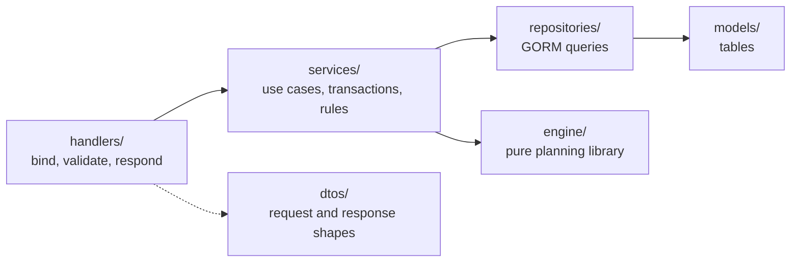

# Server: The Slot Finder

> Go · Echo v5 · Uber FX · GORM · PostgreSQL · Atlas · Redis · Keycloak · Zap · OpenTelemetry · swaggo.
> For the overall architecture see [`../README.md`](../README.md).

The Server is the **source of truth**. All data, permissions, state transitions, metrics and aggregated numbers live here. One Go codebase contains:

- **Server API**: serves the Client under `/api/v1`
- **Background jobs**: re-plan, import, notify. They run in-process in the MVP
- **Planning Engine**: a pure package used by the planning service

## 0. Run locally

From the repo root (see the root `Makefile`):

```bash
make setup     # .env files + Go and npm dependencies
make up        # Docker: Postgres, Redis, Keycloak, OTel collector, Jaeger, migrations, API on :3000
make dev       # or: infra in Docker, API and client on the host
```

Inside `server/`:

```bash
make up                                      # API on the host (reads cmd/server/.env)
make tests                                   # unit tests with race + coverage
make lint                                    # golangci-lint
make swagger-load                            # regenerate docs/ after changing handler annotations (needs swag)
make migrate-generate name=<change>          # Atlas diff from GORM models (needs the Atlas CLI + Docker)
```

Swagger UI: `http://localhost:3000/swagger/index.html` (basic auth from `BASIC_AUTH_USER` / `BASIC_AUTH_SECRET`, non-production only). Keycloak: `http://localhost:8080/auth`.

## 1. Architecture style

- **Modular monolith** in a **layer-based** layout. A logical module (people, programs, planning, ...) is a set of files with the same name across the layers.
- `cmd/server/main.go` wires providers with Uber FX. `cmd/server/routes/router.go` registers routes and middleware.



**Rules:**
1. Handlers call services only. Services own transactions and business rules.
2. A service uses **only its own module's repository**. To read another module's data it calls that module's service. No module reads another module's tables directly.
3. Repositories and models never import handlers or services. DTOs stay at the handler edge.
4. `internal/engine` **imports only the standard library**. The planning service builds a snapshot and passes it in.
5. Changes are announced as **domain events** on an in-process bus in the MVP.

## 2. Modules

Files per module follow the pattern `handlers/<module>.go`, `services/<module>.go`, `repositories/<module>.go`, `models/<module>.go`, `dtos/<module>.go`.

| Module | Responsibility | Owns data | Publishes events |
|---|---|---|---|
| **identity** | Keycloak token validation, roles, mapping the token to a PERSON (`keycloak_id`), permission checks (including assistant read access) | none (accounts live in Keycloak) | |
| **people** | People, expertise, levels, contracted hours | PERSON, EXPERTISE, PERSON_SKILL | `PersonJoined`, `PersonLeft`, `SkillChanged` |
| **availability** | Leave and public holidays; computes `capacity(person, week)` | ABSENCE | `AbsenceAdded`, `AbsenceRemoved` |
| **programs** | Programs, projects, staffing demand (budget hours), forecast overrides, scope points, milestones, assistants, program and project lifecycles | PROGRAM, PROJECT, DEMAND, MILESTONE, PROGRAM_ASSISTANT | `ProgramSlipped`, `ProgramCancelled`, `ProjectCreated`, `ProjectSlipped`, `DemandChanged` |
| **planning** | Baseline, staffing drafts, scenarios; calls the engine; accept and publish | PLAN, ALLOCATION | `PlanPublished` |
| **insights** | Heatmap, utilization, program and project metrics, at-risk lists (read-only) | none (read-only) | |
| **events** | Records ChangeEvents, assesses impact, creates re-plan jobs | CHANGE_EVENT | |
| **integrations** | Imports (CSV, HR), notifications (Email/Slack) to members and assistants | import_job | |

## 3. API (REST/JSON)

All paths below are under **`/api/v1`**. Every endpoint except health checks requires a Keycloak JWT (`Authorization: Bearer`); unsafe methods also need `X-CSRF-Token`. The Server checks permissions on every call: the role through `RequireRole` in the router, and per-program rules ("lead (own)", internal assistant) in the service.

**Identity and people**

| Method | Path | Purpose | Roles |
|---|---|---|---|
| GET | `/me` | Current user, role, programs they assist | everyone |
| GET, POST | `/people` | List or create people | planner |
| PUT | `/people/{id}/skills` | Update expertise and levels | planner |
| GET, POST | `/people/{id}/absences` | Leave calendar | planner, the person themselves |
| GET | `/expertises` | Expertise catalogue | everyone |

**Programs and projects**

| Method | Path | Purpose | Roles |
|---|---|---|---|
| GET, POST | `/programs` | List or create programs | planner, lead |
| GET | `/programs/{id}` | Program record: brief, timeline, status | planner, lead, internal assistant |
| PATCH | `/programs/{id}` | Edit a program. Moving the end date emits `ProgramSlipped` | planner, lead (own) |
| POST | `/programs/{id}/actions/{hold\|resume\|start-closing\|close\|cancel}` | Change program state through an action | planner, lead (own) |
| GET | `/programs/{id}/overview` | Header metrics, scope and cost cards, staffing by expertise | planner, lead, internal assistant |
| PATCH | `/programs/{id}/forecast` | Set or clear `forecast_override_hours` per demand | planner, lead (own) |
| GET | `/programs/{id}/projects` | Projects tab: rows with Time / Scope / Cost / Staffing and next milestone | planner, lead, internal assistant |
| POST | `/programs/{id}/projects` | Add a project to the program | planner, lead (own) |
| GET | `/programs/{id}/members` | Members tab: members with hours in this program and overall utilization (next 4 weeks) | planner, lead, internal assistant |
| GET, POST | `/programs/{id}/assistants` | List or add assistants (`kind`: internal or external) | planner, lead (own); internal assistants may list |
| DELETE | `/programs/{id}/assistants/{assistantId}` | Remove an assistant | planner, lead (own) |
| GET, POST | `/programs/{id}/milestones` | List or add milestones | planner, lead (own); internal assistants may list |
| PATCH | `/milestones/{id}` | Edit a milestone or mark it delivered | planner, lead (own) |
| GET | `/projects` | Projects across programs (filter by `status`) | planner, lead |
| PATCH | `/projects/{id}` | Edit a project, including `scope_points` and `done_points`. Moving the deadline emits `ProjectSlipped` | planner, lead (own) |
| POST | `/projects/{id}/actions/{hold\|resume\|complete\|cancel}` | Change project state through an action | planner, lead (own) |
| PUT | `/projects/{id}/demands` | Staffing demand (budget hours per expertise) | planner, lead (own) |

**Planning and insights**

| Method | Path | Purpose | Roles |
|---|---|---|---|
| GET | `/plans/current` | The baseline | everyone (specialists see only their own part) |
| POST | `/staffing-drafts` | Generate a draft: `{ projectIds }` or `{ changeEventId }` | planner |
| GET | `/staffing-drafts/{id}` | Draft with diff against the baseline and reasons | planner, lead |
| PATCH | `/staffing-drafts/{id}/allocations` | Manual edits, lock/unlock allocations | planner |
| POST | `/staffing-drafts/{id}/accept` | Publish (`{ baseVersion }`; `409` if the baseline changed) | planner |
| POST | `/staffing-drafts/{id}/reject` | Discard a draft | planner |
| POST | `/scenarios` | Create a what-if from a list of hypothetical changes | planner |
| GET | `/scenarios/{id}/diff` | Compare a scenario with the baseline | planner |
| GET | `/insights/heatmap?from=&to=&expertise=` | Person × week matrix | planner, lead |
| GET | `/insights/risks` | Understaffed and at-risk projects, overloaded people, overdue milestones | planner, lead |
| GET | `/events?programId=` | Change history and processing status; the program page uses it for the re-plan banner | planner, lead |
| POST | `/imports/{csv\|hr}` | Import data (runs in the background) | planner |

**Response envelope** (success and error):

```json
{ "meta": { "error_code": "SUCCESS", "message": "OK", "code": 200, "page": 1, "page_size": 20, "total": 18 }, "data": { } }
```

Error example (HTTP 409):

```json
{ "meta": { "error_code": "PLAN_VERSION_CONFLICT", "message": "The baseline has changed. Generate the draft again.", "code": 409 }, "data": null }
```

**Payload rules:**
- Write payloads contain only fields the user may edit. The Server ignores or rejects computed fields such as `status`, `utilization`, `gap_hours` and `total_*`.
- The Server computes and returns all metrics and aggregated numbers. The Client never accumulates them itself.

## 4. Planning engine

`engine/` is a pure library: no database, no network, no reading the system clock. If it needs "now", that arrives through `horizon`. It knows nothing about programs, scope points or assistants.

**Input: `PlanningRequest`**

```jsonc
{
  "horizon": { "fromWeek": "2026-W42", "toWeek": "2027-W05" },
  "policy": {
    "targetUtilization": 0.8,
    "maxUtilization": 1.0,
    "maxProjectsPerPersonWeek": 3,
    "weights": { "deadline": 1.0, "balance": 0.6, "stability": 0.5, "continuity": 0.3 }
  },
  "people": [
    { "id": "p1", "skills": [{ "expertise": "QA", "level": 3 }], "capacity": { "2026-W42": 40, "2026-W43": 24 } }
  ],
  "demands": [
    { "id": "d1", "projectId": "pr1", "priority": 2, "expertise": "QA", "minLevel": 2,
      "headcount": 1, "hours": 120, "fromWeek": "2026-W42", "toWeek": "2026-W48" }
  ],
  "existing": [
    { "personId": "p1", "demandId": "d0", "week": "2026-W42", "hours": 16, "locked": true }
  ]
}
```

**Output: `PlanningResult`**

```jsonc
{
  "allocations": [
    { "personId": "p1", "demandId": "d1", "week": "2026-W42", "hours": 24,
      "reason": ["QA level 3 ≥ 2", "24h free", "already on project pr1"] }
  ],
  "unmet": [{ "demandId": "d2", "hours": 40, "reason": "NO_CAPACITY_BEFORE_DEADLINE" }],
  "conflicts": [{ "type": "OVER_CAPACITY", "personId": "p3", "week": "2026-W44", "utilization": 1.15 }],
  "score": { "deadlineMet": 0.92, "loadBalance": 0.81, "stability": 0.95 }
}
```

**`unmet` reason codes:**
- `NO_SKILL`: nobody has this expertise
- `LEVEL_TOO_LOW`
- `NO_CAPACITY_BEFORE_DEADLINE`
- `BLOCKED_BY_LOCKED`

**Greedy strategy (MVP):**
1. Sort demand by priority (high first), then deadline (earliest first), then scarcity of the expertise.
2. For each demand, keep candidates with the right expertise, level ≥ `minLevel`, and free capacity inside the project's window.
3. Score candidates using `weights`: free capacity, already on the project (continuity), load kept near `targetUtilization`.
4. Fill hours week by week from `fromWeek`, split across `headcount` people, until `hours` is covered.
5. Record any shortfall in `unmet` with a reason code. Never throw.

**Re-planning** uses the same function. The difference: `existing` holds the whole baseline, the `stability` weight is raised so that the result changes as little as possible, and `locked` allocations are kept as they are.

## 5. Program metrics

The **insights** module computes these for `/programs/{id}/overview`, `/programs/{id}/projects` and `/programs/{id}/members`. Formulas are in the [root README, section 7](../README.md#7-program-view).

| Rule | Detail |
|---|---|
| Source data | `PROGRAM`, `PROJECT`, `DEMAND`, `MILESTONE` from **programs**; baseline allocations from **planning**; capacity from **availability** |
| Program values | Sums over the program's projects that are not cancelled |
| "Today" | The organization's current date, in its timezone. Week-based metrics use the current ISO week |
| Division by zero | A ratio with a zero denominator returns `null`. The Client shows "—" |
| Cost % in the MVP | Planned hours in weeks up to and including the current week ÷ budget hours. Phase 2 swaps in actual hours from a timesheet import |
| Members tab | Members come from the baseline (anyone with allocations in the program) plus the program and project leads. Utilization covers the next 4 ISO weeks across **all** projects |

## 6. Background jobs

In the MVP, jobs run inside the server process: a small runner started from an FX lifecycle hook, with a goroutine pool. When load grows, they move to a separate `cmd/worker` process with a Redis-backed queue. Job code does not change, only the runner.

| Job | Triggered by | Does |
|---|---|---|
| `replan` | A ChangeEvent | Assesses impact. If there is a conflict, calls the engine, saves a staffing draft and alerts the Planner |
| `import` | `POST /imports/*` | Reads the source, validates it, writes through each module's public interface |
| `notify` | `PlanPublished`, alerts | Sends Email/Slack messages to the affected members and to the program's assistants (internal and external) |

Every job must be **idempotent** (re-running it creates no duplicates) and must record its processing status.

## 7. Folder layout

```text
server/
├── README.md
├── THIRD_PARTY_NOTICES.md
├── Makefile · Dockerfile · docker-compose.yml · atlas.hcl · .golangci.yml
├── cmd/
│   ├── server/
│   │   ├── main.go              ← FX wiring, entry point
│   │   ├── routes/router.go     ← middleware + routes under /api/v1
│   │   └── .env.example
│   └── migrations/sql/          ← Atlas migrations generated from models
├── deploy/otel/                 ← local OpenTelemetry collector config
├── docs/                        ← generated Swagger (do not edit by hand)
├── internal/
│   ├── handlers/ · services/ · repositories/ · models/ · dtos/   ← one file per module in each
│   ├── engine/                  ← planned: pure planning library, stdlib only
│   ├── integration/             ← auth (Keycloak), email (SES)
│   ├── middlewares/ · errors/ · config/ · constants/ · db/ · cache/
│   ├── logger/ · monitoring/ · request/ · httpclient/ · utils/
└── pkg/correlationid/
```

Tests sit next to the code (`*_test.go`). Engine property tests and metric tests go in `internal/engine` and `internal/services`.
