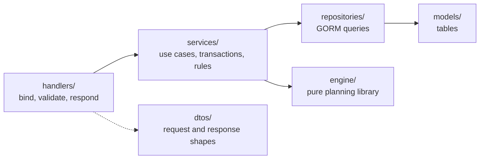

# Server: The Slot Finder

> Go · Echo v5 · Uber FX · GORM · PostgreSQL · Atlas · Redis · Keycloak · Zap · OpenTelemetry · swaggo.
> For the overall architecture see [`../README.md`](../README.md).

The Server is the **source of truth**. All data, permissions, state transitions, metrics and aggregated numbers live here. One Go codebase contains:

- **Server API**: serves the Client under `/api/v1`
- **Background jobs**: re-plan, import, notify. They run in-process in the MVP
- **Planning Engine**: a pure package used by the planning service

## 0. Run locally

From the repo root (see the root `Makefile`):

```bash
make setup     # .env files + Go and npm dependencies
make up        # Docker: Postgres, Redis, Keycloak, OTel collector, Jaeger, migrations, API on :3000 (starts once Keycloak is ready)
make dev       # or: infra in Docker, API and client on the host
make seed      # demo data: expertises, 12 people with skills, leave, holidays, 2 programs with 6 projects,
               # a baseline staffing 3 of them and 2 what-if scenarios (safe to run again)
```

Inside `server/`:

```bash
make up                                      # API on the host (reads cmd/server/.env)
make tests                                   # unit tests with race + coverage
make lint                                    # golangci-lint
make swagger-load                            # regenerate docs/ after changing handler annotations (needs swag)
make migrate-generate name=<change>          # Atlas diff from GORM models (needs the Atlas CLI + Docker)
```

Swagger UI: `http://localhost:3000/swagger/index.html` (basic auth from `BASIC_AUTH_USER` / `BASIC_AUTH_SECRET`, non-production only). `/api/v1/health/metrics` uses the same basic auth. Keycloak: `http://localhost:8080/auth`.

**Sign-in.** On a fresh start, Keycloak imports [`deploy/keycloak/realm.json`](deploy/keycloak/realm.json): the realm, the roles `planner` / `lead` / `specialist`, the web app client (Authorization Code + PKCE) and the API client. Its `${...}` placeholders come from `cmd/server/.env` (`KEYCLOAK_REALM`, `KEYCLOAK_SPA_CLIENT_ID`, `KEYCLOAK_CLIENT_ID`, `CLIENT_APP_URL`, ...). `make reset-data` deletes the Keycloak data, so the next start imports the realm again.

The sign-in pages use the `slot-finder` login theme in [`deploy/keycloak/themes/`](deploy/keycloak/themes/slot-finder/login), named by `KEYCLOAK_LOGIN_THEME`. A fresh import picks it up; on existing data, run `make keycloak-theme` at the repo root. `start-dev` does not cache themes, so edits show on reload.

Demo users, **for development only**. Their password is `KEYCLOAK_DEMO_PASSWORD` (`P@ssw0rd123` in `.env.example`); never reuse it outside a local machine.

| User | Role | Lands on |
|---|---|---|
| `planner` | planner | Dashboard |
| `lead` | lead | Dashboard |
| `specialist` | specialist | My schedule |

The server verifies access tokens locally against the realm's JWKS, cached and refreshed every `AUTH_JWKS_REFRESH_INTERVAL` (and on an unknown key id). It calls Keycloak only to fetch those keys, never per request. `KEYCLOAK_URL` is how the server reaches Keycloak; `KEYCLOAK_PUBLIC_URL` is the issuer in the tokens, as the browser sees it.

**Sentry** is off (no `SENTRY_DSN`). Before setting `SENTRY_DSN`, fix the redaction of the request headers and body that the router's error hook attaches to Sentry events.

## 1. Architecture style

- **Modular monolith** in a **layer-based** layout. A logical module (people, programs, planning, ...) is a set of files with the same name across the layers.
- `cmd/server/main.go` wires providers with Uber FX. `cmd/server/routes/router.go` registers routes and middleware.



**Rules:**
1. Handlers call services only. Services own transactions and business rules.
2. A service uses **only its own module's repository**. To read another module's data it calls that module's service. No module reads another module's tables directly.
3. Repositories and models never import handlers or services. DTOs stay at the handler edge.
4. `internal/engine` **imports only the standard library**. The planning service builds a snapshot and passes it in.
5. Changes are announced as **domain events** on an in-process bus in the MVP.

**Shared building blocks** (each arrives with the feature that first needs it, see [`docs/features/`](../docs/features/README.md)):
- **`authz` service** (sign-in): named permission checks such as `CanViewPeople` or `CanEditProgram(programID)`. Handlers and services call the checks, never raw role lists. Role checks come first; per-program rules are added by later features.
- **Request claims** (sign-in): `AuthMiddleware` verifies the JWT locally against cached JWKS and puts the claims in the request `context.Context`. Code reads them through nil-safe accessors.
- **Clock** (sign-in): provided through FX and aware of the organization time zone (`TIMEZONE`). Code asks the Clock for "now" and the current ISO week; nothing sets `time.Local`.
- **`TxManager`** (programs-and-demand): `TxManager.Do(ctx, fn)` runs `fn` in one transaction stored in `ctx` and commits or rolls back. Repositories get their handle with `r.db.From(ctx)`, which returns that transaction or the plain DB. Services own the boundary.
- **`isoweek.Week`** (people-and-skills, stored from programs-and-demand): ISO weeks in Go. The API speaks `2026-W42`; the database stores the week's Monday in a `date` column named `*_week_start`.

## 2. Modules

Files per module follow the pattern `handlers/<module>.go`, `services/<module>.go`, `repositories/<module>.go`, `models/<module>.go`, `dtos/<module>.go`.

| Module | Responsibility | Owns data | Publishes events |
|---|---|---|---|
| **identity** | Local Keycloak token verification (cached JWKS), roles, mapping the token to a PERSON (`keycloak_id`), the `authz` service with named permission checks (including assistant read access) | none (accounts live in Keycloak) | |
| **people** | People, expertise, levels, skill tags, contracted and non-project hours, start and end dates, location | PERSON, EXPERTISE, PERSON_SKILL, TAG, PERSON_TAG | `PersonJoined`, `PersonLeft`, `SkillChanged` (also for tags) |
| **availability** | Leave (entered by hand or read from a calendar feed), holidays per location, effective-dated weekly hours; computes `capacity(person, week)` | ABSENCE, CAPACITY_CHANGE | `AbsenceAdded`, `AbsenceRemoved`, `CapacityChanged` |
| **programs** | Programs, projects, phases (and their slip propagation), staffing demand (budget hours, profile, tags, preferred person), forecast overrides, scope points, confidence, milestones, assistants, program and project lifecycles (including `staffed_at`) | PROGRAM, PROJECT, PROJECT_PHASE, DEMAND, DEMAND_TAG, MILESTONE, PROGRAM_ASSISTANT | `ProgramSlipped`, `ProgramCancelled`, `ProjectCreated`, `ProjectSlipped`, `PhaseSlipped`, `DemandChanged` |
| **planning** | Baseline, staffing drafts, scenarios; assignments and their kind (primary / cross-expertise / stretch) and alternatives; calls the engine; accept and publish | PLAN, ASSIGNMENT, ALLOCATION | `PlanPublished` |
| **insights** | Heatmap, utilization, program and project metrics, at-risk lists, capacity forecast, bench list, sustained overload, plan churn, hours per point (read-only) | none (read-only) | |
| **events** | Records ChangeEvents, debounces them, assesses impact, creates re-plan jobs (one open auto draft per baseline) | CHANGE_EVENT | |
| **integrations** | Imports (CSV, HR), calendar feeds (secret ICS links and the sync runner, which writes leave through **availability**), notifications (Email/Slack) to members and assistants, the LLM provider client (later) | import_job, CALENDAR_FEED | |
| **timesheets** | The timesheet template and import; actual hours per person, project and ISO week | ACTUAL_HOURS | |
| **ai** (later) | The AI assistant: intake extraction, what-if chat, draft summaries, Q&A. Runs the function-calling loop with the LLM; each tool wraps another module's service and runs with the caller's identity (section 9) | none | |

## 3. API (REST/JSON)

All paths below are under **`/api/v1`**. Every endpoint except health checks requires a Keycloak JWT (`Authorization: Bearer`); unsafe methods also need `X-CSRF-Token`. The Server checks permissions on every call: the role through `RequireRole` in the router, and per-program rules ("lead (own)", internal assistant) in the service.

**Identity and people**

| Method | Path | Purpose | Roles |
|---|---|---|---|
| GET | `/me` | Current user, role, programs they assist, enabled features (e.g. the AI assistant) | everyone |
| GET, POST | `/people` | List or create people (start and end dates, location, timezone, non-project hours) | planner |
| GET | `/people/{id}` | One person with their expertise, for the person page | planner, lead |
| PATCH | `/people/{id}` | Edit a person: only the sent fields; `start_date` and `end_date` accept null to clear them | planner |
| PUT | `/people/{id}/skills` | Replace expertise and levels (exactly one primary) | planner |
| PUT | `/people/{id}/tags` | Replace a person's skill tags | planner |
| GET, POST | `/people/{id}/capacity-changes` | Effective-dated weekly hours (`from_week`, `weekly_hours`) | planner |
| GET, POST | `/people/{id}/absences` | Leave calendar. A person's own absence is always `planned`; planners choose the status. Leave read from a calendar feed has `source = calendar` | planner, the person themselves |
| DELETE | `/absences/{id}` | Remove an absence, or a holiday (planner) | planner, the person themselves |
| POST | `/absences/{id}/approve` | Approve a planned absence; records a change event | planner |
| GET | `/people/{id}/assignments?from=&to=` | Everything a person owns in the baseline: project, demand, **expertise**, kind, hours per week | planner, lead, the person themselves |
| GET | `/people/{id}/schedule?from=&to=` | One person's calendar: per week capacity, load, band, tentative flag, hours per project and actual hours; per day absences and holidays; the working weekdays | planner, lead, the person themselves |
| GET, PUT, DELETE | `/people/{id}/calendar-feed` | A person's calendar link: its status (never the link itself), connect or replace (`{ url }`, checked and synced once), disconnect. `503 CALENDAR_SYNC_DISABLED` without `CALENDAR_FEED_KEY` | planner, the person themselves |
| POST | `/people/{id}/calendar-feed/sync` | Sync that calendar now | planner, the person themselves |
| GET | `/expertises` | Expertise catalogue | everyone |
| GET, POST | `/tags` | Tag catalogue (`name`, `category`: technology / domain / language / client) | GET everyone, POST planner |
| GET, POST | `/holidays` | Holidays per `location` (no location = company-wide) | GET everyone, POST planner |

**Programs and projects**

| Method | Path | Purpose | Roles |
|---|---|---|---|
| GET, POST | `/programs` | List or create programs | planner, lead |
| GET | `/programs/{id}` | Program record: brief, timeline, status | planner, lead, internal assistant |
| PATCH | `/programs/{id}` | Edit a program. Moving the end date emits `ProgramSlipped` | planner, lead (own) |
| POST | `/programs/{id}/actions/{hold\|resume\|start-closing\|close\|cancel}` | Change program state through an action. `cancel` also cancels the program's open projects | planner, lead (own) |
| GET | `/programs/{id}/overview` | Header metrics (Time, Scope, Planned burn, Burn from actual hours, Staffing with warnings), cost figures (budget, planned, planned to date, actual, forecast, gap; EAC hours later), staffing by expertise | planner, lead, internal assistant |
| PATCH | `/programs/{id}/forecast` | Set or clear `forecast_override_hours` per demand | planner, lead (own) |
| GET | `/programs/{id}/projects` | Projects tab: rows with a `metrics` object (Time / Scope / Planned burn / Burn / Staffing and warnings); next milestone later | planner, lead, internal assistant |
| POST | `/programs/{id}/projects` | Add a project to the program | planner, lead (own) |
| GET | `/programs/{id}/members` | Members tab and the Programs list preview: everyone with baseline hours on the program's projects, most hours first, with hours per expertise and kind, first and last week, and projects (overall utilization later) | planner, lead |
| GET, POST | `/programs/{id}/assistants` | List or add assistants (`kind`: internal or external) | planner, lead (own); internal assistants may list |
| DELETE | `/programs/{id}/assistants/{assistantId}` | Remove an assistant | planner, lead (own) |
| GET, POST | `/programs/{id}/milestones` | List or add milestones | planner, lead (own); internal assistants may list |
| PATCH | `/milestones/{id}` | Edit a milestone or mark it delivered | planner, lead (own) |
| GET | `/projects` | Projects across programs (filter by `status`) | planner, lead |
| GET | `/projects/{id}` | Project record with its phases, its demand (each row with the weeks it may be staffed in) and the program's lead | planner, lead |
| PATCH | `/projects/{id}` | Edit a project, including `scope_points`, `done_points` and `confidence`. Moving the deadline emits `ProjectSlipped` | planner, lead (own) |
| POST | `/projects/{id}/actions/{hold\|resume\|complete\|cancel}` | Change project state through an action | planner, lead (own) |
| GET, PUT | `/projects/{id}/phases` | Ordered phases of a project (PUT replaces the whole list; removing a phase that still has demand gets `409 PHASE_IN_USE`) | planner, lead (own); GET also internal assistant |
| PATCH | `/phases/{id}` | Edit a phase. Moving its end week later shifts every later phase by the same weeks and emits `PhaseSlipped`. Returns every phase it changed | planner, lead (own) |
| PUT | `/projects/{id}/demands` | Staffing demand: budget hours per expertise and level, each with an optional `phase_id`, a `profile`, required and preferred tags, and an optional preferred person | planner, lead (own) |
| GET | `/projects/{id}/hours-suggestion` | Suggested budget hours per expertise: `scope_points × hours_per_point(expertise)` from done projects, with the ratio used | planner, lead (own) |

**Planning and insights**

| Method | Path | Purpose | Roles |
|---|---|---|---|
| GET | `/plans/current` | The baseline | planner, lead |
| POST | `/staffing-drafts` | Generate a draft: `{ projectIds }` or `{ changeEventId }` | planner |
| GET | `/staffing-drafts/{id}` | Draft with diff against the baseline, plan churn, reasons and alternatives | planner, lead |
| PATCH | `/staffing-drafts/{id}/assignments` | One batch `{ add, remove, set }`: add or remove an assignment (any person to a covered demand; the server sets `kind`), change weekly hours (0 removes the week), lock or unlock. Swap to an alternative comes later | planner |
| POST | `/staffing-drafts/{id}/accept` | Publish (`{ baseVersion }`; `409 PLAN_VERSION_CONFLICT` if the baseline changed) | planner |
| POST | `/staffing-drafts/{id}/reject` | Discard a draft | planner |
| GET, POST | `/scenarios` | List scenarios (newest first, with stale flag and churn), or create one from `{ name, assumptions }` (`shift_project`, `add_absence`) and compute it on a copy of the baseline | planner |
| GET, DELETE | `/scenarios/{id}` | A scenario with its changes against the baseline it was built on (week by week), churn, unmet demand and the projects planned again; or delete it | planner |
| POST | `/scenarios/{id}/rerun` | Compute a scenario again, with the same assumptions, against the baseline in force | planner |
| GET | `/insights/heatmap?from=&to=&expertise=` | Person × week matrix. Each cell holds total hours plus hours per expertise; `expertise=` (an expertise id) keeps people who hold that expertise or work on it in the range. Each cell also has capacity, utilization, its band and a tentative flag for planned leave | planner, lead |
| GET | `/insights/risks` | Understaffed and at-risk projects, delivery behind time, overloaded people in the next `HEATMAP_DEFAULT_WEEKS` weeks; likely over budget, sustained overload and overdue milestones later | planner, lead |
| GET | `/insights/capacity-forecast?from=&to=&expertise=` | Per expertise × week: free capacity, unmet confirmed demand, expected pipeline demand (× confidence), and shortfall signals | planner, lead |
| GET | `/insights/bench` | People below the underused band for each of the next `bench_weeks`, with suggested actions | planner |
| GET | `/insights/churn?from=&to=` | Plan churn per accepted draft: people changed, hours moved | planner |
| GET | `/events?program_id=` | Change history and processing status; the program page uses it for the re-plan banner | planner, lead |
| POST | `/imports/{csv\|hr}` | Import data (runs in the background) | planner |
| GET | `/timesheets/template?from=&to=` | CSV template: person × project × week with baseline hours in a range of past weeks, with planned hours and any actual hours already recorded | planner |
| POST | `/timesheets/import` | Upload a filled-in template (multipart `file`). Every row is checked first; any failure gets `400 TIMESHEET_INVALID` with line, column and code, and nothing is saved | planner |

**AI assistant** (later). While `AI_ENABLED` is false, these return `503` with `AI_DISABLED`.

| Method | Path | Purpose | Roles |
|---|---|---|---|
| POST | `/ai/intake-extractions` | `text` or one uploaded file (multipart), optional `programId` → a suggested project (phases, demand, tags) with a source quote per field. Saves nothing | planner, lead |
| POST | `/ai/chat` | One turn: the visible conversation plus optional context (`programId`, `scenarioId`) → the reply and links to any scenario or draft it created | planner, lead, specialist (own data only) |
| GET | `/staffing-drafts/{id}/summary` | Plain-language summary of the draft's diff, reasons and unmet; facts only. Made once per draft version and reused by `notify` | planner, lead |

**Response envelope** (success and error):

```json
{ "meta": { "error_code": "SUCCESS", "message": "OK", "code": 200, "page": 1, "page_size": 20, "total": 18 }, "data": { } }
```

Error example (HTTP 409):

```json
{ "meta": { "error_code": "PLAN_VERSION_CONFLICT", "message": "The baseline has changed. Generate the draft again.", "code": 409 }, "data": null }
```

**Payload rules:**
- Write payloads contain only fields the user may edit. The Server ignores or rejects computed fields such as `status`, `utilization`, `gap_hours` and `total_*`.
- The Server computes and returns all metrics and aggregated numbers. The Client never accumulates them itself.
- `PATCH /staffing-drafts/{id}/assignments`, accept and reject on a **superseded** draft version return `409` with `DRAFT_SUPERSEDED`. The Client reloads the latest version.
- **Accept is atomic** (staffing-draft): in one `TxManager.Do`, `UPDATE plan SET status = 'superseded' WHERE kind = 'baseline' AND status = 'published' AND version = :baseVersion`. 0 rows updated → `409 PLAN_VERSION_CONFLICT` and nothing is written. The draft is then published as version `baseVersion + 1`. A partial unique index (`kind = 'baseline' AND status = 'published'`) allows one published baseline, so a racing second accept also gets `409`.

## 4. Planning engine

`engine/` is a pure library: no database, no network, no reading the system clock. If it needs "now", that arrives through `horizon`. It knows nothing about programs, scope points or assistants.

**Input: `PlanningRequest`**

```jsonc
{
  "horizon": { "fromWeek": "2026-W42", "toWeek": "2027-W05" },
  "policy": {
    "targetUtilization": 0.8,
    "maxUtilization": 1.0,
    "maxProjectsPerPersonWeek": 3,
    "maxExpertisesPerPersonWeek": 2,
    "minHoursPerWeek": 8,
    "maxAlternatives": 3,
    "weights": { "deadline": 1.0, "primaryFit": 0.8, "tagFit": 0.5, "preference": 0.4,
                 "balance": 0.6, "stability": 0.5, "continuity": 0.3 }
  },
  "people": [
    { "id": "p1",
      "skills": [{ "expertise": "Engineer", "level": 4, "primary": true }, { "expertise": "QA", "level": 3 }],
      "tags": ["go", "payments", "acme"],
      "capacity": { "2026-W42": 36, "2026-W43": 20, "2026-W44": 0 } }  // dates, non-project hours, changes and absence already applied
  ],
  "demands": [
    { "id": "d1", "projectId": "pr1", "programId": "pg1", "client": "acme",  // opaque ids, used for continuity
      "priority": 2, "expertise": "QA", "minLevel": 2, "headcount": 1, "hours": 120,
      "fromWeek": "2026-W42", "toWeek": "2026-W48", "profile": "back",
      "requiredTags": ["payments"], "preferredTags": ["go"], "preferredPersonId": "p7" }
  ],
  "existing": [
    { "personId": "p1", "demandId": "d0", "kind": "primary",
      "allocations": [{ "week": "2026-W42", "hours": 16, "locked": true }] }
  ]
}
```

**Output: `PlanningResult`**

```jsonc
{
  "assignments": [
    { "personId": "p1", "demandId": "d1", "kind": "cross_expertise",
      "reason": ["QA cover: Engineer (primary) with QA level 3 ≥ 2", "no free QA-primary person before W48",
                 "already on project pr1", "preferred person p7 not used: on leave W44–W46"],
      "allocations": [{ "week": "2026-W42", "hours": 12 }, { "week": "2026-W43", "hours": 16 }],
      "alternatives": [
        { "personId": "p5", "score": 0.71, "reason": "QA primary, but only 8 h free before W48" },
        { "personId": "p9", "score": 0.64, "reason": "missing preferred tag go" }
      ] }
  ],
  "unmet": [
    { "demandId": "d2", "hours": 40, "reason": "NO_CAPACITY_BEFORE_DEADLINE" },
    { "demandId": "d3", "hours": 60, "reason": "NO_TAG_MATCH" }
  ],
  "conflicts": [
    { "type": "OVER_CAPACITY", "personId": "p3", "week": "2026-W44", "utilization": 1.15 },
    { "type": "TOO_MANY_EXPERTISES", "personId": "p4", "week": "2026-W45", "expertises": 3 }
  ],
  "score": { "deadlineMet": 0.92, "loadBalance": 0.81, "stability": 0.95 }
}
```

**`unmet` reason codes:**
- `NO_SKILL`: nobody has this expertise
- `LEVEL_TOO_LOW`
- `NO_TAG_MATCH`: nobody with the expertise and level has every required tag
- `NO_CAPACITY_BEFORE_DEADLINE`
- `BLOCKED_BY_LOCKED`

**Greedy strategy (MVP):**
1. Sort demand by priority (high first), then deadline (earliest first), then scarcity of the expertise and its required tags.
2. For each demand, keep candidates who have the demand's expertise, primary or secondary, at level ≥ `minLevel`, and every tag in `requiredTags`. They also need free capacity inside the demand's window and must stay within `maxExpertisesPerPersonWeek`.
3. Score candidates using `weights`: primary-expertise match (`primaryFit`), preferred tags (`tagFit`), the preferred person (`preference`), free capacity, continuity (same project, then program, then client), load kept near `targetUtilization`. A cross-expertise person wins only when no primary person can cover the hours in time, or when using them clearly balances load. The reason says which. The next `maxAlternatives` candidates are kept as `alternatives`.
4. Split `hours` into `headcount` seats of about `hours ÷ headcount`. Spread each seat's hours across the window by `profile` (`flat`, `front`, `back`). Keep one person per seat; split a seat between two people only when nobody has the capacity, and say so in the reason.
5. Never allocate less than `minHoursPerWeek` in a week, except a demand's last remainder.
6. Record any shortfall in `unmet` with a reason code. Never throw.

**Demand windows:** the engine never sees phases. When building the snapshot, the planning service sets each demand's `fromWeek`–`toWeek` to its phase's weeks, or to the project's start week through its deadline week when the demand has no phase.

**As built:** the Go request takes each demand's window as its list of weeks (the planning service expands `fromWeek`–`toWeek`), and `hourStep` rounds allocations. Tags, the preferred person, alternatives, `conflicts` and `score` come later.

**Kinds:** the engine returns `primary` or `cross_expertise` and never `stretch`. Stretch assignments only come in through `existing`: they are locked by a Planner and are left untouched.

**Re-planning** uses the same function. The difference: `existing` holds the whole baseline, the `stability` weight is raised so that the result changes as little as possible, and `locked` allocations are kept as they are.

## 5. Program metrics

The **insights** module computes these for `/programs/{id}/overview`, `/programs/{id}/projects` and `/programs/{id}/members`. Formulas are in the [root README, section 7](../README.md#7-metrics).

| Rule | Detail |
|---|---|
| Source data | `PROGRAM`, `PROJECT`, `DEMAND`, `MILESTONE` from **programs**; baseline allocations from **planning**; capacity from **availability**; actual hours from **timesheets** |
| Program values | Sums over the program's projects that are not cancelled |
| "Today" | The organization's current date, in its timezone. Week-based metrics use the current ISO week |
| Division by zero | A ratio with a zero denominator returns `null`. The Client shows "—" |
| Planned burn % | Planned hours in weeks up to and including the current week ÷ budget hours. No "behind plan" warning |
| Actual hours and Burn % | Σ actual hours from timesheet imports, and actual ÷ budget hours. Burn % is `null` until the project has actual hours |
| Delivery warning | Scope % lower than Time % by more than `SCOPE_LAG_THRESHOLD` |
| EAC hours | Hours used to date ÷ Scope %. Returned as `null` while Scope % < `EAC_MIN_SCOPE_PERCENT`. EAC > budget sets **likely over budget** |
| Gap and Staffing % | Returned side by side; they show the same shortfall unless a forecast override is set |
| Hours per point | Per expertise: Σ allocated hours on `done` projects ÷ Σ their `scope_points`. `null` with no done projects, and the form then offers no suggestion |
| Time-to-staff (goal G1) | `staffed_at − created_at` per project. `staffed_at` is set when the first draft covering the project is accepted |
| Capacity forecast | Free capacity = capacity − baseline load. Pipeline demand = hours of `incoming` projects without accepted assignments, spread by profile × `confidence`. A shortfall in consecutive weeks is reported in FTE (hours ÷ `FTE_WEEKLY_HOURS`) |
| Team signals | Sustained overload: over 100 % for `SUSTAINED_OVERLOAD_WEEKS` weeks in a row. Bench: under the underused band for each of the next `BENCH_WEEKS`. Plan churn: per accepted draft, people whose allocations changed and Σ \|hours moved\| |
| Members tab | Members come from the baseline (anyone with allocations in the program) plus the program and project leads. Utilization covers the next 4 ISO weeks across **all** projects |

## 6. Background jobs

Jobs are rows in Postgres, run by a runner inside the server process, started and stopped by an FX lifecycle hook (replan-on-change):
- **`CHANGE_EVENT` is a transactional outbox.** The service that saves a change inserts its event in the same `TxManager.Do`, so there is never a change without its event, or an event without its change.
- **The runner claims rows with `FOR UPDATE SKIP LOCKED`**, every `REPLAN_POLL_INTERVAL`, up to `REPLAN_BATCH_SIZE` at a time. Two server instances never claim the same row.
- **Retries:** runner columns `attempts`, `available_at` and `last_error`. A failure moves `available_at` by `REPLAN_RETRY_BACKOFF × attempts`. After `REPLAN_MAX_ATTEMPTS` the status becomes `failed`.
- **Scaling out:** when load grows, the same runner moves to a separate `cmd/worker` process on the same table. No queue service is needed, and job code does not change.

| Job | Triggered by | Does |
|---|---|---|
| `replan` | ChangeEvents, batched over `REPLAN_DEBOUNCE` | Assesses impact. If there is a conflict, calls the engine, saves a staffing draft and alerts the Planner. If an auto draft is already open for the baseline, it regenerates that draft instead (see below) |
| `import` | `POST /imports/*` | Reads the source, validates it, writes through each module's public interface |
| `calendar-sync` | Every `CALENDAR_SYNC_INTERVAL`, or `POST /people/{id}/calendar-feed/sync` | Fetches each due calendar feed, keeps its out-of-office events, and creates, moves or deletes the matching planned leave through **availability**, which records the change events. Claims feeds with `FOR UPDATE SKIP LOCKED`. A failed fetch changes nothing and stores an error code |
| `notify` | `PlanPublished`, alerts | Sends Email/Slack messages to the affected members and to the program's assistants (internal and external) |

**One open auto draft per baseline.** A draft is "auto" when change events link to it. When a new event arrives while one is open, `replan` regenerates it from the current baseline plus every linked event. Assignments the Planner added by hand and locked allocations are carried over. The old draft version becomes `superseded` and all events point to the new one. The worker saves the new version only if the old one has not changed since it read it; otherwise it regenerates again, so a Planner's edit is never dropped silently. An edit, accept or reject that reaches the old version afterwards gets `409 DRAFT_SUPERSEDED`.

Every job must be **idempotent** (re-running it creates no duplicates) and must record its processing status.

**As built (replan-on-change):** the runner takes a Postgres advisory lock per batch, so one batch builds drafts at a time across servers. The engine keeps unlocked baseline hours that still fit and plans only the gap, so a re-plan moves as few hours as possible.

## 7. Folder layout

```text
server/
├── README.md
├── THIRD_PARTY_NOTICES.md
├── Makefile · Dockerfile · docker-compose.yml · atlas.hcl · .golangci.yml
├── cmd/
│   ├── server/
│   │   ├── main.go              ← FX wiring, entry point
│   │   ├── routes/router.go     ← middleware + routes under /api/v1
│   │   └── .env.example
│   └── migrations/sql/          ← Atlas migrations generated from models
├── deploy/otel/                 ← local OpenTelemetry collector config
├── docs/                        ← generated Swagger (do not edit by hand)
├── internal/
│   ├── handlers/ · services/ · repositories/ · models/ · dtos/   ← one file per module in each
│   ├── engine/                  ← planned: pure planning library, stdlib only
│   ├── integration/             ← auth (Keycloak), email (SES)
│   ├── middlewares/ · errors/ · config/ · constants/ · db/ · cache/
│   ├── logger/ · monitoring/ · request/ · httpclient/ · utils/
└── pkg/correlationid/
```

Tests sit next to the code (`*_test.go`). Engine property tests and metric tests go in `internal/engine` and `internal/services`.

## 8. Settings

Planning policy and metric thresholds are server config: fields in `internal/config/config.go`, listed in `cmd/server/.env.example`. The planning service copies the policy values into each `PlanningRequest`; the engine reads no config itself. Values below are example defaults.

| Setting | Used for | Example |
|---|---|---|
| `PLANNING_TARGET_UTILIZATION` | `targetUtilization`: load the engine aims for | 0.8 |
| `PLANNING_MAX_UTILIZATION` | `maxUtilization`: hard ceiling on load ÷ capacity | 1.0 |
| `PLANNING_MAX_PROJECTS_PER_PERSON_WEEK` | `maxProjectsPerPersonWeek` | 3 |
| `PLANNING_MAX_EXPERTISES_PER_PERSON_WEEK` | `maxExpertisesPerPersonWeek` | 2 |
| `PLANNING_MIN_HOURS_PER_WEEK` | `minHoursPerWeek`: smallest weekly allocation, except a demand's last remainder | 8 |
| `PLANNING_HOUR_STEP` | `hourStep`: rounds weekly allocations (1 = whole hours, 0 = exact) | 1 |
| `PLANNING_MAX_ALTERNATIVES` | `maxAlternatives`: runner-ups kept per assignment | 3 |
| `PLANNING_WEIGHT_<NAME>` | One per weight: `DEADLINE`, `PRIMARY_FIT`, `TAG_FIT`, `PREFERENCE`, `BALANCE`, `STABILITY`, `CONTINUITY` | as in the sample request |
| `PLANNING_REPLAN_STABILITY_WEIGHT` | The raised `stability` weight used for re-plans | 2.0 |
| `DEFAULT_NON_PROJECT_HOURS` | `PERSON.non_project_hours` when a person is created without one | 4 |
| `COUNT_PLANNED_ABSENCE` | Whether `planned` absence reduces capacity (`approved` always does) | true |
| `REPLAN_DEBOUNCE` | Window in which change events are batched into one re-plan (30s in `.env.example` for local demos) | 5m |
| `REPLAN_POLL_INTERVAL` · `REPLAN_BATCH_SIZE` | How often the runner looks for pending events, and how many it claims at once | 10s · 50 |
| `REPLAN_MAX_ATTEMPTS` · `REPLAN_RETRY_BACKOFF` | Retries before an event is `failed`, and the delay step between them | 5 · 30s |
| `SCENARIO_MAX_SHIFT_WEEKS` · `SCENARIO_MAX_ASSUMPTIONS` | The most weeks a scenario may move a project, and the most assumptions in one scenario | 12 · 10 |
| `SCHEDULE_MAX_WEEKS` | Largest range of one person's schedule (a month grid needs at most 6 weeks) | 8 |
| `TIMESHEET_TEMPLATE_WEEKS` · `TIMESHEET_MAX_WEEKS` | Past weeks in the timesheet template by default, and the largest range | 4 · 12 |
| `TIMESHEET_MAX_WEEK_HOURS` | Most actual hours one row may hold | 80 |
| `TIMESHEET_MAX_BYTES` · `TIMESHEET_MAX_ROWS` | Largest timesheet file accepted | 1MB · 5000 |
| `CALENDAR_FEED_KEY` | 32-byte key (base64) that encrypts calendar links. A secret: never logged. Empty turns calendar sync off | empty |
| `CALENDAR_ALLOWED_HOSTS` | Hosts a calendar link may point to | calendar.google.com, outlook.office365.com, outlook.live.com |
| `CALENDAR_SYNC_INTERVAL` · `CALENDAR_SYNC_BATCH_SIZE` | How often the runner syncs each calendar, and how many it claims at once | 15m · 20 |
| `CALENDAR_SYNC_WEEKS` | How far ahead calendar events are read | 26 |
| `CALENDAR_LEAVE_KEYWORDS` | Title words that mark an event as out of office, ignoring case | OOO, Out of office, Vacation, Annual leave, Nghỉ phép |
| `CALENDAR_FETCH_TIMEOUT` · `CALENDAR_MAX_BYTES` | Limits on one calendar fetch | 10s · 5MB |
| `WORKING_WEEKDAYS` | Days that count when absence hours are computed | Mon–Fri |
| `HEATMAP_DEFAULT_WEEKS` · `HEATMAP_MAX_WEEKS` | Weeks shown by default on the heatmap, and the largest range allowed | 12 · 52 |
| `ALERT_HORIZON_WEEKS` | A deadline this close turns a gap into **at risk** | 4 |
| `UTILIZATION_UNDERUSED_BELOW` · `UTILIZATION_NEAR_FULL_FROM` | Utilization band limits (overloaded is always over 100 %) | 0.5 · 0.85 |
| `SCOPE_LAG_THRESHOLD` | Percentage points by which Scope % may trail Time % before **behind on delivery** (not scope points) | 20 |
| `EAC_MIN_SCOPE_PERCENT` | Scope % needed before EAC hours is shown | 10 |
| `SUSTAINED_OVERLOAD_WEEKS` | Consecutive weeks over 100 % for **sustained overload** | 3 |
| `BENCH_WEEKS` | Weeks ahead a person must stay underused to be on the bench list | 4 |
| `FTE_WEEKLY_HOURS` | Hours in one FTE for capacity-forecast signals | 40 |
| `AI_ENABLED` | Turns the AI assistant (later) on | false |
| `AI_PROVIDER` | Which LLM provider implementation to use | gemini |
| `AI_API_KEY` | The provider's API key. A secret: never logged, never sent to the Client | empty |
| `AI_MODEL_INTAKE` · `AI_MODEL_CHAT` · `AI_MODEL_SUMMARY` | The model per task | no default; set with the provider |
| `AI_MAX_OUTPUT_TOKENS` | Upper limit on one model response | 4096 |
| `AI_TIMEOUT` | Limit for one AI request, including its tool calls | 60s |
| `AI_MAX_TOOL_CALLS` | Tool calls allowed in one request | 8 |
| `AI_UPLOAD_MAX_BYTES` | Largest document accepted by intake extraction | 5MB |
| `AI_CHAT_MAX_TURNS` | Conversation turns sent with a chat message; older ones are dropped | 20 |

## 9. AI assistant (later)

Not in the MVP: it stays off until `AI_API_KEY` is set and the data policy question below is approved. The principle, capabilities and boundaries are in the [root README, section 15](../README.md#15-ai-assistant-later).

**Code:** `handlers/ai.go` and `services/ai.go` (the function-calling loop and tool definitions), and `internal/integration/llm` (a `Provider` interface plus one implementation per `AI_PROVIDER`; Gemini first). Nothing outside `integration/llm` knows which provider is used.

**Tools** (each wraps an existing service method):

| Tool | Wraps | Used by | Writes |
|---|---|---|---|
| `find_people` | people: search by name | chat, Q&A | no |
| `find_projects` | programs: search projects and programs | chat, Q&A | no |
| `find_free_people` | insights: heatmap filtered by expertise, minimum level and weeks | chat, Q&A | no |
| `get_person_schedule` | planning: a person's assignments | chat, Q&A | no |
| `get_program_overview` | insights: a program's metrics | chat, Q&A | no |
| `get_risks` | insights: risk lists | chat, Q&A | no |
| `get_capacity_forecast` | insights: capacity forecast by expertise | chat, Q&A | no |
| `get_staffing_draft` | planning: a draft's diff, reasons and unmet | chat | no |
| `create_scenario` | planning: create a scenario from `assumptions` | what-if chat | a scenario |
| `get_scenario_diff` | planning: compare a scenario with the baseline | what-if chat | no |
| `create_staffing_draft` | planning: generate a draft for projects | chat | a draft |

- **Permissions:** before calling the service, a tool checks the same role list constant as the matching route (e.g. `constants.ScenarioCreateRoles`). The service then applies the per-program rules using the caller from `ctx`. The model is offered only the tools the caller's role allows. A refused tool gives the same `403` the route would, and the reply says so.
- **Intake extraction** uses no data tools. The expertise and tag catalogues go into the prompt, and the model answers through one output function whose schema is the suggested project. The Server then:
  - drops any field whose quote does not appear in the source text
  - flags an expertise or tag that is not in the catalogue (it never creates one)
  - fills in hours from hours per point when the text has only scope points
- **Draft summaries** use no tools. The input is the draft's structured output. The Server checks that every number in the summary appears in that input. If one does not, it retries once and then falls back to a summary built from a template.
- **Limits:** `AI_MAX_TOOL_CALLS`, `AI_TIMEOUT`, `AI_MAX_OUTPUT_TOKENS`, `AI_UPLOAD_MAX_BYTES`. A provider error or timeout returns the normal error envelope. A scenario or draft already created stays as it is, since it changes nothing in force.
- **Audit:** every write through a tool records the user as the actor, `via = ai_assistant` and the tool name.
- **Observability:** per request: latency, input and output tokens, tool-call count, provider and model. There is one OTel span per LLM call and per tool call. Prompts, documents and replies are not logged. Logs carry the request id, user id and tool names.

**Open question:** customer documents and personnel data would be sent to an external LLM provider. The company data policy must approve this before `AI_ENABLED` is turned on.
